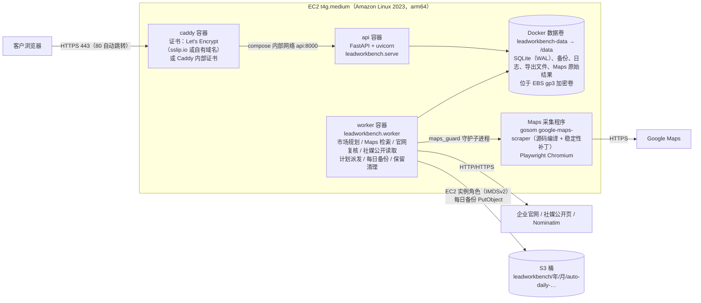
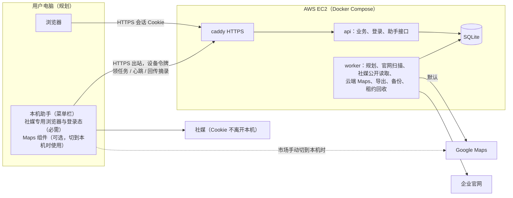

# 系统架构设计

本文描述寻迹线索工作台当前代码（main 分支）的服务器部署架构，供部署管理员和开发者参考。第 1–8 节是**已实现**的现状，内容以代码为准，文中给出对应的文件路径；第 9 节是**规划中、尚未实现**的目标架构。

部署操作步骤见 [新加坡区域部署手册](deploy/aws-singapore.md) 和 [部署到 AWS](deploy/aws.md)。

## 1. 概述与当前版本定位

- 产品：面向海外企业获客的线索工作台。按“目标市场”（国家/城市 + 企业类型 + 关键词）从 Google Maps 发现企业，再复核企业官网、读取社媒公开资料，汇总联系人入口，人工审核后导出 CSV/XLSX。
- 当前版本：**AWS 单租户体验版**。一套部署服务一家客户：一台 EC2 上用 Docker Compose 运行 `api`、`worker`、`caddy` 三个容器，客户通过浏览器访问 `https://<主机名>`，用管理员创建的账号密码登录。同一部署里的所有账号看到相同的数据，没有角色权限区分。
- 同一套代码还保留**本地模式**（`scripts/start.sh`，`LEAD_MODE=local`），在一台电脑上运行，不需要登录，行为与服务器版之前的版本一致（见第 5 节）。
- 推荐机型：`t4g.medium`（arm64，2 vCPU / 4 GiB），Amazon Linux 2023。arm64 镜像已完整验证；amd64 未验证（见第 8 节）。

## 2. 当前部署架构

要点：

- **只有 Caddy 对外**：`docker-compose.yml` 中 `caddy` 发布宿主机 80/443；`api` 只 `expose: ["8000"]`，不发布到宿主机；`worker` 不监听端口。
- **TLS**：`deploy/Caddyfile` 按 `LEAD_TLS` 选择 `acme`（默认，Let's Encrypt 真证书，自动续期）或 `internal`（Caddy 自签证书，浏览器会提示不安全）。没有自有域名时，主机名用 `<公网IP用短横线连接>.sslip.io`。
- **api 与 worker 共用一个镜像**（`Dockerfile`，`api` 构建，`worker` 以 `pull_policy: never` 复用），共享同一个数据卷，跨容器的文件锁（`worker.lock`、`worker-single.lock`、`run/maps.lock`、`migrate.lock`、`auth.lock`、`api.lock`）有效，因为两个容器共享同一个内核。
- **镜像构建**（`Dockerfile`，三个阶段）：
  1. 前端：Node 22 构建 React 页面（`frontend/` → `frontend/dist`）；
  2. Maps：Go 1.27.1 用 `scripts/install_maps.sh` 拉取固定版本的 gosom google-maps-scraper 源码，打稳定性补丁（`scripts/maps_stability.patch`、`scripts/maps_scrapemate_launch.patch`），跑 `go test -race`，编译出 `/app/tools/bin/google-maps-scraper`，并断言 `-local-stability-info` 输出 `chromium_single_process=false`；
  3. 运行时：Python 3.14 + Python Playwright Chromium（社媒公开读取用）+ 中文字体，非 root 用户 10001。
- **S3 备份**：worker 用 boto3 默认凭据链（EC2 实例角色，经 IMDSv2）上传，代码和 `.env` 里都没有 AWS 密钥（`leadworkbench/backup_upload.py`）。

## 3. 模块划分

行数为当前 main 分支 `wc -l` 的结果，只用于说明规模。

### 3.1 入口、配置与平台

| 职责 | 文件 | 行数 | 说明 |
|---|---|---:|---|
| 配置 | `leadworkbench/config.py` | 222 | 唯一入口 `load()`，读取全部 `LEAD_*` 环境变量；错误时只列出变量名、不打印值，进程以退出码 2 退出 |
| API 进程入口 | `leadworkbench/serve.py` | 55 | 持有 `{data}/api.lock`（一个数据卷只允许一个 API 进程），启动 uvicorn |
| HTTP 接口与中间件 | `leadworkbench/api.py` | 1 403 | 全部路由、Host/Origin/CSRF/登录中间件、安全响应头、错误格式 |
| 账号与会话 | `leadworkbench/auth.py`、`auth_migrations.py` | 364、42 | 用户/会话表、scrypt 哈希、会话解析与续期 |
| 登录限速 | `leadworkbench/login_limiter.py` | 156 | 内存中的账号 / IP / 全局三类计数桶 |
| 管理员命令行 | `leadworkbench/admin.py` | 275 | `create-user`、`reset-password`、`disable-user`、`enable-user`、`list-users`、`logout-all`、`backup`、`restore` |
| 健康检查 | `leadworkbench/healthcheck.py` | 50 | 不依赖 curl：`api` 查 `/healthz`，`worker` 查心跳文件（60 s 内） |
| 数据访问门面 | `leadworkbench/db.py` | 1 787 | `Store`：连接、事务、入库、审核、计划、备份与恢复 |
| 迁移台账 | `leadworkbench/migrations.py`、`p0_migrations.py`、`p1b_migrations.py` | 253、241、113 | 统一迁移执行器与 `schema_migrations` 台账 |
| 维护闸门 | `leadworkbench/maintenance.py` | 96 | 恢复备份时的独占闸门，以及共用的 `BEGIN IMMEDIATE` 重试 |
| 错误分类 | `leadworkbench/errors.py` | 142 | 存储错误（磁盘满、只读、数据库忙、损坏）到 HTTP 码的映射 |

### 3.2 业务与采集

| 职责 | 文件 | 行数 |
|---|---|---:|
| 市场规划、网格拆分、城市定位 | `market_plan.py`、`regions.py`、`company_cities.py` | 579、123、117 |
| 市场数据与企业库查询 | `market_store.py`、`market_admin.py` | 1 242、492 |
| 工作项执行与 Maps 结果入库 | `work_item_executor.py`、`market_worker.py` | 241、66 |
| Maps 适配器（启动 scraper、解析 JSONL、识别限制） | `sources/maps.py` | 473 |
| Maps 守护进程（进程组、单实例锁、遗留进程回收） | `maps_guard.py` | 301 |
| Maps 节流与重试 | `maps_policy.py`、`maps_retry.py`、`maps_migration.py` | 103、61、58 |
| 官网扫描（抓取、SSRF 防护、联系人抽取） | `sources/website.py`、`website_policy.py`、`website_link_policy.py`、`website_workflow.py` | 1 450、127、82、127 |
| 社媒发现与公开读取 | `social*.py`、`market_social.py`、`sources/social_*.py` | 合计 2 765 |
| 联系人质量、分级、审核 | `contact_quality.py`、`contact_tiers.py`、`review_policy.py`、`review_cleanup.py`、`company_comparison.py` | 296、139、175、98、68 |

### 3.3 后台、导出与运维

| 职责 | 文件 | 行数 | 说明 |
|---|---|---:|---|
| worker 主循环 | `worker.py` | 411 | 启动恢复、派发到期计划、执行工作项、保留清理、会话清理、每日备份与 S3 上传 |
| 三通道调度 | `worker_scheduler.py` | 167 | 地图、官网、社媒三个通道，每个通道同时最多 1 个工作项 |
| 导出作业 | `export_jobs.py`、`export_job.py`、`export.py` | 279、172、359 | 导出在独立子进程（`python -m leadworkbench.export_job`）中生成，状态写在 `exports/jobs/<id>.json`，同一时间只允许一个导出 |
| 每日备份与 S3 上传 | `daily_backup.py`、`backup_upload.py` | 201、47 | 见第 4.3 节 |
| 存储保留清理 | `retention.py` | 569 | 见第 4.4 节 |
| 诊断包 | `diagnostics.py` | 480 | 设置页“诊断信息”下载；白名单文件，打包时脱敏 |
| 日志 | `logging_setup.py` | 146 | JSON 行日志，带请求编号、轮次和工作项编号，写入时隐藏令牌和密钥 |

### 3.4 前端与部署文件

- 前端：`frontend/src`（React + TypeScript，约 7 400 行），构建产物由 api 同源提供。登录页 `LoginPage.tsx`、登录门 `AuthGate.tsx`、会话层 `session.ts`；设置页 `pages/SettingsPage.tsx` 含“备份与恢复”“存储清理”（`RetentionPanel.tsx`）“诊断信息”。
- 部署：`Dockerfile`、`docker-compose.yml`、`deploy/Caddyfile`、`deploy/install.sh`（安装 Docker 与固定版本的 compose/buildx 插件，校验 sha256，可选 2 GiB swap）、`deploy/backup-now.sh`（手动备份）、`deploy/verify.sh`（部署后检查）、`deploy/AGENT_RUNBOOK.md`（给 AI 部署助手的手册）、`.env.example`。

## 4. 数据与存储

### 4.1 数据库

- 单个 SQLite 文件 `/data/workbench.sqlite3`，打开时设为 WAL 模式（`migrations.py`），每次调用单独建连接，`busy_timeout=15000`（`db.py`）。读写可以并发；写操作用 `BEGIN IMMEDIATE` 先拿写锁再读后写（`maintenance.begin_immediate`）。
- 数据卷 `leadworkbench-data`（`docker-compose.yml` 的 `LEAD_VOLUME_NAME` 默认值）挂到容器 `/data`，物理上在 EC2 的 EBS gp3 根卷上。Caddy 的证书另存两个卷：`leadworkbench-data-caddy`、`leadworkbench-data-caddy-config`。
- 主要表（完整 DDL 见 `docs/technical/schema.current.sql`，共 57 张表）：

| 表组 | 主要表 | 内容 |
|---|---|---|
| 市场与任务 | `tasks`、`runs`、`work_items`、`schedules`、`occurrences`、`market_*` | 目标市场、每轮检索、查询单元与复核工作项、月度计划 |
| 企业与来源 | `companies`、`listings`、`locations`、`observations`、`company_cities`、`company_categories` | 企业主记录、Maps/官网来源、地址、字段观察值 |
| 联系人与审核 | `contacts`、`contact_versions`、`contact_decisions`、`contact_change_proposals`、`reviews`、`changes`、`manual_contacts` | 联系入口、版本历史、人工决定、待审核变更 |
| 社媒 | `social_entities`、`company_social`、`social_runs`、`social_work`、`social_page_observations` 等 | 账号候选、归属、读取任务与结果 |
| 访问保护 | `maps_access_policy`、`website_host_gates`、`social_platform_gates` | Maps 冷却/人工恢复状态、按主机/平台暂停 |
| 账号 | `auth_users`、`auth_sessions` | 用户（scrypt 哈希）与会话（只存会话 ID 的 sha256） |
| 台账 | `schema_migrations` | 已执行的迁移 ID |

### 4.2 迁移

- 所有迁移登记在 `leadworkbench/migrations.py` 的统一台账 `REGISTRY` 中（`0001_base_v1` 到 P0、P1 批次和 `aws_20261021_auth`）。`once` 类迁移只执行一次并写入 `schema_migrations`；`R0x` 类修复每次启动都会幂等执行。
- **只能向前**：备份里出现当前版本不认识的迁移 ID 时拒绝恢复（“该备份来自更新版本的应用”）。回退版本 = 切回旧代码 + 用升级前的备份恢复。
- 多进程用 `migrate.lock` 串行迁移（最多等 120 s）。首次启动大库时迁移可能需要几分钟，所以 `api` 健康检查的 `start_period` 为 600 s，期间网页返回 502 属正常。

### 4.3 备份

| 类型 | 文件名 | 触发 | 是否上传 S3 |
|---|---|---|---|
| 每日备份 | `backups/auto-daily-….sqlite3` | worker 每天 `LEAD_BACKUP_TIME`（默认 03:30，时区 `LEAD_TIMEZONE`，默认 `Asia/Shanghai`）；启动 120 s 后检查一次以补做错过的备份；失败 1 小时后重试 | 配置了 `LEAD_BACKUP_S3_BUCKET` 时上传到 `s3://<桶>/leadworkbench/<年>/<月>/<文件名>`，SSE-S3（AES256），同一份最多尝试 3 次 |
| 手动备份 | `backups/backup-….sqlite3` | 网页“设置 → 备份与恢复 → 创建备份”或 `sh deploy/backup-now.sh` | 否 |
| 恢复前 / 修复前自动备份 | `backups/auto-pre-restore-…`、`auto-pre-repair-…` | 恢复或修复迁移前自动创建 | 否 |

- 备份是用 SQLite backup 接口做的一致性副本（单文件，不依赖 -wal/-shm），只含数据库，不含 Caddy 证书、日志和 Maps 原始结果。
- 上传在独立线程里执行，不持有 `worker.lock`，不会阻塞恢复。状态文件 `backup-state.json`、`backup-upload-state.json`（权限 0600），设置页显示最近一次备份与上传结果（`GET /api/backups/status`，不返回桶名、键名）。
- 恢复默认保留**当前**账号与会话（账号不随备份回滚）；命令行可用 `--accounts backup` 改用备份里的账号。

### 4.4 保留策略

默认值（`leadworkbench/retention.py` 的 `DEFAULT_POLICY`），可在设置页“存储清理”中调整：

| 类别 | 默认 | 可调范围 |
|---|---|---|
| Maps 原始结果（`runs/` 下的目录） | 30 天 | 7–365 天 |
| 自动备份（`backups/auto-*`） | 每日备份、其他自动备份各保留最近 10 份 | 1–100 份 |
| 导出文件（`exports/`） | 7 天 | 1–90 天 |

- **首次确认前不删除任何文件**：策略处于“待确认”时，自动备份会一直累积。管理员首次登录后需要在设置页确认一次（第 10 步）。改得更严格时需要重新确认。
- 手动备份（`backup-*`）永不自动删除；数据库里的企业、联系人记录不受保留策略影响。
- worker 启动 60 s 后执行第一次清理，之后每 6 小时一次，明细写入 `logs/retention.log`。

## 5. 运行模式：local 与 server

模式由 `LEAD_MODE` 决定（`config.py`）。`docker-compose.yml` 为 `api`、`worker` 固定 `LEAD_MODE=server`，并由 `LEAD_PUBLIC_HOST` 拼出 `LEAD_PUBLIC_ORIGIN=https://<主机名>`。

| 方面 | local（`scripts/start.sh`） | server（Docker Compose） |
|---|---|---|
| 登录 | 关闭（`LEAD_AUTH=off`）；浏览器从 `/api/session` 取本地令牌放在 `X-Local-Token` 头 | 必须开启（`LEAD_AUTH=on`，设为 off 时启动报错）；账号密码登录，会话 Cookie |
| 监听 | `127.0.0.1:18765`；未开启登录时只能监听回环地址 | 容器内 `0.0.0.0:8000`，只对 Caddy 可见 |
| 允许的 Host | 只有 `127.0.0.1`、`localhost`、`::1` | 上述回环名 + `LEAD_PUBLIC_ORIGIN` 的主机名 + `LEAD_ALLOWED_HOSTS`（最多 10 个）；其他 Host 返回 403“不允许的访问地址” |
| 公开来源 | 不需要 | `LEAD_PUBLIC_ORIGIN` 必填，https；用于 Origin 校验和 `__Host-` Cookie |
| 每日备份 | 默认关闭 | 默认开启（`LEAD_BACKUP_DAILY=on`） |
| 社媒 | 可在本机打开专用浏览器登录 Instagram / Facebook / X，并用登录态读取 | **不支持登录**：打开登录窗口返回 409 `social_login_unsupported`，站内搜索工作项记为 `skipped`（`server_mode`）；账号发现和公开资料读取照常可用（无沙箱 headless Chromium，隔离由容器承担） |
| 界面文案 | “本地服务”“本机”等 | 服务器版文案（页头、设置、社媒、计划、导出的说明改为服务器语境） |
| 恢复备份（命令行） | 需要先自己停止 `start.sh`，命令要求输入 yes 确认 | 需要先 `docker compose stop api worker`，命令通过进程锁确认两者已停止 |

## 6. 安全设计

### 6.1 登录与密码

- 账号只能由管理员在服务器上用命令行创建（`python -m leadworkbench.admin create-user`），网页没有注册入口。用户名 3–32 个字符，只含字母、数字、点、下划线、短横线，以字母或数字开头（NFKC 规范化，大小写不敏感）；密码 12–128 个字符，不能全是空白，不能与用户名相同（`auth.py`）。密码只在交互提示中输入，不出现在命令行参数里。
- 密码哈希：scrypt，N=2^15、r=8、p=1，16 字节随机盐，输出 32 字节；参数变化后登录时自动重新哈希。用户名不存在或已停用时也计算一次假哈希，避免通过响应时间判断账号是否存在。API 同时最多进行 2 个 scrypt 计算。

### 6.2 会话与 Cookie

- 会话 ID 为 32 字节随机值，数据库只存其 sha256。Cookie 名 `__Host-lw_session`，属性 `HttpOnly; Secure; SameSite=Lax; Path=/`，无 `Domain`、无 `Max-Age`（https 下）。
- 有效期：空闲 24 小时、最长 7 天（`LEAD_SESSION_IDLE_HOURS` 1–720、`LEAD_SESSION_MAX_DAYS` 1–90）；每 5 分钟最多续期一次。每次登录都换新会话；每个账号最多 10 个会话，超出时最早的被挤掉。
- 重置密码、停用账号会立即删除该账号的全部会话；`logout-all` 可强制退出。worker 每小时清理过期会话（启动 5 分钟后第一次）。

### 6.3 登录限速（`login_limiter.py`）

| 维度 | 规则 |
|---|---|
| 账号 | 15 分钟内失败 5 次，锁定 15 分钟（未知用户名也计数） |
| IP | 15 分钟内失败 20 次，锁定 15 分钟（IPv6 按 /64 计） |
| 全局 | 每分钟 100 次，只对 7 天内没有成功登录过的 IP 生效 |

计数只在 api 进程内存里，`docker compose restart api` 会清零（已登录的会话不受影响）。被锁时返回 429 并带 `Retry-After`。

### 6.4 CSRF 与同源

- 每个会话一个 CSRF 令牌，前端从 `/api/session` 取得并放在 `X-Local-Token` 头；除 GET/HEAD 外必须一致，否则 403 `csrf_failed`。
- `Origin` 必须等于 `LEAD_PUBLIC_ORIGIN` 或与 Host 同源；`Sec-Fetch-Site: cross-site` 一律拒绝。应用层请求体上限 1 MB，Caddy 上限 2 MB。

### 6.5 公开端点

不需要登录的只有：`/healthz`（只返回 `{"status":"ok"}`，不访问数据库）、`/api/session`、`/api/auth/login`；`/api/auth/logout` 登录可选。前端静态页面本身可以访问（未登录时显示登录页），其余所有 `/api/*` 未登录返回 401（`api.py` 的 `AUTH_PUBLIC`）。

### 6.6 容器与反向代理

- `api`、`worker`：用户 `10001:10001`，`cap_drop: [ALL]`，`no-new-privileges`，`init: true`（tini 回收 Chromium 子进程），`/tmp` 为 512 MiB tmpfs，`worker` 的共享内存 1 GiB。
- `caddy`：镜像固定 digest，只保留 `NET_BIND_SERVICE`，根文件系统只读，`admin off`，只启用 HTTP/1.1 与 HTTP/2，删除 `Server` 头，gzip。
- 应用响应头：`Content-Security-Policy`（`default-src 'self'`、`frame-ancestors 'none'` 等）、`X-Content-Type-Options: nosniff`、`Referrer-Policy: no-referrer`、`Cache-Control: no-store`。
- 公开介绍页 `/about`：Caddy 在转发给应用之前直接返回只读挂载的单个文件 `docs/partner/index.html`（无需登录，任何人可访问，不经过应用，因此不在 `AUTH_PUBLIC` 里）；`/about/` 跳转到 `/about`，`/about/` 下其他路径 404，不列目录。响应头：`default-src 'none'` 的 CSP（只允许内联样式和 data: 图片）、`X-Robots-Tag: noindex, nofollow`、`nosniff`、`no-referrer`、`Cache-Control: public, max-age=300`。前端只使用 `/?view=…` 查询参数路由，没有 `/about` 路由，不冲突。
- HSTS：只在 `LEAD_TLS=acme` 时发送，`max-age=86400`（1 天），这样临时切到 internal 证书后，浏览器最多 1 天就能“继续访问”。

### 6.7 凭据与日志

- 没有 AWS 密钥：S3 上传只用 EC2 实例角色（IMDSv2 必需，跳数上限 2，容器需要多经一跳）。`deploy/verify.sh` 会检查 `.env` 里没有 `AWS_ACCESS_KEY_ID` 等变量。`.env` 权限 600，不进 git。
- 日志脱敏：应用日志写入时隐藏令牌、密钥、Cookie、`Authorization` 等（`logging_setup.py`）；Caddy 访问日志删除 `X-Local-Token`、`Cookie` 请求头和 `Set-Cookie` 响应头（`deploy/Caddyfile`）；登录日志只记 IP 哈希前 8 位。管理员命令行不写日志、不打印密码和哈希。
- 诊断包只含白名单文件，打包时把邮箱、网址、电话、企业名/联系人名替换掉，不含数据库、备份、会话、桶名。

## 7. 后台任务与并发

### 7.1 进程与锁

| 锁文件（在 `/data`） | 持有者 | 作用 |
|---|---|---|
| `api.lock` | api 进程全程 | 一个数据卷只有一个 API；命令行恢复据此确认 api 已停止 |
| `worker-single.lock` | worker 全程 | 只允许一个 worker |
| `worker.lock` | worker 派发和执行工作时 | 空闲时释放，恢复备份需要拿到它 |
| `run/maps.lock` | Maps 守护进程 | 同一时间只有一个 Maps 查询 |
| `migrate.lock` | 迁移时 | 迁移串行 |
| `auth.lock` | 账号写操作、恢复 | 恢复期间账号命令等待 |

- 只部署**一个** worker 和**一个** api 进程；不要用多个 uvicorn worker 或多副本扩容。
- `docker-compose.yml` 中 worker `depends_on: api (service_healthy)`：api 先完成迁移并健康后 worker 才启动；api 处于降级状态时 worker 不启动。

### 7.2 维护闸门（`maintenance.py`）

普通 API 请求共享进入闸门，可以并发；只有“恢复备份”独占（写者优先）。恢复进行中时普通请求最多等 30 s，超时 503 `maintenance`；恢复请求最多等在途请求 10 s，超时 409 `maintenance_busy`。有排队中或运行中的轮次时拒绝恢复（已暂停的不阻止）。

### 7.3 worker 调度

- 三个通道（`worker_scheduler.py`）：地图、官网、社媒，每个通道同时最多执行 1 个工作项；多个市场的工作项轮转执行，正在执行的工作项不会被抢占。
- **Maps 节流**（`maps_policy.py`）：单并发；每个查询后间隔 60–120 s；单个查询超时 180 s、每批最多 120 条记录（`market_worker.py`）。
  - 验证码 / 限流 / 拒绝访问：进入“需人工恢复”状态，冷却 30 分钟；冷却结束后**不会自动恢复**，需要在网页点“恢复地图检索”（`POST /api/maps/resume`）。
  - 超时、非零退出等临时失败：全局退避 600 / 1800 / 7200 s。
  - 空结果：按查询重试，间隔 600 / 1800 s；浏览器异常退出：120 / 600 / 1800 s（`maps_retry.py`）。
- **重启恢复**：worker 启动时先用 `maps_guard.reclaim` 回收上次遗留的 scraper 进程组，再 `recover()` / `recover_social()` 把中断的工作项退回队列。worker 被强杀时，守护进程通过 stdin EOF 结束整个 scraper 进程组。
- **定时任务**（`worker.py`）：

| 任务 | 时间 |
|---|---|
| 到期计划派发（按日历月，错过后最多补跑一次） | 每轮主循环（约 1 s） |
| 每日备份检查 | 启动 120 s 后，之后每 60 s 检查是否到点 |
| S3 上传检查 | 启动 120 s 后，之后每 60 s |
| 存储保留清理 | 启动 60 s 后，之后每 6 小时 |
| 过期会话清理 | 启动 5 分钟后，之后每小时 |
| 心跳文件 `worker-heartbeat.json` | 持续更新；健康检查要求 60 s 内 |

- 导出在 api 启动的子进程中执行，同一时间一个；api 停止时向子进程发 SIGTERM，最多等 5 s。

## 8. 已知限制与风险

1. **Google Maps 在 AWS IP 上能否使用尚未实测**。云服务器 IP 更容易被要求验证或限流。容器内的 Maps 程序已经用本机网络出口完成过 1 次真实查询，但还没有从 AWS 出口测过。部署后先按 [部署手册](deploy/aws-singapore.md) 第 11 步做阶段 0 实测；出现验证码就立即暂停。
2. **amd64（x86，如 t3.medium）未验证**：在模拟环境下两次构建失败。请使用 `t4g.medium`（arm64）。
3. **服务器模式不支持社媒登录读取**，也不支持需要登录的站内搜索（显示“已跳过”）；账号发现和公开资料读取可用。镜像里没有 Instaloader 和 SearXNG。
4. **单机、无高可用**：EC2 或 EBS 故障时需要从 S3 的每日备份恢复，**最多丢失约 1 天的数据**（自上次每日备份以来的变更）。
5. 登录失败计数在内存里，api 重启清零；知道用户名的人可以故意输错 5 次，让该账号锁定 15 分钟（处理：`docker compose restart api`）。
6. 单租户：同一部署内的账号看到相同数据，没有角色权限。
7. 部分只支持旧 TLS 套件（静态 RSA）的企业官网无法扫描，会记为 blocked，与部署方式无关。
8. Maps 程序（上游 gosom）每次运行会访问公网 IP 查询服务（如 `api.ipify.org`）生成机器 ID，只是一次 GET，不上传业务数据。
9. `internal` 证书模式下浏览器会提示不安全；sslip.io 在中国大陆的解析可用性未验证，正式交付前建议换成自有域名。

## 9. 目标架构（规划中，尚未实现）

> **本节是规划，当前代码中没有实现。** 内容来自部署架构评审选定的“方案 B”，工作量为基于代码阅读的估算，没有原型。实施顺序和范围仍可能调整。

### 9.1 目标

用户在本地通过浏览器使用工作台、并在本机登录社媒账号；核心代码不交到用户手上；搜索、企业库、导出的性能不受影响。原则是“能放云端的都放云端”。

### 9.2 方案 B：云端核心 + 最小本机助手

- **云端**（与现在的服务器版相同的 compose 部署）：业务逻辑、数据库、市场规划、官网扫描、社媒公开资料、计划、导出、备份、审核、诊断，以及默认的 Maps 检索。
- **本机助手**（macOS 菜单栏程序，签名公证，自动更新，不监听任何端口，只发起出站 HTTPS）：
  - 弹出社媒专用浏览器窗口，让用户在**自己的电脑上**登录 Instagram / Facebook / X；Cookie 和登录态只留在本机；
  - 领取并执行需要登录态的社媒读取，只回传清洗后的页面摘录，由云端解析入库；
  - 可选的 Maps 组件：按需下载，只在某个市场被切到本机执行时使用。
- **Maps 执行位置**：默认云端；云端被 Google 拦截时界面提示，由用户**按市场手动**切到本机助手执行，之后也可以手动切回云端（第 1 阶段）。自动切换放到第 2 阶段。
- **用户访问方式**：浏览器直接打开云端网址（助手菜单提供“打开工作台”）。
- **解耦任务 X1**：现在的社媒采集模块在导入时会连带 `contact_quality`、`review_policy`、`company_comparison`、`sources/website.py` 等核心规则。放进助手前必须先拆出只依赖标准库、`bs4`、`playwright` 的 `leadworkbench/collect/` 包（浏览器启动、profile 锁、导航守卫、页面摘录），解析留在云端，并用 CI 的导入闭包检查保证助手包里没有核心模块。估算 4–6 人天。

### 9.3 主要改造点（规划）

- 后端：工作项增加执行位置与租约（领取、心跳续租、过期回收、按 `lease_id` 防止旧结果覆盖）；“执行”与“入库”拆开，云端 worker 和助手回传走同一个入库函数；新增 `/api/agent/v1/*`（设备令牌鉴权，拒绝浏览器 Origin，按路由限制请求体）；云端重新校验助手回传的数据；Maps 节流改为按出口计算；按市场切换 Maps 执行位置的接口。
- 设备绑定：网页生成 10 分钟有效、一次性的绑定码和带云端地址的绑定链接；助手确认框显示要绑定的主机、租户和用户名；助手只接受公共 CA 签发的 https（因此要求 `LEAD_TLS=acme`）；设备令牌只存哈希，可吊销、定期轮换。
- 前端：设置页“本机助手”区块、助手在线状态、“等待本机助手”状态、Maps 受限提示条与切换确认框。

### 9.4 分阶段路线

| 阶段 | 范围 | 估算工作量 |
|---|---|---|
| 0 准备（当前） | 用当前版本部署到 AWS，实测云端 Maps、HTTPS、每日 S3 备份；选区域、准备自有域名、申请 Apple 开发者账号 | 1–2 人天，另加你的账号与费用 |
| 1 首个客户体验版 | 后端改造、解耦 X1、社媒助手、Maps 组件与手动切换、前端、部署与测试 | 合计 55–64 人天；可拆为 1a（社媒助手 + X1 + 云端 Maps）42–49 人天，1b（Maps 组件 + 手动切换）13–15 人天 |
| 2 稳定与自动化 | 强信号下自动切到本机、试探云端与自动切回、更新灰度、诊断上传 | 6–8 人天 |
| 3 多租户 | 租户维度贯穿数据与设备、管理后台；可选 Windows 助手 | 25–40 人天；Windows 助手另加 10–15 人天 |

阶段 0 的实测结果决定阶段 1 是否拆分：云端 Maps 可用就先交付 1a；从一开始就被拦则不拆分。
