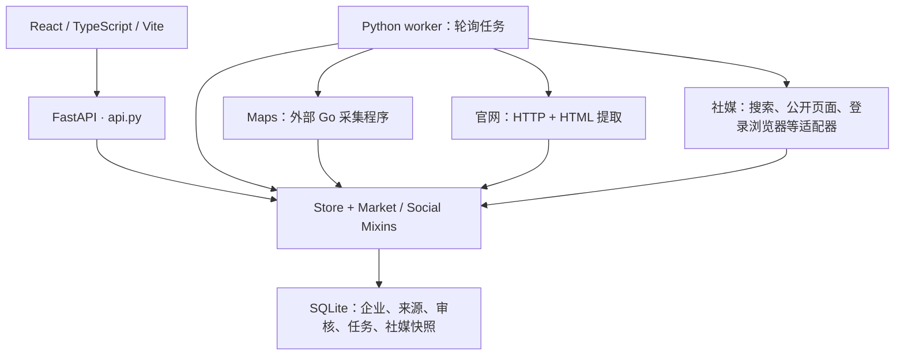

# 系统架构与代码结构评审

评审日期：2026-09-23。范围：本地源码、任务调度、资料投影、前端组织与自动测试。只做评审，没有修改业务逻辑或真实企业数据。复现使用临时数据库，没有请求社媒平台。

## 结论

当前是适合本地内部使用的单体系统，已有数据库持久化、来源证据、审核历史、后台任务和平台适配器。无需立即更换技术栈或拆成微服务。当前主要风险是任务语义与资料更新语义不够明确，以及页面与数据访问职责持续集中。

优先修复下面三个功能问题，再逐步拆分模块。测试通过并不代表这些连续操作场景正确。

## 当前架构

主要目录：

| 位置 | 当前职责 |
|---|---|
| `frontend/src/App.tsx` | 应用布局、导航、页面分支、表单、请求与交互 |
| `frontend/src/SocialPanel.tsx` | 统一联系人列表、社媒详情、联系人详情、帖子、归属与跟进 |
| `leadworkbench/api.py` | HTTP 接口、本地访问保护和应用启动 |
| `leadworkbench/db.py` | 数据库初始化、企业/联系人写入、审核、迁移等 |
| `market_store.py`、`social_store.py`、`social_discovery_store.py` | 市场/社媒存储、业务决策、任务状态和展示数据 |
| `worker.py`、`social_worker.py` | 后台调度与来源调用 |
| `leadworkbench/sources/` | Maps、官网与各类社媒读取适配器 |
| `tests/`、`frontend/tests/` | 后端测试、前端纯函数/渲染及可选 DOM 测试 |

## 确认的问题

### 1. P1：不同社媒操作会被错误合并为同一任务

位置：`leadworkbench/social_discovery_store.py:87`。

创建任务时，仅以排序后的企业 ID 集合查询现有 queued/running 任务；没有比较 `profile_only`、`platform_search`、`read_only` 或配置。

临时数据库复现：

1. 为企业添加 X 账号。
2. 提交“补充账号资料”。
3. 对同一企业提交“站内搜索”。
4. 两次返回相同任务 ID，第二次实际任务阶段仍是 `profile`，没有 `platform_search`。

影响：用户看见提交成功，却没有执行所选操作；更新配置后的请求也可能继续使用旧任务配置。

建议：把操作类型和影响执行的配置纳入任务指纹；只有语义相同的请求才复用任务。不同操作应独立排队或明确显示冲突，不可悄悄替换。

### 2. P1：一次字段较少的成功更新，会隐藏此前采集到的有效资料

位置：`leadworkbench/social_discovery_store.py:239`。

当前账号资料取最新快照；只有最新状态不是 `preview_read` 时才回退历史成功内容。若最新读取成功但 `fields=[]`，以前的邮箱、电话等字段不会合并进入当前资料。帖子却有独立的历史合并逻辑，两类资料的更新规则不一致。

临时数据库复现：先保存含邮箱的成功快照，再保存含帖子但字段为空的成功快照；`social_pages()` 返回的 `fields` 变成空列表。

影响：历史数据没有删除，但用户会以为联系方式消失；基于当前字段计算的企业匹配线索也会减少。

建议：原始快照与“当前账号资料”分离，按字段维护值、来源、观察时间和状态。未采集到不等于已失效；只有明确失效证据才撤下旧值。冲突值应保留双方证据。

### 3. P1：市场任务会阻塞社媒任务调度

位置：`leadworkbench/worker.py:56`、`leadworkbench/worker.py:175`。

`serve()` 先等待 `process_run()` 返回，再处理一项社媒任务；`process_run()` 内部循环领取该市场运行的所有任务，直到完成或暂停。

影响：较长的市场发现与官网扫描期间，社媒任务只能等待。心跳仍可能正常，因此“worker 在线”不等于社媒任务正在推进。此项由控制流确认，未在真实市场启动长任务压测。

建议：调度单位改为工作项，市场和社媒队列公平轮转；保留平台级并发限制。记录排队时间、当前阶段、最后进展时间，将“在线”和“有进展”分别展示。现阶段不必引入分布式队列。

### 4. P2：账号详情每次请求扫描全部历史快照，长期运行成本持续增加

位置：`leadworkbench/social_discovery_store.py:242`、`:258`。

详情先取各账号最新快照，再逐账号读取历史 JSON，遍历所有成功快照合并帖子。读取失败时还会额外查询一次历史。建表处（同文件 `:24`）也没有为快照表声明按账号查询的索引。

影响：每几个月更新一次后，历史越多，详情请求解析越多；返回帖子没有分页。当前规模是否已造成明显延迟未进行性能压测，因此不宣称已有性能故障。

建议：建立当前资料投影和独立帖子表，以平台帖子键去重；详情分页读取帖子，历史快照按需加载。增加适合账号和时间查询的索引，并用增长数据集测延迟。

### 5. P2：关键前端交互测试默认跳过

位置：`frontend/tests/socialDiscovery.test.ts:62`、`:110`；`frontend/tests/socialConnections.test.ts:56`。

三项真实 DOM 测试依赖外部 `SOCIAL_TEST_JSDOM` 路径；常规 `npm test` 不设置时直接跳过。

影响：任务提交、取消、重试、配置保存等交互未被默认测试覆盖。静态渲染和纯函数测试无法代替这些流程验证。

建议：将 DOM 测试环境纳入项目固定开发依赖，默认执行关键交互测试；增加“不同操作连续提交”“部分字段连续更新”和队列公平性回归测试。

## 结构改进建议

### 前端按页面和用例拆分

`App.tsx:26` 开始集中管理多类页面行为，文件最长行达到 7,838 字符；`SocialPanel.tsx:99` 同时负责多种详情和操作流程。问题不是行数本身，而是改一处联系人展示容易牵动社媒请求、路由与跟进状态。

建议先统一格式化，再拆为 CompaniesPage、CompanyDetailPage、ContactList、ContactDetail、SocialAccountDetail。App 只保留布局和路由。请求与刷新逻辑放入按业务划分的 hooks，保留已有纯函数模块。

### 存储、业务决策、迁移拆开

`db.py:115` 的 Store 通过多层 Mixins 聚合大量职责；初始化（`:116`）不只建立连接和迁移，还调用审核自动处理方法。

建议将数据库迁移作为显式、版本化步骤；把联系人接纳/冲突判定、市场匹配、社媒更新放入业务服务，Repository 专注读写。避免仅把大文件切成多个仍依赖同一隐式 `self` 的文件。

### 联系人规则形成单一结果契约

目前存在 `contact_quality.py` 两套验证入口（`:119`、`:177`）、后端联系人投影、前端分组和统一列表过滤。保守清理与严格校验可以分别存在，但必须明确各自适用范围。

建议后端统一输出：是否可联系、是否采购、排除原因、匹配依据、来源和时间；前端负责展示。对同一组样本同时验证入库、列表、计数、筛选和导出，防止同一记录在各入口被不同分类。本次未据此断言所有这些入口已经不一致。

### 更新运行文档

README 的旧范围说明仍称社媒只记录官网链接、不读取登录后资料，与当前浏览器适配器和社媒工作流并存，容易误导维护者。应区分当前能力、可选依赖和历史验证记录。

## 推荐实施顺序

1. 修复任务指纹、字段级资料保留、工作项公平调度，并补回归测试。
2. 固定 DOM 测试环境；统一联系人分类与接口字段契约。
3. 拆分 App/SocialPanel 与 Store 职责，显式管理迁移。
4. 为快照/帖子建立查询投影、分页和增长数据性能测试。

继续采用 React + FastAPI + SQLite 即可。是否需要多 worker 或其他数据库，应由任务量、并发和实测延迟决定。

## 验证记录与限制

- 后端：443 passed，44 subtests passed；2 项依赖弃用警告。
- 前端：42 passed，3 skipped，0 failed。
- TypeScript 检查及 Vite 构建通过。
- 两项资料/任务问题使用独立临时数据库复现，未改真实数据库。
- 本次是源码架构评审和自动测试，不是所有浏览器流程验收、平台实时可用性测试或安全审计。
- 仓库当前主要文件显示为未跟踪，缺少可用的版本差异基线；本次评审针对当前文件内容。
