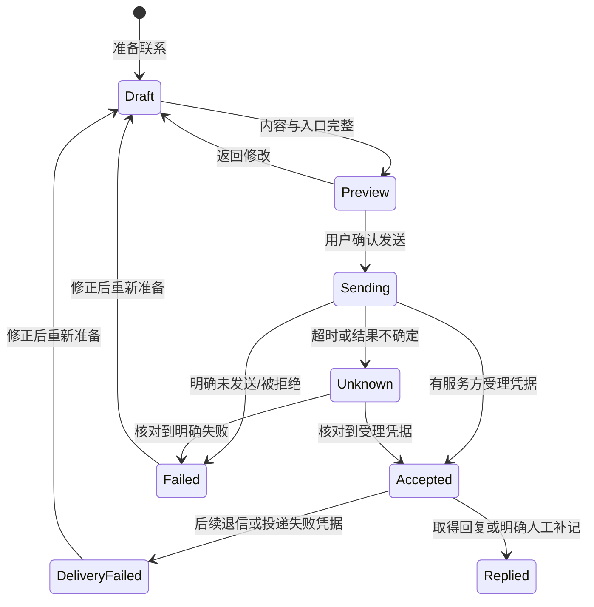

# 寻迹：交互设计文档

版本：1.1｜2026-09-25 市场社媒集成更新；其余目标交互保留状态标记  
依据：[PRD](overseas-lead-acquisition.prd.md)；视觉约束：[UI设计](ui-design.md)

本文包含“当前交互”和“目标交互”，未实现的发送、人员关联等均明确标注。页面规则编号 IX 用于与 PRD、UI 和验收交叉核对。

## IX-01 信息架构与导航

### 当前入口

```text
目标市场
  市场详情 / 运行记录 / 定时计划
企业库
  企业详情
    联系人详情
    社媒账号 / 帖子详情
待审核
更新记录
设置
```

当前企业详情与账号详情通过 URL 保存企业、筛选、页码等上下文。企业详情不是侧边栏一级项，进入详情时仍选中企业库。

### 建议目标入口

保留上述结构，新增“触达与跟进”（规划中），统一邮件和社媒的草稿、发送结果、回复及下一步；产品/发件身份配置置于设置。

用户应能从企业或联系人直接“准备联系”，不必先去触达中心重复搜索收件对象。新增导航只有相应功能可用时才作为正式入口；设计稿必须标出“规划中”。

返回规则：企业列表 → 详情 → 联系人/账号 → 返回后保留筛选、页码和列表位置；刷新或分享详情链接能打开相应对象。对象不存在时提示“记录已更新或移除”，提供返回企业入口。

## IX-02 创建与维护市场

关联 PRD-01、02、03、04。

| 环节 | 输入/动作 | 反馈和异常 |
|---|---|---|
| 定义市场 | 国家、行政区、城市、企业类型、关键词；排除条件为目标扩展 | 显示完整地域路径；名称相同的城市须区分 |
| 改国家/州 | 建议清空不再匹配的下级值，并保留可撤销提示 | 自定义地区允许输入，但显示未验证，不静默拼接混合地区 |
| 保存市场 | 保存定义后显示“开始检索” | 相同市场提示已有市场，可直接进入，不重复建定义 |
| 社媒选项 | 新表单默认开启；Facebook/Instagram/X 全选，近期帖子默认不选 | 默认只补基础资料；启用或显式补充至少选一个平台，历史市场缺字段按关闭展示 |
| 更新市场 | 一个业务动作更新累积名单 | 自动选择续查/更新策略；不要求填写企业数量上限 |
| 执行过程 | 查看当前阶段、新增/存量、待处理范围 | 排队与正在执行分开；程序在线不代表该任务已开始 |
| 暂停/继续/取消 | 作用于本轮及关联社媒 | 保留已取得资料；暂停/取消后旧领取结果不再应用或扩展，相同企业的独立社媒运行不受市场控制 |
| 本轮结束 | 跳转该市场的企业列表 | 展示完成/部分完成及未完成原因，不写“已收集全城所有企业” |

“覆盖进度”建议改为“本轮检索进度”；未验证地域边界时使用“近似检索范围”。实际地址在范围外的结果进入单独可筛选状态，不静默贴上目标城市。

可重试的失败显示“重试未完成项”；达到细分/预算等策略能力边界时显示“本轮策略已达到范围限制”，提供“查看限制/调整策略”，不能用同一个“继续”暗示必然扩大覆盖。再次更新市场不保证增加企业数量。

当前缺口：地区输入联动和范围外结果核验未形成完整闭环；排除条件、产品与岗位设置未完成。

### 市场内社媒补充与设置

市场详情保留紧凑工作流和现有 `WorkflowHint` 交互，常驻明确的“补充社媒资料”按钮。页面加载、自动刷新、展开设置和选择平台均不执行补充。

| 动作 | 行为与反馈 |
|---|---|
| 保存后续设置 | 保存自动开关、平台和帖子选项，仅影响后续自动执行；提示已有队列仍按轮次快照执行 |
| 补充社媒资料 | 使用当前选择；有活动轮次则附加，已结束则新建 `kind=social` 的仅社媒轮次；成功后切到返回的市场轮次，不改选中的历史轮次 |
| 已有不同执行配置 | 显示服务端错误并保留选择，不静默替换已运行的平台/帖子选项 |
| 活动轮次已暂停 | 附加后仍暂停；补充动作不等于继续运行 |
| 去登录/处理连接 | 进入内部设置；不自动打开外部平台。用户处理并释放专用登录窗口后，回到任务恢复 |
| 恢复某平台 | 显式恢复保留队列，使用设置中最新保存的连接配置；本轮平台/帖子选项不变。冷却未到期、操作忙碌、后台离线或该轮暂停/取消时不可通过此按钮继续 |
| 完整社媒运行报告 | 用户展开时读取关联子运行报告；可进一步展开逐项明细；失败显示原因和重新读取入口 |
| 企业内查看市场关联社媒 | SocialDiscovery 提供“查看所属市场任务”；暂停/继续/取消交给父市场轮次。市场子运行不禁用企业内独立搜索/补资料按钮，独立社媒仍保留自身操作和防重复提交 |
| 读取中标记账号“不采用” | 停止该账号在途读取，迟到结果不新增资料、帖子或后续工作；已保存证据保留 |

进度顺序为 **1 规划 → 2 Maps → 3A 官网 / 3B 社媒（并行）→ 4 结果汇总**。各分支随企业发现就绪即可执行；图中的编号不表示必须等整个上一阶段结束。仅社媒轮次只显示社媒和结果汇总，不补虚构的零 Maps/官网进度。

主行与平台明细按企业计数；完整报告按处理项计数，同一企业可有多项。正常无结果是成功执行；平台登录、会话占用、冷却、配置等待均保留为待处理。总量可在 Maps/官网上游关闭前继续增加，不能把旧的终态标签或暂时的已处理比例当成全部完成。

等待区显示平台、原因、下次可尝试时间及是否人工处理。正常间隔 60–120 秒，网络/限流按 10、30、120 分钟恢复，三次自动恢复仍失败再转人工；不提供跳过冷却的操作。受影响平台等待时，其他平台及地图/官网状态继续各自展示。账号、帖子成果另列，帖子开关关闭不显示“正在读帖”。

每企业每轮最多 8 个基础资料读取项，超出部分候选证据仍可查看；开启帖子后沿用现有单次最多 5 条的读取预算，不把预算当作已取得数量。界面不自动确认账号归属或发送消息。集成最终验收状态见[实施审计](../validation/2026-09-25-market-social-integration.md)。

仅社媒轮次在轮次详情中有明确名称和社媒企业进度，不显示零地图/官网进度；市场概况仍显示最近发现轮次的 coverage 和新增/存量统计。部分预览已取得但仍待重试时保留可读内容与等待状态，不把内容保留误写为执行全成功。滚动或后续帖子读取才出现登录/验证时，同样显示对应平台的登录等待与处理入口；已有预览不能掩盖后续受阻。

## IX-03 企业库与下一步选择

关联 PRD-03、06、11。

当前：搜索、市场/本轮分类/客户匹配/类型/入口筛选、排序、每页50家、当前页批量标记、CSV/XLSX导出。

目标规则：

- 主任务是“找到下一家值得联系的企业”。建议默认优先具备目标岗位入口的企业，并允许回到最新建档排序；此默认排序变更为建议，当前仍是最新建档。
- 搜索和筛选共同作用；切换筛选回第一页；批量选择明确是当前页还是全部筛选，不能隐式扩大范围。
- 新增、存量、资料变化的定义放在可查看说明中，列表不用始终显示大段技术解释。
- 客户匹配状态指是否符合销售目标，不代表联系人身份或邮箱验证。
- 采购、关键员工、其他社媒、其他邮箱按PRD-06口径展示；不能把这些数直接加总成“人数”。
- 点击企业进入详情；目标版本可在选择后“准备联系”或“导出联系入口”，必须再次显示具体选择对象。
- 入口级导出是新增能力，不能将现有“CSV企业表”改名冒充联系人清单。

空态：空库显示“创建目标市场”；有企业但筛选无结果显示“清除筛选”；资料请求失败显示“重试”，不能变成“0家”。

## IX-04 企业详情与联系人/账号列表

关联 PRD-04、05、06。

页面从上至下：

1. 企业名称、城市/实际地址、业务类型与客户匹配状态。
2. 关键资料、关联门店。
3. **联系人/账号**：主要工作区；可选择具体对象。
4. 资料更新、来源与历史：按需展开。

当前定时计划、资料和来源占据较多空间；建议将维护能力弱化，避免挤占联系入口。

统一列表保持四列：

| 联系人/账号 | 联系渠道 | 企业关系 | 更新时间 |
|---|---|---|---|
| 姓名或账号展示名；必要时副行展示邮箱/用户名 | 邮箱、Facebook、Instagram、Twitter（X）等明确名称 | 采购人员、采购部门、关键员工及岗位、品牌/门店入口、待确认 | 实际资料时间；不能用缓存复用时间 |

点击名称进入内部详情，查看原平台是独立外链。帖子内容、采集错误、原始证据、全部字段历史不放列表列中。

分组：

- 采购优先展开；关键员工显示真实岗位。
- 无明确岗位但可能有用的业务入口继续可见。
- 联系页面若只发现URL、未证明可提交表单，放“补充联系页面”。
- 待处理冲突、不采用和非开发用途默认收起；明确脏数据不占主列表。

同人同时符合采购和关键员工时归采购；共享邮箱或品牌账号在可见的“共享入口”行中保留多方关联，入口只计一次。人员记录仍各自独立，详情显示“共享入口，关联N人/门店”。主可用数量与“归属待确认”数量分开；仅岗位未知不影响正常业务入口使用。

## IX-05 人员、岗位与账号归属核对

关联 PRD-05、06、07。

当前仅具备部分能力：联系人字段/证据展示、账号关系确认；尚无完整“从社媒字段建立具体联系人”交互。

建议新增“关联到联系人”：

1. 展示来源原文中的姓名、岗位、邮箱/账号。
2. 选择关联已有人员或新建；账号为品牌/门店时选择企业入口，不造出人员。
3. 分别核对“属于哪家企业”“是什么岗位”“这个联系方式属于谁”。
4. 保存后列表归并展示，保留每个字段来源。

入口位于账号详情“身份与归属”区域，按钮“关联到联系人”；同时提供“作为企业通用入口”。弹层必须展示所选字段、关联对象、原文来源和采用依据，禁止把展示名自动当真实姓名。成功后显示“已关联：某联系人/企业入口”，但采购标签仍依赖岗位证据；保存失败保留选择并显示原因，不提前改变列表。

不能只因为用户选择“企业员工”就认定为采购；不能把简介里的服务描述或关注列表里的其他账号分配给员工。

为减少无意义审核：证据充分、无冲突的普通字段可自动收录；只有归属矛盾、关键身份不明确或人工资料被挑战时才要求处理。待确认线索可查看、可准备草稿，但发送前必须明确选定目标及采用依据；不因点开记录自动确认。

准备联系中的“采用此入口”打开同一归属核对区域。记录证据来源或用户的具体人工判断后才能变为已采用；缺失依据时仍可保存草稿，不能确认发送。已不采用的入口须先明确恢复并重新核对，不能通过选中它隐式恢复。

## IX-06 准备联系与内容编辑【新增】

关联 PRD-08、09。当前只有社媒草稿备注，不是以下完整编辑器。

建议入口：联系人/账号详情主操作“准备联系”；列表选定入口后的工具栏也可进入。采购邮箱不需要绕到社媒账号才能记录跟进。

编辑器区域：

- **对象摘要**：企业、具名人员/部门/账号、实际岗位、目标邮箱/账号；待确认关系明显提示。
- **发送方式**：邮件或具体平台；显示已连接的发送身份及当前可用能力。
- **内容区**：邮件主题/正文，或社媒正文；产品介绍可手写。模板、变量、附件和签名形式待定。
- **操作区**：“保存草稿”“预览”。只有发送通道完成实现与验证后才开放“确认发送”。

草稿规则：

- 按目标入口分别保存。加载另一目标草稿前，当前未保存修改必须成功保存或由用户明确放弃；“取消”留在原目标，保存失败也留在原目标。没有未保存修改时直接加载目标自己的草稿，不重复打扰。
- 显式“复制内容到另一对象”可以复用文本，但需重新确认收件对象和内容。
- 页面返回、刷新、短暂请求失败不丢已保存草稿；未保存内容离开时提示。
- 当前本地手写跟进状态不得冒充待发送邮件内容。
- 姓名或产品变量缺失时指出具体位置，禁止静默生成不实描述。

建议不要把“确认身份”和“确认发送”做成多层重复弹窗。身份已确认且没有新冲突时直接进入预览；最终发送确认聚焦目标、渠道和内容。

## IX-07 发送、结果与失败恢复【新增】

关联 PRD-09、10。



Replied必须注明是实际同步还是人工补记；Accepted不是“送达”或“已读”。没有回执能力时不出现这些结果。

此图描述发送主过程；回复事件与投递历史分别保留。后续退信不会抹掉原来的受理凭据，人工记录回复也不会改写发送结果。

发送准入：

| 检查 | 允许进入准备/保存草稿 | 允许确认发送 |
|---|---|---|
| 普通企业入口，岗位未知，已采用且归属无冲突 | 是 | 是，不要求伪造采购身份 |
| 账号归属待确认/人员对应缺依据 | 是 | 否，先在身份与归属区记录采用依据 |
| 不采用、无效或归属冲突未解决 | 可查看历史 | 否 |
| 企业或入口已拒绝联系 | 可查看历史 | 否 |
| 通道不可用或发送身份未连接 | 是 | 否 |
| 存在同一内容/入口的发送中或结果未知记录 | 可查看原内容 | 否，先核对原结果 |

以上检查在预览和最终提交时重新执行，避免预览后资料状态变化导致继续发送。

| 情况 | 用户看到什么 | 可执行操作 |
|---|---|---|
| 通道未连接/不支持发送 | “此通道尚不能在工作台发送”及具体原因 | 保存草稿、连接账号或打开外部平台 |
| 发送前登录失效 | 内容保留、需要重新登录 | 登录后重新预览，不自动继续发送 |
| 企业/入口已拒绝联系 | 停止联系状态及影响对象 | 查看历史；不提供发送按钮 |
| 发送中再次点击 | 同一任务执行中 | 查看状态，不重复创建发送 |
| 明确失败 | 原因与可否重试 | 修正后重新预览 |
| 结果未知 | “尚无法确认是否已发送” | 核对记录；不能一键无条件重发 |
| 已受理 | 发件身份、目标、内容版本与时间 | 查看结果、记录下一步 |
| 受理后退信/投递失败 | 失败原因和原受理时间均保留 | 修正入口或内容，再次预览；不盲目原样重发 |
| 外部手动发送 | “外部发送／人工记录”，可附时间和说明 | 补记跟进；打开外链本身不写发送状态 |

平台发送能力未确认前，本节是目标交互，不是已经可用按钮清单。

“核对结果”位于该发送记录旁：通道支持查询时刷新实际结果；不支持时明确提示“无法自动查询”，可打开发件记录并添加人工核对说明及依据。未取得明确结果就保持未知；只有确认未发送或明确失败后才解除重复发送限制。查询失败不自动把未知改成未发送。

## IX-08 跟进与停止联系

关联 PRD-10。

建议触达中心按对象展示：最近联系、渠道、实际/人工结果、回复、下一步日期。公司和共享品牌账号可查看既有历史，避免门店重复联系。

“拒绝联系”与“本次没回复”不同；用户标记拒绝时须清楚显示作用于哪个入口或整家企业。当前有企业级拒绝联系，入口级范围及跨渠道传播规则需要实现前明确。

当前社媒跟进手动保存的“已联系/已回复”建议在展示上明确加“人工记录”；新发送模块应使用自己的结果凭据，不复用旧字段冒充回执。

## IX-09 维护与异常反馈

关联 PRD-07、11。

| 维度 | 正常/空态 | 异常 | 下一步 |
|---|---|---|---|
| 市场检索 | 运行中、本轮计划结束 | 范围不明、仍有饱和/失败区域 | 可重试失败：重试；策略耗尽：说明限制并调整策略 |
| 账号发现 | 找到候选、真实无结果 | 搜索未运行或平台不可用 | 查看来源、连接/重试 |
| 资料读取 | 已读取、缺少某字段 | 登录、验证码、页面无法识别 | 保留旧资料，处理后重试 |
| 资料更新 | 空值补全、格式归一 | 实质冲突 | 展示可理解的新旧值，处理归属 |
| 本地服务 | 在线、任务排队 | 后台离线 | 提示如何启动；不说“0结果” |
| 编辑保存 | 保存成功 | 修订冲突/网络失败 | 保留用户输入，刷新核对，不静默覆盖 |
| 备份恢复 | 完成 | 正在运行任务/文件无效 | 明确阻塞原因，避免含糊“失败” |

技术错误默认折叠，摘要要包含影响和下一步。缺失姓名用账号用户名，不显示随机ID或平台页签标题。

## IX-10 交互验收场景

| 编号 | 操作 | 预期 |
|---|---|---|
| IT01 | 切换国家/州后保存市场 | 不携带不匹配的旧州/城市；自定义地区有确认提示 |
| IT02 | 检索存在受阻区域 | 本轮不是“全城已完成”；可看到影响及下一步 |
| IT03 | 列表第2页筛选后进入详情再返回 | 筛选、页码和位置保留 |
| IT04 | 同一人员有邮箱和社媒 | 聚合为同一确认人员，入口仍可分别选择 |
| IT05 | 账号确认属于品牌 | 不自动把账号标为采购员工 |
| IT06 | 有采购邮箱但无社媒 | 能准备邮件草稿和跟进，不被社媒前置条件阻断 |
| IT07 | 给对象A写内容后切换对象B | 先保存成功或明确放弃A修改；取消/保存失败留在A，再加载B独立草稿 |
| IT08 | 草稿切换列表、详情和刷新 | 已保存草稿不丢；未保存有提示 |
| IT09 | 通道不可用或登录过期 | 内容保留；没有虚假的“发送成功” |
| IT10 | 发送超时或重复点击 | 不重复触达；未知结果进入核对 |
| IT11 | 仅打开账号或帖子链接 | 不标记已联系 |
| IT12 | 旧字段未再次读到/缓存复用 | 保留旧值及原始日期；不标新采集 |
| IT13 | 导出当前筛选企业的入口 | 说明范围与排除项；邮箱与社媒分别有可用目标字段 |

IT04–10、IT13包含尚未实现的目标能力，不能用当前页面截图替代验收。IT01、07、08需要补针对当前代码路径的回归验证。


## 2026-09-24 已实现调整

市场任务页的返回导航位于标题上方；市场操作位于概览标题右侧。状态和轮次筛选集中在列表工具栏，重置仅在有筛选时展示。复核操作位于表格最后一列，窄屏表格局部滚动；轮次详情在原生对话框展示。进入复核详情后返回保留分页、状态和原轮次。企业批量操作只在选中记录时展示。账号详情不显示企业编辑操作。

切换国家或州清空下级地域。跟进目标切换时有未保存内容须确认放弃；同一页面生命周期内返回企业/账号页保留内容，按企业隔离，不等同于刷新后持久化草稿。人工补记的回复带“人工记录”来源。完整测试结果见 `../validation/2026-09-24-prd-ui/综合测试报告.md`。


## 2026-09-24 美国地区目录

创建市场使用国家 → 州/省 → 县/同级地区（可选） → 城市/居民点四项。县用于筛选，跨县城市仍为完整目标市场；可选全州城市跳过县筛选。上级变更清空下级，正式名称及类型区分建制市镇和CDP。保存同时携带地区编码，由服务端复核所属州、县关联及文本一致性。目录由本地官方来源数据提供，不随企业历史清空；版本和范围见技术方案 `../technical/us-geography-design.md`。
