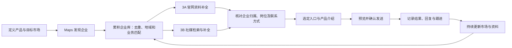

# 寻迹：海外企业获客 PRD

版本：1.1｜2026-09-25 市场社媒集成更新；发送等未实现目标仍为评审稿  
配套：[交互设计](interaction-design.md)｜[UI 设计](ui-design.md)｜[交叉评审](cross-review.md)

## 1. 产品定位与问题

寻迹面向需要拓展海外客户的企业销售人员。用户需要的结果是：在指定目标市场找到相关企业，识别值得联系的人或业务入口，发送针对性的产品介绍，并跟进回复。

当前工作台主要解决发现、整理和核验线索；新的产品目标进一步包括触达和跟进。不能用“采集到很多链接”替代“找到可联系的目标客户”。

已知问题来自用户在本项目中的反馈：重复企业消耗筛选时间，栏目名称被当成人名，普通账号被误认为采购联系人，入口散落在多处，来源不清楚，以及需要反复跳转平台才能看资料。尚无外部客户访谈或量化耗时基线。

### 用户与使用场景

- 已确认：企业获客用途；当前本地内部测试，不依赖付费方案。
- 建议主用户：外贸业务员、海外销售或负责开发市场的企业负责人。
- 起始场景：用户确定销售产品和目标城市，希望持续维护该市场名单，并优先联系采购或相关关键员工。
- 首批领域：沿用当前服装批发、零售、进口贸易场景；软件的产品定位不限定只能服务服装行业，其他行业仍需单独验证。
- 待定：首轮销售品类、目标国家/语言、日常规模、企业内有几人协作。

JTBD：当我准备拓展某个海外市场时，我希望得到可追溯、持续更新的企业和联系人清单，并知道联系谁、通过什么入口、发过什么、下一步做什么。

## 2. 产品价值假设

假设：把市场发现、联系人识别、触达与跟进放在同一流程，能减少人工搜索和整理时间，并增加与符合目标客户的有效对话。

建议验证：选定一个产品、一个市场、一套目标客户规则；对可比较样本分别记录手工和软件流程的人工耗时，计入纠错、核验、找联系方式和发送前检查。

- 成立信号：建议试点中，每条经人工确认可用线索的处理时间降低至少30%，且错误归属不增加。
- 否定信号：纠错成本抵消了节省的时间；或虽增加账号数量，却没有增加可确认的业务入口和有效对话。
- 上述30%是建议试点门槛，不是实测结果。回复率与有效对话目标待销售品类、文案、渠道和样本周期确定后制定。

## 3. 主流程与交付物

每一步必须给下一步可用的结果：企业记录、联系对象、具体渠道、待发送内容、发送结果、跟进状态。仅显示“任务完成”不能代替这些业务交付物。

## 4. 核心对象与业务口径

| 对象 | 用户理解 |
|---|---|
| 目标市场 | 地域范围＋业务条件＋关键词，是长期维护的市场，而非一次爬取任务 |
| 企业/门店 | 实际经营主体或地点；共享品牌可合并展示，不因共用官网就互相覆盖 |
| 联系人 | 有姓名/部门及相应证据的联系对象；没有具体人员证据的账号不能显示为某位员工 |
| 联系入口 | 邮箱、电话、社媒账号或已确认可提交的联系表单 |
| 岗位证据 | 支持某人承担采购或其他业务职责的原文，独立于邮箱是否存在 |
| 账号归属 | 属于企业品牌、门店、具体员工、第三方，或尚不明确 |
| 观察记录 | 某时间从某来源看到的内容，不等同于永久有效事实 |
| 触达记录 | 指定对象、渠道、内容及结果；人工补记与实际发送回执必须区分 |

“采购人员”“采购部门”“关键员工”“企业通用入口”分开表达。Owner、Founder、Merchandising 等是否属于本产品的关键岗位取决于业务场景，不能一律改成采购。

## 5. 功能需求与当前实现

以下“目标规则”为新版产品需求；当前实现单独列出，未实现项不得在产品介绍中宣称已有。

### PRD-01 产品与目标客户定义

目标规则：保存销售产品/服务、目标企业类型、排除条件、目标岗位、联系语言和可使用的产品素材。产品介绍至少可由用户手动输入，不因模板未确定而强制生成文案。

当前：**部分实现**。已有市场关键词和企业类型；没有完整的发送企业/产品资料配置或关键岗位定义。

验收：销售产品、目标客户和岗位条件可查看；未知条件标记未设置，不自动计算“成交潜力”。

### PRD-02 指定城市的企业发现

目标规则：按国家、行政区、城市、企业类型和关键词发现所有能够取得且符合条件的企业。用户不需要填写100或1000这样的名单上限。系统持续扩展查询、保留进度，并提示尚未完成的范围。

“所有能查到”是覆盖目标：必须尽可能充分查询，但没有城市企业总数的可靠分母时，不能展示“企业覆盖率100%”。展示实际使用的范围、关键词、检索轮次和遗漏风险。

地域必须区分“搜索目标城市”和“企业实际地址所在区域”；范围外、无法定位和多门店结果分开处理，不能把任务城市直接当成企业地址已核实。

当前：**部分实现**。已有关键词、近似城市范围、网格及饱和细分、运行状态；尚不具备严格地域归属验证或可证明的全城召回率。

验收：每条企业可追溯实际发现来源；范围不明、饱和、失败有下一步；运行完成仅表示本轮计划结束；换国家/州时不能提交无意保留的旧城市。

失败和能力耗尽分开：网络等可重试失败可继续处理；达到本轮预算、细分层级等策略边界时，应说明限制并调整策略，不能给出必然扩大覆盖的“继续”承诺。新一轮更新可以维护资料，但不保证找到更多企业。

### PRD-03 长期企业库、去重与增量

目标规则：重复发现更新已有记录，新企业入库；用户只需“更新市场”，无需理解增量/全量策略。同品牌不同门店可关联展示；同店搬迁须有同店身份和新地址证据，保留历史。

新增指本轮首次加入该市场，不一定是全库首次出现。存量与新增互斥；“资料变化”是独立标记，不能作为第三个互斥数量直接相加。未再次找到不等于停业。

当前：**部分实现**。累积、来源去重、市场归属和部分门店/搬迁规则已有；复杂主体合并、撤销和地域真实性仍有限。

验收：重复运行不产生同一来源实体的重复企业；同品牌门店不互相覆盖；所有自动修改可追溯。

### PRD-04 通过官网与社媒发现业务入口

目标规则：既提取官网链接，也用企业名称、公开业务电话、官网域名及城市等线索搜索 Facebook、Instagram、Twitter（X）候选账号。企业无官网或没有邮箱时仍可进入社媒发现流程。

当前：**市场集成已实现，评审问题已关闭，最终回归、构建及本地部署验收完成**。企业发现后，官网与社媒分别入队并行推进；已有市场可显式补充社媒。企业名称搜索、官网账号、基础资料读取已有；多线索身份匹配仍不完整，也不能承诺三平台每次都有结果。测试数量、数据保留及真实平台验证边界见[实施审计](../validation/2026-09-25-market-social-integration.md)。

本次已批准规则：

- 新建市场表单默认开启自动社媒，默认选择 Facebook、Instagram、X；帖子读取默认关闭。后端及旧市场缺失 `auto_social` 时默认关闭，加载页面、迁移和部署不自动重放历史市场。
- 官网和社媒为 3A/3B 两条并行补充分支；无官网企业也可搜索社媒。地图、官网、社媒三个执行通道各最多 1 项，社媒不按平台增加并发额度。
- 稳定优先：每个平台正常间隔 60–120 秒；网络/限流依次冷却 10、30、120 分钟，最多 3 次自动恢复，之后转人工。登录/验证只暂停受影响平台；即使在已读到资料后的滚动或帖子读取中遇到登录/验证，也保留有效预览并显示真实等待原因，其余平台和地图/官网可继续。
- 每家企业每轮最多读取 8 个候选账号的基础资料，所有发现的候选证据仍保存。开启近期帖子后复用已有读取器，单次账号读取默认 3 条、最多 5 条；不是完整历史，也不保证达到上限。
- 市场设置只影响后续自动执行；轮次保留自己的平台/帖子快照。在设置中修正连接并显式恢复平台后，待执行项使用新连接，本轮业务范围不变，也不能跳过未来冷却。已有市场的“补充社媒资料”须显式点击：加入当前活动轮次，或在旧轮已结束时新建仅社媒轮次，旧轮次与报告不改写。
- 暂停/取消作用于该市场轮次及其关联社媒。旧领取的迟到结果不能更新资料或扩展队列；账号在读取期间被标为“不采用”时停止该读取，并丢弃迟到的新资料和帖子，保留此前证据。
- 相同企业手动发起的独立社媒任务仍独立；市场子运行不会禁用企业内的独立搜索/补资料按钮，也不能被复用为手动独立运行。独立任务仍遵循自身的防重复提交与执行限制。

验收：主进度按企业计数，平台数量不相加当市场企业数；正常无结果计成功，登录、冷却和排队不计结束。Maps/官网上游未关闭前，总量可增加，暂时处理完已知账号不代表本轮全部完成。“无结果”“读取失败”“需要登录”“未尝试”可区分，等待原因、下次尝试及人工恢复入口可见。打开页面不自动发起补充、打开外部平台或发送消息。详细状态与预算见[市场社媒技术设计](../technical/market-social-integration.md)。

### PRD-05 采购与关键员工识别

目标规则：从公开资料识别具名人员或采购部门，保存岗位、所在企业、联系字段及各自证据。不能把产品栏目、文章标题或页面邻近文字拼成人员资料。

人员可能关联多个渠道；确认企业账号归属不等于确认某个采购员工。关键员工必须显示实际岗位及与本销售场景的关系，不能用一个“员工”标签代替。

当前：**部分实现**。官网有人员与岗位提取、过滤；社媒字段主要停留在账号资料，尚未形成具体人员、岗位与账号/邮箱的统一确认链路。

验收：每个采购/关键员工标签均能查看对应岗位证据；具体人员与邮箱/账号有单独归属依据；证据不足降为普通线索。

### PRD-06 统一联系人/账号列表与不重叠计数

目标规则：统一入口，列表保持“联系人/账号、联系渠道、企业关系、更新时间”四列，点入详情看证据、帖子及操作。

排序建议：采购人员/部门优先，其次经确认与业务相关的关键员工，再到其他可尝试入口。没有明确采购身份的正常业务入口仍有价值，不能全部排除。招聘、隐私投诉、建站服务商等明确非开发用途入口不计入可联系名单。

去重规则：同一已确认人员的多个渠道聚合展示；同平台同账号、同邮箱去重。已归入采购/关键人员的入口不再重复列为其他账号/邮箱。归属尚不明确时不能强行合并两个人。

计数必须注明单位：人数、部门/入口数、账号数或邮箱数；不同单位不相加当作“联系人总人数”。

归类优先级：采购 > 其他关键员工 > 其他社媒账号/其他邮箱；同时符合采购与关键员工的人员只归采购。两个人共用邮箱不合并成一个人，共享入口仅计一次并保留两人的关联；多门店共用账号同理。发送按实际入口核对历史，不能按门店重复触达。

主可用计数包含已采用或无冲突自动收录的入口；岗位未明确的正常业务入口仍可计入。归属待核实或存在冲突的记录单列“待确认”，不混进已可用数量；不采用、无效和非开发用途排除。是否采购与是否可用是两个维度。

建议计数示例（均假设归属证据已确认）：

| 情况 | 人员与入口的展示/计数 |
|---|---|
| 同一采购经理同时属于关键员工，有邮箱和个人Instagram | 采购1人、关联2个入口；关键员工不再重复计该人，其他邮箱/社媒不重复计该入口 |
| 两名采购员工共用一个部门邮箱 | 采购2人、共享邮箱1个；两人独立，公共邮箱作为共享入口，不生成两次发送 |
| 三家门店共用一个品牌账号 | 每店可见关联；同一市场的唯一品牌账号1个，门店关联3条；不把3条关联称为3个账号 |
| 岗位未知但确属企业的通用邮箱；另有归属不明账号 | 可用其他邮箱1个；待确认账号1个，不显示采购人员 |

当前：**部分实现**。统一四列表、采购优先、部分去重和无关信息过滤已有；关键员工分类及跨平台同人关联未完整实现。

验收：同一入口不重复计数；列表无招聘等明显无关入口；正文与岗位不串位；帖子只出现在详情。

### PRD-07 持续更新与冲突处理

目标规则：空字段被新值自动补全；仅格式不同不要求审核；失败或未读取到字段不清空旧值。真正的归属冲突、来源矛盾和人工确认值变化才需处理。旧资料保留自己的采集时间，缓存复用不伪造新采集时间。

当前：**已实现主要规则**，仍需随着真实样本验证过滤和冲突覆盖范围。

验收：空值、格式变化、真实变化、读取失败和缓存复用分别有正确结果与证据；用户不用反复审核相同无意义变化。

### PRD-08 选择指定入口并准备内容

目标规则：从联系人或账号进入“准备联系”，明确显示企业、具体对象、渠道和收件地址/账号。企业通用入口可作为备用，不伪装成采购人员。

产品介绍格式待定。建议最小内容能力：手写邮件主题/正文、社媒正文和明确发送方身份；正文可包含普通文本链接。结构化产品链接、签名、附件及模板变量作为待定扩展，不是首版草稿或发送验收前置条件。用户必须能修改并预览最终内容。

当前：**未完整实现**。仅已确认社媒入口可以保存草稿/跟进备注，邮箱联系人没有统一准备与跟进入口。

验收：邮箱和社媒均可选择具体目标并保存独立草稿；切换对象不沿用上一对象内容而不提示；返回页面不丢草稿。

### PRD-09 实际发送邮件/社媒消息

这是本轮新增明确目标，取消旧需求文档将“发送”永久排除的范围定义。具体连接方式、发件账号、平台能力和发布顺序仍待验证，不在本稿中假定已经可用。

建议目标规则：

- 第一阶段以用户选定的单个目标、单次确认发送为基线，不默认自动群发。
- 发送前展示确切收件入口、发送账号和最终内容；发现账号与发送身份分别管理。
- 通道不可发送时明确显示原因，可保存草稿或提供外部手动联系入口；外部打开不计作软件已发送。
- 结果至少区分：未发送、发送中、服务方已受理、失败、结果未知。是否送达/已读仅在取得相应凭据时显示。
- 服务方受理后收到退信或后续失败时，显示“投递失败”并保留先前受理凭据，不继续显示成功。
- 超时后结果未知时先核对记录，不盲目重复发送。
- 拒绝联系企业或入口不进入发送；共享品牌账号需要展示既有联系，避免多个门店重复触达。
- 预览及最终提交时再次检查入口采用、归属冲突、拒绝联系和通道状态；不采用或归属冲突未解决的入口不能直接发送。正常企业通用入口不要求具备采购身份。

当前：**未实现**。没有邮件投递、社媒发送或可靠发送结果链路。当前登录浏览器用于读取资料，不证明能够发送。

验收：真实受控收件对象收到与预览一致的内容；重复点击/重试不重复触达；失败和未知状态不显示已送达。邮件和每个社媒通道分别验收，不以一个平台通过替代全部。

### PRD-10 回复与销售跟进

目标规则：按企业和联系对象查看联系历史、回复、下一步和停止联系状态。自动同步、手工补记及外部发送须分别标明来源。

当前：**部分实现**。社媒有人工 draft/contacted/replied/closed 记录；没有邮件统一跟进、回复同步或销售结果统计。

验收：人工标记“已回复”与实际收取的回复有明显区分；无回复、发送失败、对方拒绝不能混用；拒绝联系能阻止后续发送。

### PRD-11 导出、定时维护与数据可追溯

目标规则：保留现有企业导出，同时增加“联系入口级”导出：企业、人员/部门、岗位、渠道、具体地址/账号、来源、归属状态、采集时间和联系状态。明确是否包含待确认入口，默认排除不采用和拒绝联系。

手动/定时更新、备份恢复继续支持。定时计划须说明应用运行/电脑唤醒条件。

当前：**部分实现**。CSV企业表、XLSX企业/联系人/地点/来源、计划及备份已有；完整社媒入口与触达历史导出未实现。

验收：导出数量对应当前筛选范围；不同表关联正确；账号不被导成空邮箱；备份恢复保留来源与人工决定。

## 6. 版本与验收边界

| 阶段 | 建议交付 | 放行标准 |
|---|---|---|
| 当前基线 | 发现、整理、核验、导出、部分跟进记账 | 按现有能力描述，不能称完整获客闭环 |
| 本次市场社媒集成 | 三通道并行、平台独立等待、已有市场显式补充 | 最终回归与本地部署验收完成；稳定优先，历史不重放，暂停/取消及迟到结果隔离 |
| V1-A 线索可用 | 地域/业务归属、人员与入口关联、统一联系选择与草稿 | 抽样逐条可核对，具名人员和普通入口不混淆 |
| V1-B 邮件闭环 | 待确认发件方式、人工确认发送、结果与跟进 | 受控真实投递与重复发送保护验收通过 |
| V1-C 社媒闭环 | 按Facebook、Instagram、X分别验证、逐个开放 | 每个通道独立完成发送与结果验证；不可用则保留明确的手动路径 |
| 后续扩展 | 批量编排、多用户分工、更多市场/语言、自动回复同步 | 日常使用规模和真实获客效果得到验证后另立需求 |

以上顺序为建议，不是用户已选择邮件优先，也不是承诺各平台均能自动发送。平台能力与允许使用范围作为上线依赖验证；本轮没有完成相关外部评估。

## 7. 质量、指标与验证方法

| 指标 | 定义与验证 | 当前状态 |
|---|---|---|
| 可追溯率 | 抽查的自动记录中，能定位来源与时间的比例；目标100% | 有记录机制，业务验收待做 |
| 目标企业正确率 | 人工抽查符合地域＋业务条件的企业/抽查企业 | 基线待测 |
| 采购身份正确率 | 人工确认岗位与人员关联正确的记录/标为采购的样本 | 建议验收样本中错误关联为0；不保证总体100% |
| 可用线索处理耗时 | 含发现、纠错和确认的人工分钟数/确认可用线索 | 与手工基线比较，建议降低30% |
| 重复率 | 未归并的同一企业或入口/抽查记录 | 分企业、人员、入口统计；基线待测 |
| 市场检索完整性 | 查询范围、已尝试任务、饱和/失败区域与轮次 | 不冒充全城企业覆盖率 |
| 触达结果 | 实际受理/失败/未知数量；有送达凭据才统计送达 | 未实现 |
| 有效对话率 | 对方回复且符合约定业务含义的对象/实际触达对象 | “有效”定义与目标待定 |

小样本建议至少覆盖：有官网、无官网、无采购人、同品牌门店、同名异企、第三方社媒链接、登录失败、地域范围外、无关邮箱、字段更新冲突。报告实际分子分母，不把空样本当100%通过。

## 8. 不纳入本轮默认范围

- 用虚构企业或推测邮箱填补缺失结果。
- 承诺任何城市的绝对全量、所有账号可读、所有通道可发送。
- 未经用户选择自动群发、自动评论或自动承诺商业条件。
- 把打开主页、点击发送按钮或人工补记当成送达证明。
- 本轮直接建设计费、多租户、完整CRM或自动成交预测。

## 9. 待定事项

| 编号 | 待定项 | 影响 | 可先继续的内容 |
|---|---|---|---|
| Q01 | 销售产品/服务、目标岗位及关键员工定义 | 客户筛选、优先级、文案 | 通用流程与来源规则 |
| Q02 | 发件邮箱、发件主体和可连接方式 | 邮件闭环实施 | 收件入口与草稿交互 |
| Q03 | 社媒发送账号、首个开放平台、允许使用范围 | 通道可行性、发送结果语义 | 候选核对与通道能力展示 |
| Q04 | 产品介绍格式、语言、链接/附件、模板变量 | 编辑器与预览 | 手写内容和草稿结构 |
| Q05 | 团队人数、目标地区/语言、日处理规模 | 协作、容量与版本排期 | 单人本地测试 |
| Q06 | 回复同步还是先人工记录、何谓有效对话 | 效果指标与跟进闭环 | 明确人工/自动记录区别 |
| Q07 | 发布市场的数据使用和发送要求 | 对外上线条件 | 不冒充已获许可；继续内部功能验证 |

待定项由产品负责人提供业务输入，渠道可行性由实现与测试共同验证；不得因为本轮文档评审而标为已解决。
