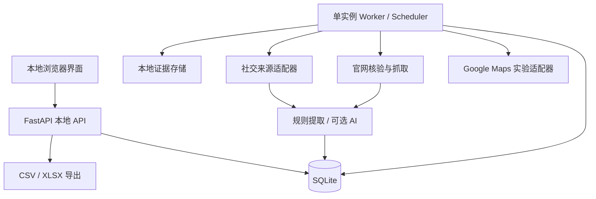

# 本地销售线索工作台：技术设计

> 历史技术建议稿，不是现行架构清单。当前产品目标见 [新版产品文档](product/README.md)；已实现的架构与拆分参考 [架构评审](audits/2026-09-23/系统架构与代码结构评审.md) 和 [修复记录](audits/2026-09-23/架构修复与模块拆分.md)。下文未采纳的技术选型、旧功能边界不作为现行实现依据。

版本：0.2（文档修订；产品目标仍为 v0.1）  
日期：2026-09-22  
状态：建议架构，未实现、未完成容量或采集可行性测试  
需求依据：[需求文档](./requirements.md)

选型补充：[免费本地爬虫调研](./crawler-research.md)。本次新增现成 Maps 爬虫作为 M0 验证候选，并明确不使用付费依赖。

## 1. 设计目标与边界

在单台电脑上完成真实企业发现、证据保存、官网核验、采购联系人补全、人工审核、导出及定期复核。

技术选择以容易调试、断点恢复和数据可追溯为优先。第一版不采用分布式爬虫、消息集群或微服务，也不把地图、官网、社交媒体混成一个不可替换的脚本。

本文给出模块、数据契约和验证方法，不表示 Google Maps 的技术与使用范围问题已经解决。任何来源不可用时须显式报告，不用模型生成结果兜底。

## 2. 方案选择

| 方案 | 优点 | 代价 | 决策 |
|---|---|---|---|
| 命令行脚本＋CSV | 最快验证采集 | 任务恢复、审核与历史管理弱 | 仅可用于 M0 独立试验 |
| 本地网页＋后台任务＋SQLite | 审核方便，部署组件少，数据本地化 | 要实现进程与任务管理 | 推荐 v0.1 |
| 桌面壳＋本地后端 | 安装、托盘和通知体验更好 | 打包及跨平台成本较高 | 流程稳定后再做 |

### 2.1 推荐技术栈

下表是新项目的建议选择，不是已安装或经本项目实测的版本清单。实施开始时验证兼容性并锁定依赖，不在本稿中虚构最新版本号。

| 层 | 建议 | 原因 |
|---|---|---|
| 前端 | React＋TypeScript＋Vite | 适合任务表格、详情及审核交互 |
| 本地 API | Python＋FastAPI＋Pydantic | 与采集、解析、校验代码共用语言 |
| Maps 验证候选 | gosom/google-maps-scraper 本地程序 | M0 先验证现成工具；未经实测不直接确定产品采用 |
| 浏览器自动化 | Playwright Python＋Chromium | 自建 Maps 备选及动态官网读取；官方提供 Python API [T1] |
| 静态页面读取 | HTTPX＋HTML 解析器 | 先静态读取，必要时才启动浏览器 |
| 数据层 | SQLite＋SQLAlchemy＋Alembic | 单机持久化与可控迁移 |
| 队列 | SQLite 持久化任务表＋独立 worker | 无需 Redis；能恢复和检查每步状态 |
| 调度 | worker 内持久化计划扫描 | 避免仅存在内存的定时任务 |
| 导出 | Python CSV＋openpyxl | 企业、联系人、地点多表输出 |
| AI | 本版规则提取；预留本地模型接口 | 不调用在线模型，不产生付费运行依赖 |

备选 Node 全栈同样可行；当前推荐 Python 是为集中采集、解析和后台处理，并非认定其浏览器能力必然优于 Node。

### 2.2 免费运行约束与验证顺序

- 不接入付费 Maps／搜索 API、托管爬虫、付费代理、验证码服务、联系人或邮箱验证 API。
- 不依赖限时试用、赠送额度或在线模型。
- 使用当前现有网络；连通性不足时报告阻塞，不自动采购替代服务。
- M0 优先验证 gosom 本地程序，通过隔离子进程适配，不自动安装其附带技能或云服务。
- 若输出证据、错误识别或停止控制不能满足本项目契约，则转用自建 Playwright。
- 第三方代码采用前核查实际版本、许可证、网络行为、遥测和数据输出，不直接信任 README 中的性能或稳定性宣传。
- Crawlee、Scrapy、Crawl4AI 作为后续备选，不同时叠加进首版运行链路。

## 3. 运行架构



建议一个启动入口同时管理 API 和 worker。前端构建后由本地服务提供静态文件；开发时才使用独立 Vite 服务。

- API 和 worker 为不同进程；默认各一个实例。
- 浏览器由 worker 管理，不能在 API 请求内执行长时间采集。
- 前端定期读取进度；第一版可轮询，不必引入 WebSocket。
- API 仅绑定回环地址；不向局域网暴露。
- SQLite 启用 WAL，使用短事务和 busy timeout；WAL 仍不能消除单写入者约束。[T3]
- SQLite 数据文件放本地磁盘，不放共享网络文件系统。
- API 负责用户编辑和入队，worker 负责采集结果；都须遵守短事务与冲突重试。

## 4. 本地数据与配置

建议默认根目录为用户选择的应用数据目录，macOS 可使用：

```text
~/Library/Application Support/LocalLeadWorkbench/
  config/
  data/lead-workbench.sqlite3
  evidence/
  browser-profile/
  logs/
  exports/
  backups/
```

- 本地访问令牌和外部服务密钥不写入日志、导出或浏览器前端；敏感配置优先使用系统凭据存储。
- 浏览器使用独立应用 profile，不复用用户日常浏览器配置。
- 默认不开启账号登录采集；确需人工处理的页面由用户自行查看。
- 日志默认 14 天轮转；原始诊断证据建议最长 7 天，但来源规则可能更短或禁止保存。
- 结构化记录按来源规则保存，不设置“一律永久”的全局开关。
- 删除来源证据后保留非敏感事件与证据已过期标志，不假装证据仍可查看。

## 5. 数据模型

字段清单体现关键契约，实施时再细化索引和迁移。

| 实体 | 关键字段 | 作用 |
|---|---|---|
| Region | id、parent_id、country_code、admin_level、名称、别名、bounds、boundary_source | 地区层级与查询范围 |
| CollectionTask | id、region_id、关键词配置、企业类型、limits、source_id、状态 | 用户创建的任务模板 |
| TaskRun | id、task_id、trigger、配置快照、开始结束时间、stop_reason | 一次不可变配置的运行 |
| Query | id、run_id、文本、locale、范围、状态、checkpoint | 实际查询子任务 |
| Job | id、run_id、阶段、目标、幂等键、lease、attempt、状态 | 可恢复执行单元 |
| SourcePolicy | id、source、permissions_status、可保存字段、证据规则、reviewed_at | 来源使用规则记录 |
| SourceListing | id、source、source_key、来源链接、首次最后发现时间 | 来源条目身份，不等同企业 |
| ListingObservation | id、listing_id、query_id、观察时间、发现定位、证据引用 | 每次真实发现的出处 |
| Company | id、展示名、注册名可空、domain、核验状态、分类 | 企业主体 |
| Location | id、company_id 可空、名称、地址、经纬度可空、类型、证据 | 总部、分店、仓库等 |
| CompanySourceLink | company_id、listing_id、match_status、match_basis | 来源与企业的可审核关联 |
| Contact | id、company_id、姓名／部门、岗位、身份状态 | 人员或部门 |
| ContactChannel | id、company_id、contact_id 可空、类型、值、归属状态、技术检查 | 邮箱、电话、表单、供应商入口 |
| FieldObservation | entity_type/id、field、value、source_url、observed_at、method、evidence_id | 来源级字段事实 |
| FieldSelection | entity/field、selected_observation_id、manual_override、review_state | 当前显示值及人工保护 |
| ReviewItem | id、类型、涉及实体、候选值、决策、时间 | 重复、冲突与身份审核 |
| ChangeEvent | entity/field、旧新事实引用、原因、时间、run_id | 审计与更新变化 |
| SalesNote | company/contact、备注、跟进状态、拒绝联系 | 与爬虫字段分离的业务信息 |
| Schedule | id、目标、类型、interval_months、timezone、next_due_at、enabled | 定时发现或复核 |
| ScheduleOccurrence | schedule_id、due_at、run_id、状态 | 防止重复调度 |
| Evidence | id、来源、定位、短片段、hash、expires_at、storage_path 可空 | 可核验内容；权限决定保存范围 |

### 5.1 关键关系

- 一个任务多次运行，一次运行包含多个 Query 和 Job。
- 一个来源条目可被多个查询发现，以 Observation 保留所有发现出处。
- 一个企业可有多个来源、地点和联系人。
- 地点尚未确定所属企业时允许 company_id 为空，不强行合并。
- 官网同一页有多个人员和多个邮箱时，关系不明的邮箱先挂企业，不能猜对应人员。
- “当前值”与“观察事实”分离，保留来源冲突和人工确认值。
- 同一来源对象优先用可靠 source_key 去重；无法取得时使用规范来源链接，名称地址指纹仅用于疑似重复。

## 6. 来源适配器契约

每个来源单独声明能力，避免前端假设所有来源都支持同一字段。

```text
capabilities():
  discovery, refresh, public_contact_extraction,
  can_store_fields, can_store_evidence, requires_manual_review

discover(query, limits, checkpoint)
  -> ListingObservation[] + next_checkpoint + completion_reason

refresh(source_listing, previous_observations)
  -> Observation[] + explicit_missing_fields + diagnostics

health_check()
  -> available | manual_action_required | unavailable
```

统一错误类别：

`NETWORK_ERROR`、`RATE_LIMITED`、`LOGIN_REQUIRED`、`CAPTCHA_REQUIRED`、
`ACCESS_DENIED`、`PARSER_CHANGED`、`OUT_OF_REGION`、`SOURCE_POLICY_UNRESOLVED`。

限制和解析变化不能都当作网络错误无限重试。来源策略与执行方式独立：能获取的数据也必须按策略决定是否保存。

## 7. 地区与查询规划

### 7.1 地区数据

- 使用可导入的地区注册表：国家、行政区、城市、别名和坐标。
- GeoNames 可作为候选地区数据来源；使用时保留其数据许可与署名要求。[T4]
- 城市点坐标不等于行政边界。边界需另有来源；若没有，仅定义可见的近似范围。
- 国际行政层级不强制所有国家都是三级；界面根据 parent_id 生成路径。

### 7.2 查询计划

1. 用户选择地区与企业类型。
2. 生成明确关键词列表，用户可以预览。
3. 按来源支持能力生成位置上下文及子区域查询。
4. 计划保存后才执行；新增子区域记录为计划扩展。
5. 对近似范围结果标明位置判断依据，无法定位的不自动认定在城内。

建议初始限制：最多 100 家去重企业、30 个子查询、60 分钟。三者均为产品保护限额，不是平台允许请求量的声明。

结果达到页面可见上限时，可在计划预算内细分区域；细分只改善检索覆盖，不证明全量。地图网页结果上限不得套用 Places API 的 60 条规则。

## 8. Google Maps 实验适配器

### 8.1 定位

第一版目标是验证真实可追溯的页面发现。M0 首先验证 gosom 本地程序，必要时转用自建 Playwright。下文 8.2～8.3 描述自建适配器及候选适配器必须满足的产品控制要求，不代表第三方程序已经具备这些能力。

第三方输出经过包装层转换为 Observation，不直接写企业主表。每次运行记录版本、查询和配置；有部分输出但因限制退出时标记 partial／blocked。候选工具续跑选项只用于中断恢复，定期复核必须重新抓取旧记录。

官方 Places API 不纳入当前免费运行方案，后续若考虑需独立评估，不静默替换网页方式。

### 8.2 执行流程

1. 以明确 locale、地区上下文和关键词打开查询页面。
2. 等待可识别结果列表、空结果提示或阻塞提示。
3. 分批观察结果条目，提取页面实际提供的来源链接。
4. 顺序打开详情，读取可见字段；不依赖未公开私有接口。
5. 记录 query_id、来源定位、观察时间及解析版本。
6. 持久化结果与检查点后继续下一批。
7. 列表明确结束、重复批次达到阈值、限额或阻塞时终止。

页面选择器优先可访问性角色和稳定结构，集中在适配器中。文本标签按语言配置，不能散落在业务逻辑。

### 8.3 页面变化与停止条件

- 默认 Google 浏览器并发 1；每次页面动作需等待当前状态明确。
- 如“结果数为零”但没有明确空结果结构，标记 `PARSER_CHANGED`。
- 连续两批只有已见条目可结束当前滚动，但记录停止原因，不能宣称无更多企业。
- 页面刷新后检查点不可原样恢复时重放当前查询，并通过来源键防重。
- 验证码、登录、访问拒绝暂停当前来源，禁止自动破解或轮换身份继续。
- 单来源连续失败触发暂停；官网补全等不依赖该来源的任务可以继续。

### 8.4 来源记录

地图详情与官网事实分别存储来源。转到官网后重新提取的字段必须拥有官网自己的观察证据，不能只修改来源标签。跨来源使用范围仍需单独评估。

## 9. 官网读取与企业身份核验

### 9.1 URL 和身份

- 从来源实际提供的 URL 出发，不通过模型猜域名。
- 规范 scheme、host、默认端口、fragment 和追踪参数；保留影响内容的参数。
- 核查展示名、品牌、地址、电话；发生同名或跳转到其他企业时转人工。
- 禁止把共享平台域名、目录域名作为企业唯一身份。
- 如需通过搜索补官网，后续接入真实搜索适配器并保存查询与结果；v0.1 没有则标记缺失。

### 9.2 页面预算

建议每个域名最多 20 个页面、链接深度 2；优先联系、团队、关于和供应商页面。静态请求超时建议 20 秒，浏览器导航建议 45 秒，均可配置。

先 HTTP 请求，页面确需 JavaScript 时才使用浏览器。遵循站点适用规则；robots.txt 是抓取提示，不是数据使用授权。

不提交表单、不登录、不购买、不发送消息。站点无采购信息时正常结束并记录未找到。

### 9.3 安全边界

防止采集链接访问本地服务或云元数据：

- 仅允许 HTTP/HTTPS。
- 拒绝环回、私网、链路本地、组播及保留 IP，覆盖 IPv4/IPv6。
- DNS 解析、每次重定向、浏览器子资源连接都检查目标；不能只验证初始 URL。
- 采用校验后的连接目标或等效机制，防止 DNS 重绑定和检查使用间隔问题。
- 限制响应体、重定向次数和下载文件大小；不执行下载文件。

网页和模型输出均为不可信数据，不得形成 shell 命令或未经验证的数据库操作。

## 10. 联系人提取与核验

### 10.1 规则优先

提取可见文本和 `mailto:` 中的地址，保留 DOM 定位或文本偏移。岗位词典包括 Buyer、Purchasing、Procurement、Sourcing 及对应本地语言，但须检查上下文。

同一人物卡片内的姓名、岗位、邮箱可以形成候选关联；不在同一明确语义区块时转人工。

邮箱清理包括空格和尾部标点，但不推测缺失字符。规范化域名用于比较，保留原始地址；不得对所有域名一律移除加号或点号。

### 10.2 证据约束

建议提取输出结构：

```json
{
  "company_id": "uuid",
  "person_name": null,
  "role": "Purchasing",
  "email": null,
  "channel_type": "supplier_form",
  "source_url": "实际取得的来源页面",
  "evidence_locator": "可定位到实际页面内容的位置",
  "role_status": "department",
  "association_status": "company_only",
  "method": "rule"
}
```

schema 验证后还需确认实体和值出现在证据中。字段缺失合法，虚构值不合法。

### 10.3 邮箱检查

第一版仅做格式和可选 DNS 邮件配置检查。MX 不存在时还需区分隐式邮件路由、明确 Null MX、域名不存在和临时 DNS 失败，不能简单“没有 MX＝邮箱无效”。

不使用 SMTP 探测或测试邮件。技术状态绝不转换为“收件人有效”。如果后续接入第三方校验，应保存服务、时间、原始状态及未知／catch-all，不保证个人身份。

### 10.4 社交媒体

从官网关联账号起步，每个平台一个适配器和能力声明。无可用读取权限时仅保存允许记录的账号入口并提示人工核验。

从社交页面发现人员后，不能仅以相同姓名关联另一网站邮箱。任职与邮箱关系分别保存证据。

### 10.5 可选 AI

只传入预算内页面正文、目标 schema 和已取得的企业上下文。输出必须带证据定位并通过规则复查。不允许模型自主访问任意网址、调用系统命令或发消息。

本版 provider 默认关闭且不调用在线模型。若后续评估本地模型，须检查硬件与模型许可，继续执行相同证据校验。未来在线服务单独评估，不作为本版功能依赖。

## 11. 去重与企业归属

按以下顺序处理：

1. 相同来源稳定键：同一来源条目重复观察。
2. 已确认同一企业的官方域名与身份依据：关联原企业。
3. 名称、地址、电话和域名组合：生成疑似重复，不凭单字段自动合并。
4. 连锁店、加盟店和共享客服电话：保留多个地点，企业归属不确定则审核。

所有合并生成事件并保留被合并 ID 的指向。撤销合并需恢复实体及来源关联，不能仅重建一条名字相同的新记录。

数据库唯一约束用于明确身份，例如 `(source, source_key)`；source_key 缺失时不强制错误唯一性。

## 12. 队列、状态与断点恢复

### 12.1 状态

```text
Job:
queued -> running -> succeeded
                  -> retry_wait -> queued
                  -> manual_action_required
                  -> failed
                  -> cancelled

TaskRun:
queued -> running -> completed | partial | blocked | failed | cancelled
running -> pausing -> paused -> running
```

暂停发生在安全检查点。取消停止派发新工作，已完成结果保留；在途结果按可取消性处理并记录最终状态。

### 12.2 幂等与租约

- worker 用短事务领取 job，写入 lease_owner 和 lease_expires_at。
- 同一 `(run_id, stage, target_key)` 只有一个有效 job。
- 心跳续租；进程退出后租约过期可重新领取。
- job 结果写入与成功状态在同一事务提交，避免“已成功但无结果”。
- 失败重放允许再次抓页面，但不会重复创建企业或联系人。
- manual_action_required 不因重启而自动无限重试。

### 12.3 重试

网络故障与临时限流最多重试 3 次，指数退避，尊重 Retry-After，并受任务总时间限制。

登录、验证码、访问拒绝、解析变化及来源策略未解决不自动重试。后台日志明确区分抓取、解析、保存与审核失败。

## 13. 增量更新与调度

### 13.1 更新不等于重写

1. 创建新 run，引用当前字段作为比较基线。
2. 抓取后新增 FieldObservation。
3. 同来源成功确认相同值：更新最近成功检查时间。
4. 新值与旧值不同：生成 ChangeEvent；冲突或人工保护值进入审核。
5. 抓取失败：只记录失败，不修改当前值。
6. 内容不存在：记录该次未观察到；不自动判断停业、离职或永久失效。

原始发现时间、最近观察时间、最近成功检查时间分开保存。

### 13.2 日历周期

- 时间戳存 UTC；Schedule 同时保存 IANA 时区。
- 3 个月为日历月，不按 90 天处理。
- 月末日期不存在时取目标月最后一天；保留原始锚定日，避免永久漂移。
- 夏令时不存在时间顺延到当日下一个有效时刻，重复时间执行一次。
- 唯一约束 `(schedule_id, due_at)` 防止重复创建同一到期实例。
- 程序恢复后将多个错过时点合并为一次补跑，再按原日历锚点计算下一次未来时点。
- 同一目标更新仍在运行时不并发启动重复更新。
- 禁用计划不删除历史；是否取消已经排队的实例由界面明确选项决定。

## 14. 本地 API 契约

所有接口默认带本地会话令牌；写接口校验 Origin，限制 CORS，防止外部网页调用本地服务。

| 方法与路径 | 作用 |
|---|---|
| GET `/api/regions` | 查询地区与父子层级 |
| POST `/api/tasks` | 创建配置，返回任务 ID |
| POST `/api/tasks/{id}/runs` | 手动执行，立即返回 run ID |
| GET `/api/runs/{id}` | 进度、指标、结束原因 |
| POST `/api/runs/{id}/pause` | 请求在安全点暂停 |
| POST `/api/runs/{id}/resume` | 继续允许恢复的运行 |
| POST `/api/runs/{id}/cancel` | 取消未完成工作 |
| GET `/api/companies` | 分页筛选 |
| GET `/api/companies/{id}` | 企业、地点、联系人及证据 |
| PATCH `/api/companies/{id}` | 人工编辑，带修订号 |
| POST `/api/companies/{id}/refresh` | 单企业复核 |
| GET `/api/reviews` | 待审核项 |
| POST `/api/reviews/{id}/decision` | 确认或拒绝，记录决策 |
| POST `/api/schedules` | 创建定时发现／复核计划 |
| PATCH `/api/schedules/{id}` | 修改或禁用计划 |
| POST `/api/exports` | 按筛选快照生成导出 |
| POST `/api/backups` | 创建一致性备份 |

启动、导出等可重复提交动作接受 idempotency key；人工编辑使用 revision 防止覆盖另一处更新。

## 15. 导出、备份与恢复

- XLSX 分为 Companies、Contacts、Locations，包含稳定关联 ID。
- CSV 分别导出相同实体；文本 UTF-8，提供适合 Excel 打开的编码选项。
- 防止公式注入：名称、备注等来自外部的文本不得作为公式导出；CSV 对危险开头做安全转义。
- 导出默认排除拒绝联系记录，导出筛选条件及生成时间写入元信息。
- 备份使用 SQLite 一致性备份机制；不能只复制运行中的主数据库而遗漏 WAL 中的提交。
- 备份包含 schema 版本和可保存证据清单，不默认包含凭据与浏览器会话。
- 恢复前停止 worker、备份当前库、验证完整性及迁移兼容；失败保留原库。

## 16. 测试与观测

### 16.1 有意义的测试

| 范围 | 用例 |
|---|---|
| 来源解析 | 正常列表、空列表、验证码、结构变化必须得到不同状态 |
| 身份匹配 | 同名不同企业、共享平台域名、连锁多地点、加盟关系不明 |
| 联系人 | 多人多邮箱、客服与采购同页、历史员工、未公开邮箱 |
| 幂等 | 同一发现任务重放、worker 崩溃在事务前后、租约回收 |
| 更新 | 页面失败不清空值、来源冲突、人工修正不被覆盖 |
| 调度 | 月末、夏令时、休眠错过多期、重复启动 |
| 安全 | 重定向到私网、DNS 变化、浏览器子资源访问本地、网页提示注入 |
| 导出恢复 | CSV/XLSX 公式注入、中文、稳定 ID、WAL 活跃期间备份恢复 |

解析测试使用允许保留的最小化或合成页面片段。合成数据必须标记为测试夹具，禁止进入真实客户库或业务验收统计。

### 16.2 实测指标

每个 run 记录：

- 查询尝试／成功／阻塞数量及结束原因。
- 来源条目、去重企业、重复候选、错误合并审核数。
- 官网确认率、业务匹配率、采购岗位证据明确人数。
- 至少一个明确采购入口的企业数／成功完成补全的企业数。
- 公开个人采购邮箱对应明确的企业数／成功完成补全的企业数。
- 未完成补全比例，防止只用成功样本掩盖失败。
- 抓取时间、审核人工时间、外部服务调用成本。

指标按公司和联系人分开计算，不能用联系人条数充当企业覆盖率。

## 17. 技术验证与实施阶段

| 阶段 | 技术产物 | 通过标准 |
|---|---|---|
| M0 | gosom 候选验证，必要时对比自建 Playwright，输出来源实验报告 | 真实查询可追溯；检查证据、停止与错误识别；5 个查询持续阻塞时暂停该路线而不是伪造结果 |
| M1 | 本地 API/UI、队列、企业库、来源记录、导出 | 完成 FR-01～03、FR-08～09 主流程及恢复验证 |
| M2 | 官网与联系人流程、社交能力声明、审核 | 完成 FR-04～06、FR-10；误配测试通过 |
| M3 | 调度、历史、备份、全流程验收 | 完成 FR-07 和 AC01～AC14；披露实测不足 |

M0 的源码、测试结果、限制与失败都应保留。一次成功页面抓取不能证明跨城市、语言和时间的稳定性。

建议容量试验从 20 家开始，再扩至最多 100 家；只有新瓶颈出现才引入更多并发或基础设施。没有测量数据前不给出每小时企业数的保证。

## 18. 未关闭的依赖与决策

| 项目 | 当前处理 | 解决方式 |
|---|---|---|
| Google Maps 长期保存与使用范围 | 独立标记未评估；不承诺永久授权 | 来源使用范围确认与必要授权 |
| Maps 页面稳定性 | 实验适配器 | M0 实测 |
| 销售产品 | 不做成交倾向评分 | 用户补充后配置匹配规则 |
| 全球地区与城市边界 | 首先支持美国，边界缺失则明确近似 | 逐国地区数据与许可评估 |
| 社交平台采购信息 | 逐来源能力声明，人工入口兜底 | 平台许可接口或公开来源验证 |
| 联系人发现率 | 未知 | M2 真实样本测量 |
| Windows 安装与后台常驻 | 非首轮交付 | macOS 流程稳定后适配 |
| 商业授权、团队权限及费用 | 不在 v0.1 中实现 | 商业化前单独设计 |

## 19. 参考资料

外部文档用于核对能力，不表示本项目实现已经通过验证。Google 和 LinkedIn 的使用限制见需求文档 [S1]～[S4]。

- [T1] Playwright Python 文档。`https://playwright.dev/python/docs/intro`
- [T2] FastAPI 部署进程文档。`https://fastapi.tiangolo.com/deployment/server-workers/`
- [T3] SQLite Write-Ahead Logging。`https://sqlite.org/wal.html`
- [T4] GeoNames 数据导出及许可说明。`https://www.geonames.org/export/`

技术栈的实际依赖版本、浏览器版本和锁文件在项目初始化时生成；本稿不声称已完成安装或兼容性测试。
