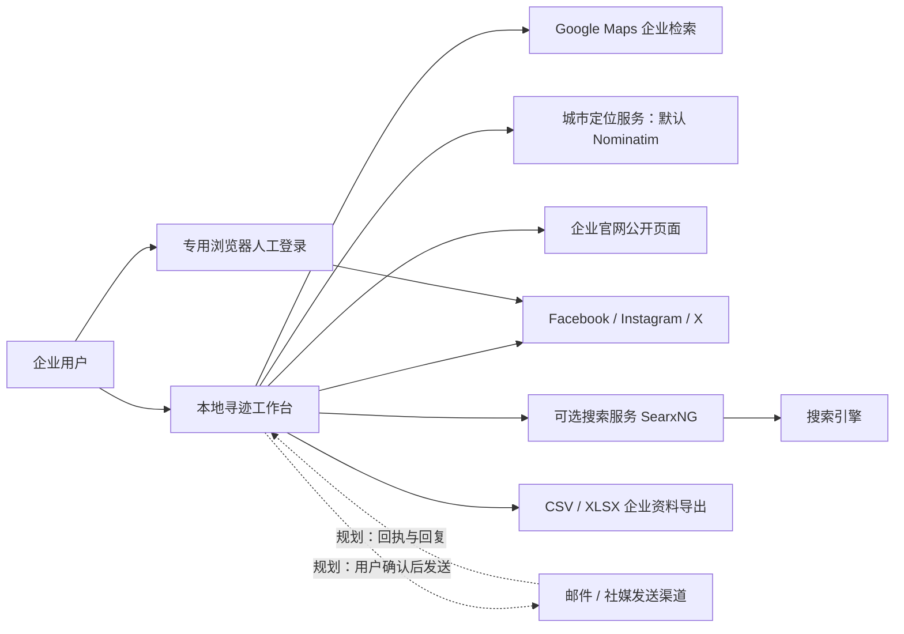
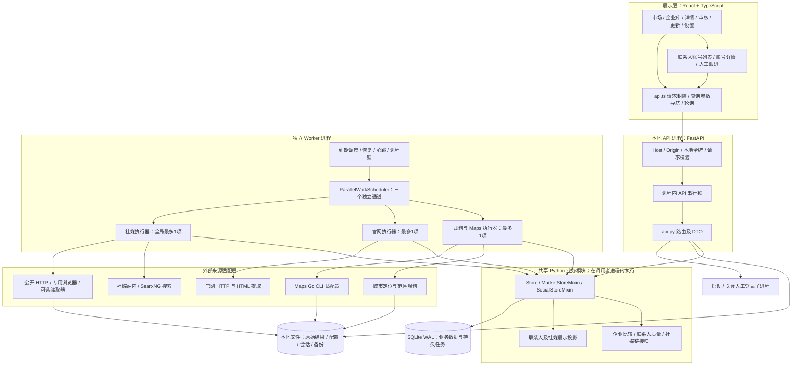

# 整体技术架构

版本 1.0 · 2026-09-23 · 以当前工作区代码为准

本文描述已实现架构；虚线标识规划扩展，不代表已上线。产品目标和验收口径以[新版 PRD](../product/overseas-lead-acquisition.prd.md)为准。

## 1. 系统定位与边界

寻迹是本机运行的企业获客线索工作台。当前主链路是：指定市场检索 → 企业累积与去重 → 官网及社媒补全 → 联系入口整理与归属核对 → 人工跟进记账。直接发邮件、社媒私信和自动收取回复仍是规划能力。

当前不是多租户 SaaS，也不是分布式采集平台。API 与 Worker 是两个进程，使用同一数据目录；业务模块仍在一个 Python 包内。拆分文件不等于拆分微服务。

## 2. 系统上下文图

城市定位由 `market_plan.py` 直接访问默认 Nominatim 或 `NOMINATIM_ENDPOINT` 指定端点，缓存位于数据目录；失败降级为城市文字查询，不经过 Maps CLI 或 SearxNG。

外部数据源可能返回空结果、登录页面、验证页面或限流响应。“搜索没找到”不等于企业没有账号；“有账号链接”不等于已读取资料；“已确认企业归属”不等于已确认采购岗位。

## 3. 当前组件架构图

图中的 Domain 不是第三个服务器。API 与 Worker 各自导入同一套类、各自建立 SQLite 连接。Web 请求提交持久任务；后台逐项执行，前端通过查询接口获取结果，没有 WebSocket 推送或独立消息队列。

## 4. 技术栈及代码归属

| 层次 | 实际技术 | 主要入口 |
|---|---|---|
| 页面与状态 | React 19、TypeScript、URL 查询参数、组件状态 | `frontend/src/App.tsx`、`pages/`、`social/`、`hooks.ts` |
| 构建 | Vite；生产静态文件由 API 提供 | `frontend/package.json`、`vite.config.ts` |
| HTTP API | Python 3.11+、FastAPI、Pydantic、Uvicorn | `leadworkbench/api.py` |
| 业务与数据访问 | Python 类与 mixin、标准库 sqlite3、手写 SQL | `db.py`、`market_store.py`、`market_social.py`、`social_store.py`、`social_discovery_store.py`、`social_policy.py` |
| 任务执行 | asyncio、SQLite 工作项、fcntl 本机锁 | `worker.py`、`worker_scheduler.py`、`work_item_executor.py`、`social_worker.py` |
| Maps | 本地 `google-maps-scraper` Go 可执行文件及其浏览器子进程 | `sources/maps.py`、`scripts/install_maps.sh` |
| 官网 | HTTP 客户端、BeautifulSoup 解析与规则过滤 | `sources/website.py`、`contact_fields.py`、`contact_quality.py` |
| 社媒 | 搜索适配器、HTML 提取、Playwright 专用浏览器；可选 Instaloader 等 | `sources/social_*.py`、`social_connections.py` |
| 数据导出 | CSV、openpyxl XLSX | `export.py` |

Python 依赖的声明范围见 `pyproject.toml`，前端固定版本见 `frontend/package.json`。本项目未使用 SQLAlchemy、Alembic、Redis 或 Celery；旧版技术文档中的选型不能作为当前实现依据。

## 5. 核心数据流与不变量

1. **市场不是一次搜索结果集。** Task 定义市场；Run 表示一轮执行；Membership 累积市场企业；本轮新增/存量与字段变化分别记录。未再次找到的记录不直接删除。
2. **来源身份优先于名称。** Maps 适配器使用 CID、Place ID、地点链接及别名识别来源。企业名、品牌官网不能独立证明是同一家门店。
3. **原始证据和展示值分开。** Observation / Version 保留来源内容；Current projection 选择可展示字段。新页面字段缺失不意味着旧字段失效；格式等价差异不需要业务审核。
4. **关联不等于身份。** 社媒账号是平台实体，企业与账号是关联关系。品牌、门店、员工范围不等于具体员工及采购岗位已被证明。
5. **任务状态不等于内容状态。** 抓取失败时可以继续展示历史有效资料，但必须显示其实际采集时间。复用缓存不生成“刚刚采集”的新证据。
6. **跟进记录不等于发送回执。** 现有 outreach 接口保存用户填写的状态和备注，没有调用邮件或社媒发送服务。

具体表关系、接口和时序见[数据库设计](database.md)、[接口协议](api-contract.md)、[模块设计](module-design.md)。

## 6. 并发、可靠性与容量边界

| 问题 | 当前处理 | 尚不能承诺 |
|---|---|---|
| 重复启动 Worker | `worker-single.lock` 互斥；心跳每 5 秒写入，健康判断同时检查锁和 30 秒新鲜度 | 多节点调度、高可用接管 |
| 长任务阻塞其他任务 | 地图/官网/社媒三个独立通道各最多1项；官网按批保存检查点，平台等待项跳过到期前领取 | 工作项内部抢占、严格公平或固定等待上限 |
| 进程中断 | 持久化 run/item，启动执行 recover/recover_social | 外部操作严格 exactly-once |
| 多方更新同一记录 | 部分编辑使用 revision；事务与唯一约束约束部分重复 | 所有接口均有幂等键、所有对象均有版本控制 |
| 社媒重复任务 | 活跃任务按企业集合和执行配置签名复用 | 任意历史请求均去重、无限期幂等 |
| 账号登录与采集同时进行 | 平台 profile 文件锁；市场社媒以平台门控保留 pending，其他平台及地图/官网继续 | 不同浏览器任意共享登录态 |
| 大规模增长 | SQLite 本机存储；有原始证据与快照 | 未经压测的规模、延迟或全城市召回率 SLA |

当前 API 对 `/api/` 请求做进程内串行化，简化本机恢复和编辑互斥，也会使慢接口阻塞其他请求。这是现状和后续压测关注点，不是建议扩展为多实例时沿用的方案。

市场社媒集成以稳定为先：正常同平台间隔 60–120 秒，网络/限流按 10、30、120 分钟等待，三次自动恢复后转人工。`market_social_runs` 关联市场父轮次与社媒子运行，控制沿关联传播；上游 Maps/官网关闭且社媒队列结束后才汇总终态。手动独立社媒不继承市场父轮次控制。`worker-single.lock` 由 Worker 全程持有；`worker.lock` 只在派发和执行作业时持有，空闲时释放，恢复接口最多等待 5 秒拿锁。详见[市场社媒集成](market-social-integration.md)。

## 7. 演进边界

优先补充数据身份与草稿持久化，再接入单个发送通道。暂不因为未来可能多人使用而立即拆成微服务；多租户认证、租户数据隔离、共享 Worker 队列和集中凭据服务需单独立项。规划协议和数据结构见[触达扩展设计](outreach-planned.md)。

## 8. 代码核对入口

- HTTP 边界：`leadworkbench/api.py:create_app/local_boundary`。
- 三通道调度：`leadworkbench/worker_scheduler.py:ParallelWorkScheduler.turn/aclose`；`WorkScheduler` 仅为保留的兼容实现。
- Maps 身份与停止预算：`leadworkbench/sources/maps.py:_record/discover_maps`。
- 本地会话：`leadworkbench/sources/social_browser.py:profile_lock/open_session/browser_context`。
- 配置：`leadworkbench/social_connections.py:load_connections/private_write`。
- 当前有效字段：`leadworkbench/social_projection.py:project_account`。

本轮为代码与文档核对，没有重新进行真实平台抓取、城市覆盖实验或性能测试。
