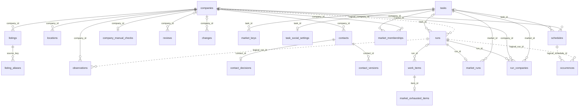
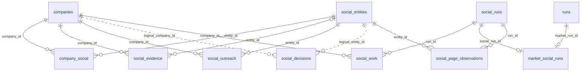

# 当前数据库设计与迁移

状态：2026-09-25 同步市场社媒结构；本次只改文档，最终业务验收待确认。依据 `db.py`、market/social Store mixin、`market_social.py` 和 `social_policy.py`。本文描述实际结构，不代表人员统一关联、邮件发送或社媒发送已实现。

配套：本目录`schema.current.sql`为完整结构附件，`api-contract.md`说明HTTP投影。附件生成于临时Store；**未实例化真实数据目录Store，也未打开真实数据库**。因此本文不是线上数据量、索引使用率或真实数据完整性审计。

## 1. 存储与版本事实

- 使用Python标准库 **sqlite3 + 手写SQL**。没有SQLAlchemy模型、ORM session、Alembic revision链或Alembic迁移命令。
- `Store(directory)`将目录expanduser/resolve后创建`workbench.sqlite3`，新目录请求权限0700、数据库文件chmod0600；不能假定已有目录权限已被重新收紧。
- 每次连接设置`foreign_keys=ON`、`busy_timeout=15000`，sqlite3连接timeout=15秒、row_factory=sqlite3.Row；成功commit、异常rollback、最终close。
- 初始化设置`journal_mode=WAL`。附件仅记录DDL和user_version，**没有把WAL、连接超时或文件权限固化到DDL**。
- 当前`PRAGMA user_version=2`。版本2之后仍有幂等扩展迁移及数据修复，所以“user_version相同”不保证表组完整或应用版本一致。
- 2026-09-25 临时 Store 启动结构为 **37 张表**；`market_exhausted_items` 仍按需创建，完整附件为 **38 张表**、8 个显式索引、45 个自动索引。数量以同批次 DDL 与 `validation.json` 为证，自动索引不单独导出 SQL。
- 当前没有view、虚拟表、STRICT表或WITHOUT ROWID表；P0 修复后有 5 个触发器（见文末“2026-10-18：P0 修复”）。DDL中的TEXT/INTEGER/REAL按实际列声明保存；业务状态多数没有CHECK约束。

源码入口：`db.py:56–184`；`market_store.py:74–148,458–464`；`social_store.py:19–46`；`social_discovery_store.py:17–33`。

## 2. 迁移顺序与生命周期

| 顺序 | 触发条件 / 实际动作 |
|---|---|
| 版本检查 | 读取user_version，>2报错；不是完整schema diff |
| 基础v1 | version=0时执行`db.SCHEMA`：企业、来源、联系人、审核、任务、计划等12张表和2个索引，设置user_version=1 |
| 市场v2 | 启动时原version<2，执行`_migrate_market`：4张市场表、3个索引；所有旧tasks.limit改为0；回填market_keys、market_runs、membership/run分类；活动旧发现项保存进snapshot后替换为planning；最后user_version=2 |
| audit扩展 | 每次启动执行`_migrate_audit`：先建listing_aliases及索引、回填别名；再建contact_decisions/contact_versions/company_manual_checks；从历史审核回填采用决定，保护已接受的字段override |
| social扩展 | 每次启动建social_entities/company_social/evidence/decisions/outreach/migrations；调用social discovery扩展建config/runs/work/page_observations；纠正无官网项no_results→skipped，result同步missing_website |
| 市场社媒扩展 | 社媒基础迁移后建 task_social_settings、market_social_runs、social_platform_gates；没有设置记录时默认关闭，不为历史任务创建社媒运行/队列 |
| 一次性社媒回填 | `social_migrations.name='legacy_links_v1'`不存在时，将非合并企业已有social_links/观察转为社媒实体及证据，写迁移标记 |
| 启动业务修复 | 初始化完成后调用resolve_branch_reviews、resolve_empty_reviews、resolve_format_reviews；可能修改审核、联系人状态和字段采用，不是只创建表 |
| 运行时扩展 | `record_market_exhausted`中建market_exhausted_items并保存不可续查项及reason，不提升user_version |

市场迁移使用`BEGIN IMMEDIATE`，表创建、回填和版本提升在其事务中执行；整个Store初始化并非一个统一原子迁移事务，`executescript`、社媒扩展显式commit等存在事务边界。不能把手写迁移描述成全量自动回滚的Alembic upgrade。

完整DDL附件不含业务INSERT、迁移标记或历史回填代码；它能重建**空结构**，不能替代旧库升级，更不能直接对现有库执行。启动Store即可能写库，真实库只读检查应使用sqlite3 URI `mode=ro`，不能先创建Store再声称只读。

## 3. 实体关系图

图仅画主要已声明FK；具体可空性与所有关联见表清单及DDL。虚线表示逻辑关系、数据库不强制；PK复合项详见§4。为了可读性，market_memberships的first/last_run两个FK与部分辅助证据关系放在表格中。





`social_config`、`social_migrations`、`social_platform_gates` 是独立键表。平台门控通过平台字符串关联执行行为，没有到具体运行的 FK；市场父子关系则由 market_social_runs 显式约束。没有独立 Person/Channel 实体，也没有 contacts 到社媒实体的人员 FK；scope=employee 不是已确认采购人员身份。

## 4. 完整表清单、PK/FK与逻辑关联

以下覆盖当前 38 张表。列类型、NOT NULL、DEFAULT及完整CREATE语句以`schema.current.sql`为准。表中“→”为声明FK，“逻辑”是应用解释，不由SQLite保障。

### 4.1 企业、来源、联系人及审核（11张）

| 表 | 主键 / 唯一键 | 声明FK及用途 |
|---|---|---|
| companies | PK id | 无FK。name/address/phone/website/city/country为当前值；business_types/overrides/social_links为JSON；status/notes/revision及时间。merged_into逻辑指向companies.id，无自引用FK |
| listings | PK source_key | company_id→companies.id；来源地点实体、source_url、first_seen/last_seen |
| listing_aliases | PK alias | source_key→listings.source_key；同来源place/CID等标识统一；一个alias只能映射一个listing |
| locations | PK id；UNIQUE source_key | company_id→companies.id；地址/坐标/source_url/observed_at。source_key只唯一，**未声明到listings的FK** |
| observations | PK id；UNIQUE fingerprint | company_id→companies.id；field/value/source_url/evidence/observed_at/method/run_id/query；run_id逻辑关联runs，可空串或null |
| contacts | PK id；UNIQUE fingerprint | company_id→companies.id；name/role/email/url/kind/role_status/association_status/source/evidence/time/review_status。email/url没有全局唯一约束 |
| contact_decisions | PK contact_id | contact_id→contacts.id；采用状态accepted/excluded及decided_at |
| contact_versions | PK id | contact_id→contacts.id；payload JSON与原observed_at；保留字段/来源版本，无内容唯一约束 |
| company_manual_checks | PK company_id | company_id→companies.id；最近人工checked_at，与官网last_checked_at分开 |
| changes | PK id | 可空company_id→companies.id；field/old_value/new_value/created_at/reason；审计变更记录 |
| reviews | PK id；UNIQUE fingerprint | 可空company_id→companies.id；kind/field/old_value/new_value/source/evidence/status/time；多态引用见§5 |

### 4.2 市场、轮次、工作项和计划（10张）

| 表 | 主键 / 唯一键 | 声明FK及用途 |
|---|---|---|
| tasks | PK id | 无FK；市场名称、地域、keywords/company_types JSON、limit、auto_enrich、created_at；limit=0为市场模式 |
| market_keys | PK identity | task_id→tasks.id；市场规范化SHA-256；task_id没有UNIQUE，数据库不强制一个task只有一个identity |
| runs | PK id | 可空task_id→tasks.id；kind/company_id/status/progress/message/error/time/snapshot；company_id仅逻辑关联 |
| work_items | PK id；UNIQUE(run_id,stage,target) | 可空run_id→runs.id；stage/target/state/result；target按stage为ID、查询或JSON |
| market_runs | PK run_id | run_id→runs.id；market_id→tasks.id；plan/unresolved JSON |
| market_memberships | PK(market_id,company_id) | market_id→tasks、company_id→companies、可空first_run_id/last_run_id→runs；长期市场成员及首次/最近遇见 |
| run_companies | PK(run_id,company_id) | run_id→runs、company_id→companies、market_id→tasks；segment CHECK仅new/existing；changed独立整数标记，first_seen/last_seen |
| market_exhausted_items | PK item_id | item_id→work_items.id；reason非空；按需创建，记录不能靠同策略重试补齐的项 |
| schedules | PK id | 可空task_id→tasks、company_id→companies；kind/interval_months/timezone/next_due_at/enabled/anchor |
| occurrences | PK(schedule_id,due_at) | **无FK**；schedule_id/run_id分别逻辑关联schedules/runs，避免同一期重复调度 |

### 4.3 社媒实体、观察和任务（8张）

| 表 | 主键 / 唯一键 | 声明FK及用途 |
|---|---|---|
| social_entities | PK id；UNIQUE url | 无FK；platform/kind/url/label/created_at，跨企业共享规范化账号/帖子/集合实体 |
| company_social | PK(company_id,entity_id) | company_id→companies、entity_id→social_entities；status/scope/revision/decided_at；确认属于当前企业关系，不改变全局实体 |
| social_evidence | PK id | company_id→companies、可空entity_id→social_entities；original_url/source_url/evidence/method/observed_at/reason；无法分类链接entity_id可null |
| social_decisions | PK id | **无FK**；company_id/entity_id逻辑指向关联两端；old_status/new_status/scope/decided_at |
| social_outreach | PK id | company_id→companies、entity_id→social_entities；state/note/created_at；只记人工事件，无发送凭据 |
| social_runs | PK id | 无FK；status/time/company_ids/settings/sample；后三者JSON；company_ids元素没有数据库FK |
| social_work | PK id；UNIQUE(run_id,company_id,stage,target) | run_id→social_runs、company_id→companies；stage/target/state/result/created_at/finished_at |
| social_page_observations | PK id | entity_id→social_entities、run_id→social_runs；payload JSON/observed_at；观察按实体共享，不按企业复制 |

### 4.4 配置与迁移元数据（2张）

| 表 | 主键 | 内容 |
|---|---|---|
| social_config | PK key | 无FK；value TEXT。当前key为searxng_url，value是普通字符串，非JSON对象 |
| social_migrations | PK name | 无FK；一次性数据回填标记，当前为legacy_links_v1 |

### 4.5 后续扩展：地域、创建人、访问策略与市场社媒（6张）

| 表 | 主键 / 关联 | 内容与生命周期 |
|---|---|---|
| task_metadata | PK task_id→tasks.id | 创建人预留 created_by_user_id，可空；无发送身份语义 |
| task_geography | PK task_id→tasks.id | payload JSON；所选地域身份与来源信息 |
| maps_access_policy | PK id，CHECK id=1 | 地图全局 not_before/manual_required/failures/reason，独立于社媒平台门控 |
| task_social_settings | PK task_id→tasks.id | payload JSON，三个未来社媒选项；缺行默认 auto_social=false、三平台、read_posts=false |
| market_social_runs | PK market_run_id→runs.id；UNIQUE social_run_id→social_runs.id | 一父轮次对应至多一个子社媒运行；手动独立社媒无此关联 |
| social_platform_gates | PK platform | state、not_before（Unix 秒）、reason、failures；同平台跨市场共享，持久化间隔和人工恢复要求 |
| website_host_gates | PK host | gate JSON（not_before/manual_required/reason/http_status）、last_request、min_interval；HTTP/HTTPS 与 www 别名共用官网访问节奏，跨企业和轮次持久保留；在 audit 迁移及恢复备份时补建 |

未来设置与 `runs.snapshot`、`social_runs.settings.market_options` 的执行快照分开；PATCH 设置不修改已排队项。平台恢复可更新活动市场父轮次下未取消社媒子运行的 `settings.connections`，使用最新保存的连接配置；不改本轮业务快照、既有队列范围或手动独立运行。显式补充可给活动父轮次附加快照/关联，无活动轮次则新建 `kind=social`、`social_only=true` 的父轮次，旧轮次保留。

企业入库和官网新增账号在同事务中追加市场关联社媒项，利用已有 `UNIQUE(run_id,company_id,stage,target)` 去重；手动创建运行另按归属排除市场子运行，不能跨归属复用。领取元数据 `claim_token/attempts` 保存在 `social_work.result`，完成时重新核对令牌和父子状态，拒绝暂停/取消前的迟到领取结果；API 投影删除 claim_token。profile/read 提交同时检查该企业账号关联的 excluded 状态，取消该项并丢弃迟到观察/帖子，不覆盖已有证据。有效部分预览先写页面观察，再按恢复规则保留 pending；result.partial 进入企业与父轮次异常汇总。候选证据先入已有 evidence/entity/association 表，8 个 profile 项预算不删除候选。详见[集成设计](market-social-integration.md)。

## 5. 约束与索引

### SQL确实保障的内容

- 8个显式索引如下。其它PK/UNIQUE的自动索引由SQLite重建，不应手工创建`sqlite_autoindex_*`。
- `run_companies.segment`的CHECK限制new/existing。其余业务状态、布尔0/1、岗位类型、JSON合法性、revision正数等大多由应用约束，**没有等价SQL CHECK**。
- 所有声明FK均未设置CASCADE、SET NULL或DEFERRABLE，PRAGMA显示默认NO ACTION；不能假设删企业会级联删历史。当前没有公开删除API。
- 常规rowid表的TEXT PRIMARY KEY不等价于显式NOT NULL；部分复合PK列也未写NOT NULL。附件保留源码原样，不额外强化可空性。业务入口通常提供非空ID，但直接SQL写入的保障更弱。

| 显式索引名 | 列 | 主要用途 |
|---|---|---|
| observations_company | observations(company_id,observed_at) | 企业证据时间查询 |
| work_items_run | work_items(run_id,state) | 轮次工作项领取/统计 |
| market_membership_company | market_memberships(company_id,market_id) | 企业所属市场反查 |
| run_companies_market | run_companies(market_id,run_id,segment,changed) | 市场本轮分类与变化筛选 |
| market_runs_market | market_runs(market_id,run_id) | 市场轮次关联 |
| listing_alias_source | listing_aliases(source_key) | 来源别名反查 |
| social_evidence_company | social_evidence(company_id,entity_id) | 企业账号证据查询 |
| social_work_state | social_work(state,run_id) | 社媒任务状态调度 |

### 仅由应用维持的关系

| 逻辑引用 | 解释 / 限制 |
|---|---|
| companies.merged_into | 指向另一company；没有自FK；市场入库可追踪该链，列表排除merged_into非null |
| locations.source_key | 与listings同来源键，无FK，允许null且UNIQUE不等于“所有地点必有listing” |
| runs.company_id / observations.run_id | 分别指company和普通run，无FK；人工observations.run_id可"" |
| reviews.old_value/new_value | contact类new_value为contact id、old_value可JSON快照；duplicate_candidate为两个company id；field_update为字段值；没有多态FK |
| changes.old_value/new_value | 字段旧新值、JSON或业务ID；没有统一类型或FK |
| work_items.target | planning为task id、refresh为company id、市场discovery为job JSON；没有目标FK |
| social_work.target | website为URL、search为查询、platform_search为平台名、read/profile为URL；不引用social_entities.id FK |
| social_decisions两个ID | 独立文本，不强制company_social关联存在 |
| social_outreach两个FK | 仅确保两端存在；没有复合FK确保company_social存在。应用写前校验归属confirmed和企业非拒绝联系 |
| market_runs / run_companies / membership | 多个FK只验证各自存在，不能保证所有run属于同一market；业务层检查一致性 |
| schedules两个目标 | SQL允许同时有值或都为空；应用要求二选一并匹配kind |
| occurrences / social_runs.company_ids | 逻辑引用，不受foreign_key_check检查 |

因此`foreign_key_check`通过不能证明企业归属正确、人员去重正确或JSON有效。公司名称、官网域名、邮箱均没有独立全局唯一约束；共享品牌/邮箱不会仅靠DDL变成同一人。

## 6. JSON字段及序列化规则

SQLite存储均为TEXT，没有声明原生JSON列或`CHECK(json_valid(...))`。应用查询实际使用json_each/json_extract/json_set/json_valid，运行环境必须支持这些函数。JSON格式不合法可能导致运行期SQL/解析错误，并非入库即被数据库拒绝。

| 表.字段 | 结构与生命周期 |
|---|---|
| companies.business_types | 字符串数组；业务分类，可由用户编辑；Store.row解码 |
| companies.overrides | 字符串数组；已人工采用/修正的字段名，防止来源静默覆盖；Store.row解码 |
| companies.social_links | URL数组；官网补全按集合累积、sync读取；不是唯一社媒事实来源；Store.row解码 |
| tasks.keywords/company_types | 字符串数组；新市场排序、规范化、去重；Store.row解码 |
| runs.progress | 计数对象，随worker进度更新；Store.row解码，不是不可变事件日志 |
| runs.snapshot | 任务配置对象；refresh含company_id，market可补market_plan；旧迁移可含legacy_snapshot/legacy_discovery_items；Store.row解码 |
| market_runs.plan/unresolved | 计划对象与原因数组；plan含jobs/coverage/status/warnings；unresolved可更新/清理，耗尽原因还保存在独立表 |
| work_items.target | 只有市场discovery采用规范JSON，典型键query/geo/zoom/depth/bbox/level/key；其余stage不是JSON |
| work_items.result | 可null或对象；含message/status/retryable/stop_reason、官网summary等；不通过普通run端点直接返回整组item |
| contact_versions.payload | 当前或历史联系人字段及证据对象；为来源历史追加，不能代替已采用决定 |
| social_runs.company_ids | 排序后的ID数组，用于活动任务匹配；无元素FK |
| social_runs.settings | 社媒设置和连接参数快照，加read_only/platform_search/profile_only；API响应主动移除此字段；不是密钥存储 |
| social_runs.sample | pilot样本数组，含id/name/stratum；非pilot通常[] |
| social_work.result | 对象，默认{}；原始来源状态、reason/message/links/posts等；API显式解码后返回 |
| social_page_observations.payload | 来源读取对象，含status、字段/帖子/来源等；成功失败都可留存，详情通过投影选择可用旧资料 |
| observations.value、reviews/changes的old_value/new_value | 混合普通文本和JSON编码文本；按field/kind解释，不能无条件json.loads |

Store.row只统一解码business_types/overrides/social_links/keywords/company_types/progress/snapshot，并把enabled/auto_enrich转bool。其它字段由各方法显式处理；详情observations.value仍是存储文本。

时间通常由UTC `datetime.isoformat()`生成，SQL主要按TEXT排序；外部观察可能保留来源时间，DDL没有强制日期格式。社媒最新观察选择使用rowid顺序，字段上显示自己的observed_at；不要把API查询时刻或缓存复用时刻当采集时刻。

## 7. 业务数据流与状态生命周期

### 企业发现和市场覆盖

`create_market`用规范化country/state/city、关键词集合和类型集合计算identity；名称和auto_enrich不参与。同identity返回旧定义，不自动更新旧配置。每轮runs关联market_runs；work_items持久化planning/discovery/refresh。

Maps记录先按source_key/alias解析，找不到时做保守企业匹配；名称+域名不构成通用全局合并规则，不同门店保留。入库同步listing、location、observations及market_memberships/run_companies。

membership描述长期市场归属；new表示首次进入该市场，不一定全库新企业。run_companies.changed是独立标记，不能作为第三种互斥segment；not_seen由查询投影得出，不存在该segment存储值，也不等于停业。

coverage由计划与work_items计算，done数成功discovery，unresolved汇总规划失败/未完成/耗尽原因。达到策略边界会保留企业并记录market_exhausted_items；resume跳过这些项。**coverage不是全城企业分母，也未证明实际地址属于目标行政区**。

### 联系人、证据和人工采用

官网补全只接受completed/partial来源结果，并要求联系人/观察有source_url和evidence。contacts指纹由企业、email或url、name、source_url计算；同企业邮箱还可命中已有记录。它不是全局人员身份解析。

新联系人通常auto_recorded，同时写contact_versions。后续字段/来源差异保留版本，实质身份冲突设pending并生成review；人工accept/reject落contact_decisions。联系人当前行、历史版本、采用状态是三层：

- review_status：pending/auto_recorded/accept/reject/invalid/superseded等证据处理状态。
- adoption_status：表中accepted/excluded；缺少决定时API投影automatic（历史reject可推导excluded），不是表内第三个默认枚举。
- kind/role_status/association_status：采购类型、岗位证据与同块/企业入口关联，不等价于投递能力。

查询与导出过滤pending/reject/invalid/superseded和人工excluded；详情可保留不采用项以供追溯。投影只把与当前身份字段相同的版本证据挂回当前记录，避免把共享邮箱的另一人的岗位拼上来。岗位和邮箱真实有效性仍依赖证据及人工核对。

observations以指纹去重，同一事实不同时间可以形成新观察；`_observe`使用INSERT OR IGNORE，当前没有UPDATE observations路径。与之不同，social_evidence的重复指纹会更新observed_at，reviews也会转状态，不能把所有表笼统称为不可变事件库。changes追加变更，人工字段由overrides保护；没有完整历史撤销API。

### 社媒关联、共享账号与资料投影

`social_entities.id`是规范URL的SHA-256前32位，url另有UNIQUE；同账号跨企业共享实体。company_social分别保存各企业的candidate/confirmed/excluded、scope及revision。social_evidence.id按企业+链接+来源+证据+方法生成，重复证据更新观察时间。

确认归属只改company_social并追加social_decisions，不自动确认采购员工。social_work发现站内候选后可追加profile项；结果存social_page_observations，不直接建contacts人员关系。取消/拒绝联系/企业合并后的迟到结果不会按正常成功入库。

账号资料读取失败时保留历史；`social_projection.project_account`以最近非空成功字段建立视图，旧值进入field_history，retained及字段时间标明沿用。仅`preview_read`视为可用内容；失败页面的内容不冒充账号资料。同轮共享账号复用结果不新增“新采集”的观察行。

### 人工跟进与发送缺口

social_outreach追加draft/contacted/replied/closed事件，note为正文备注，没有状态转换前提、revision或重复请求唯一键。确认归属的共享账号历史可跨关联企业展示。企业do_not_contact阻止新增记录。

没有message、delivery、provider receipt、sender identity、template、person-channel association等发送表。没有邮件跟进表、入口级拒绝状态或统一草稿对象；不能把social_outreach当已实现的发送队列。

### 任务恢复与日历调度

普通run：queued/running/paused/completed/partial/blocked/failed/cancelled。worker中断恢复把活动/暂停轮次中的running work_items回pending，把running runs回queued；成功项不重置。市场耗尽项另行排除续查。

社媒run：queued/running/completed/partial/cancelled；work还含succeeded/no_results/blocked/failed/skipped。来源auth_required/challenge/unreadable映射blocked，原状态留result。cancel保留历史；retry新建或复用同签名活动轮次，并非原run失败项局部重试。

schedule按时区及anchor日历月计算next_due_at，occurrences复合PK防同一期重复调度；暂停旧任务时保留欠执行期，不写occurrence。错过多期后推进到当前时间之后，不逐期追补所有历史月份。它是采集/复核计划，不是消息发送计划。

## 8. 并发、文件与备份恢复

- 企业及company_social分别有revision乐观锁；批量企业状态先核对全部revision再更新，单事务原子。review还核对pending及字段旧值。数据库没有覆盖所有对象的统一revision机制。
- （P1 起）API 请求并发执行，只有恢复备份经维护闸门独占；worker-single.lock用于单worker，worker.lock为worker操作/恢复互斥，migrate.lock 串行化所有进程的迁移。SQLite事务仍是实际读写协调机制，不能声称仅有一个连接。
- 配置/密钥/浏览器会话不全在SQLite：social-connections.json保存reader/proxy/max_posts等；social-secrets.json保存YouTube key且公开API只返回是否配置；专用浏览器目录保存登录会话。social_config仅存SearXNG配置。
- worker-heartbeat.json、运行采集文件、geocoding缓存、浏览器目录与锁文件不是SQL表。数据库备份不会自动包含这些文件；仅恢复SQLite不等于恢复全部运行环境或登录态。
- 备份使用sqlite3.Connection.backup生成backups目录文件，不是直接复制正在WAL写入的主文件。备份文件chmod0600。
- restore检查文件名、版本、完整性、部分必需表和台账 id（有当前版本不认识的 id 时拒绝）；先生成 `auto-pre-restore-*` 备份，复制后对目标库执行统一迁移执行器（与启动相同，含 R01–R08），再恢复中断项。旧备份补建 task_social_settings/market_social_runs/social_platform_gates，缺历史设置保持默认关闭；v1可升级。没有版本降级、独立回滚迁移或完整业务关联校验。
- （P1 起）文件保留策略只清理 runs/ 下的 Maps 原始结果、自动备份和导出文件，首次需用户确认；数据库记录从不自动删除，审计表也不裁剪。API返回条数上限不等于数据库删除旧记录。

源码：`db.py:348–407,846–938`、`worker.py:18–94`、`social_connections.py`。敏感配置不应写进OpenAPI/schema附件；本次附件均未包含临时数据或密钥。

## 9. DDL再生成与校验

附件从**执行当前迁移后的临时库**读取 sqlite_master；按需耗尽表的 CREATE 语句从 `record_market_exhausted` 源码 AST 提取后只在临时库执行，不创建任务/运行 fixture，不依赖业务投影成功。输出只有 DDL，不启动 Worker。

```bash
cd <项目目录>
PYTHONDONTWRITEBYTECODE=1 .venv/bin/python - <<'PY'
import ast
import hashlib
import sqlite3
import tempfile
from pathlib import Path
from leadworkbench.db import Store

files = [
    "leadworkbench/api.py", "leadworkbench/db.py",
    "leadworkbench/market_store.py", "leadworkbench/social_store.py",
    "leadworkbench/social_discovery_store.py", "leadworkbench/maps_policy.py",
    "leadworkbench/market_social.py", "leadworkbench/social_policy.py",
]
hashes = {p: hashlib.sha256(Path(p).read_bytes()).hexdigest() for p in files}
tree = ast.parse(Path("leadworkbench/market_store.py").read_text())
function = next(n for n in ast.walk(tree)
                if isinstance(n, ast.FunctionDef) and n.name == "record_market_exhausted")
lazy = [n.value for n in ast.walk(function)
        if isinstance(n, ast.Constant) and isinstance(n.value, str)
        and n.value.lstrip().startswith("CREATE TABLE IF NOT EXISTS market_exhausted_items(")]
assert len(lazy) == 1
with tempfile.TemporaryDirectory(prefix="lead-schema-") as directory:
    store = Store(directory)  # 不得替换成生产目录
    with store.connect() as con:
        con.execute(lazy[0])
        rows = con.execute("""
            SELECT type,name,sql FROM sqlite_master
            WHERE sql IS NOT NULL AND name NOT LIKE 'sqlite_%'
            ORDER BY CASE type WHEN 'table' THEN 0
                               WHEN 'index' THEN 1 ELSE 2 END, rowid
        """).fetchall()
        version = con.execute("PRAGMA user_version").fetchone()[0]
    ddl = "-- Generated from a temporary Store; no production DB opened.\n"
    ddl += "-- Startup migrations plus lazy market_exhausted_items DDL; schema only, no data.\n"
    ddl += "-- Not an upgrade migration; use only to inspect/reconstruct an empty schema.\n"
    ddl += "".join(f"-- SHA256 {p}: {h}\n" for p, h in hashes.items())
    ddl += "PRAGMA foreign_keys=ON;\nBEGIN TRANSACTION;\n"
    ddl += "\n\n".join(
        ("-- Lazy runtime table; absent from a fresh Store until exhaustion is recorded.\n"
         if row["name"] == "market_exhausted_items" else "") + row["sql"] + ";"
        for row in rows
    )
    ddl += f"\nPRAGMA user_version={version};\nCOMMIT;\n"
    with sqlite3.connect(":memory:") as check:
        check.executescript(ddl)
        assert check.execute("PRAGMA integrity_check").fetchone()[0] == "ok"
        assert not check.execute("PRAGMA foreign_key_check").fetchall()
    assert hashes == {p: hashlib.sha256(Path(p).read_bytes()).hexdigest() for p in files}
    Path("docs/technical/schema.current.sql").write_text(ddl)
PY
```

上述命令保留核心源码哈希和按需表说明，并拒绝生成期间源码变化。Store 迁移自身的初始配置只存在临时库，附件不包含 INSERT、公司数据、访问令牌或配置值。本次实际生成另禁用了 socket connect，OpenAPI 也用独立临时子目录且不启动 lifespan。

2026-09-25 稳定性评审新增官网共享状态后：37 张启动表、38 张完整表、8 个显式索引、45 个自动索引、user_version=2；内存重建检查结果见 validation.json。只证明当前空结构可重建，不证明旧库迁移和业务链路通过。最终业务测试与部署记录见[稳定性实施审计](../validation/2026-09-25-search-stability-review.md)。

## 2026-09-24：持久化官网检查点

`work_items.result`的refresh JSON增加checkpoint/has_more/summary；队列、已访问集合、累计统计和逐URL日志见[官网分批方案](website-batch-design.md)。没有新表/列，DDL保持不变。claim按stage、checkpoint.batches、rowid排序，使同run企业分批轮转。资料应用与检查点保存不在同一事务，中断允许重做未确认批次，不声明exactly-once。


## 地区选择扩展（2026-09-24）

`task_geography(task_id PRIMARY KEY REFERENCES tasks(id), payload TEXT NOT NULL)` 保存任务所选州、县、Place编码、Place的多县关联、版本及whole_place范围，幂等启动迁移创建。参考地区目录为随程序分发的JSON.gz静态数据，不在企业业务表中。详见 [美国地区目录设计](us-geography-design.md)。

## 2026-10-18：P0 修复

### 迁移台账与顺序

`leadworkbench/p0_migrations.py` 的 `migrate_p0(store, con)` 在 `Store.__init__`（`_migrate_market_social` 之后、`resolve_*` 之前）和 `Store.restore()` 中执行。`schema_migrations(id PK, applied_at)` 记录已完成项。每项固定为 `BEGIN IMMEDIATE → 查台账（已存在则回滚跳过）→ 执行 → 写台账 → COMMIT`，所以两个进程同时启动不会重复执行；分批项每批一个事务，最后一批完成才写台账。启动末尾 `PRAGMA optimize`。`user_version` 仍为 2（新表都是旁表，旧表不加列）。

| # | id | 内容 | 改写旧表已有行 |
|---|---|---|---|
| 1 | `p0_20261018_indexes` | 13 个索引 + `ANALYZE` | 否 |
| 2 | `p0_20261018_facets_schema` | `contact_facets`、`contact_facets_dirty`、`manual_contacts` 与 5 个触发器 | 否 |
| 3 | `contact_facets_v1_mark` | 全部联系人标脏 | 否 |
| 4 | `contact_facets_v1` | 每批 5 000 行计算分面，脏表空时写台账 | 否（只写派生表） |
| 5 | `p0_20261018_categories` | `company_categories`、`company_type_hints`、`exclusion_rules`；从 Maps category 观察回填类别，从市场 company_types 回填提示 | 否（只新增行） |
| 6 | `p0_20261018_contact_proposals` | `contact_change_proposals`（只建表；旧版待审核冲突留到用户决定时转换） | 否 |
| 7 | `p0_20261018_repair_rejected` | 修复旧版“标记为不采用”误排除的原联系人（用户已同意，D2=A） | 是：仅候选联系人行与其采用决定 |

失败处理：任一项异常回滚、`log.exception`、启动失败，下次重试；分面回填已提交的批次保留；第 7 项备份失败时 `log.warning` 跳过该项、不写台账，其余照常。`FACET_VERSION` 加 1 时会新增 `contact_facets_v{N}_mark` / `contact_facets_v{N}` 两项。

### 新表（8 张）

| 表 | 主键 / 约束 | 内容 |
|---|---|---|
| schema_migrations | PK id | P0 台账 |
| contact_facets | PK contact_id；索引 (company_id,category,tier_rank)、(company_id,email_key) | 只依赖联系人行内容的派生结论：channel_ok、category、tier、tier_rank、identity_key、email_key、version |
| contact_facets_dirty | PK contact_id | 待刷新的联系人 |
| manual_contacts | PK contact_id → contacts | 人工联系人的电话、备注 |
| contact_change_proposals | PK review_id → reviews；contact_id → contacts；索引 (contact_id,proposal_key,status) | 联系人变化提议：status pending/accepted/rejected/superseded，origin proposal/legacy/repair |
| company_categories | PK (company_id,category_key)；索引 (category_key,company_id) | Maps 来源类别原文、首末次时间 |
| company_type_hints | PK (company_id,business_type,market_id) | 市场定义的初始业务类型（待核实） |
| exclusion_rules | PK id；唯一 (scope,COALESCE(market_id,''),kind,value_key)；CHECK 作用域 | 排除规则 |

### 触发器（5 个）

`contacts_facets_insert`、`contacts_facets_update`（company_id/name/role/email/url/kind/role_status/association_status/evidence 变化）、`contacts_facets_delete`、`manual_contacts_facets_insert`、`manual_contacts_facets_update`。只写 `contact_facets_dirty`/删除分面，纯 SQL、不调用 UDF，旧版代码写联系人也会标脏。写路径在事务末尾调用 `_refresh_facets_locked(con)`；读入口在打开读连接前调用 `_refresh_facets()`（独立短连接，每 2 000 行一个 `BEGIN IMMEDIATE`）。`Store.connect()` 维护线程本地连接深度，在已打开连接时调用 `_refresh_facets()` 会抛 `RuntimeError`。

### 索引（第 1 项）

`contacts_company(company_id)`、`contacts_company_email(company_id,lower(trim(email)))`、`contact_versions_contact(contact_id,observed_at)`、`reviews_status(status,created_at)`、`reviews_company_field(company_id,kind,field,status)`、`reviews_contact(kind,new_value,status)`、`locations_company(company_id)`、`changes_company(company_id,created_at)`、`observations_company_field(company_id,field,observed_at)`、`companies_newest(created_at DESC,id)`、`companies_status(status)`、`listings_company(company_id)`、`work_items_target(target,stage)`。`tests/test_query_plans.py` 断言热点查询不做全表扫描。

### `_migrate_audit` 回填保护

`_migrate_audit` 的第一条回填（最新一条联系人审核 → contact_decisions）在 `contact_change_proposals` 存在时，外层和 `max(rowid)` 子查询都排除带提议行的审核，所以拒绝提议不会在重启时变成 excluded。新语义下的所有联系人审核决定（提议、旧版转换、修复）都写提议行。

### 提议、旧版冲突转换与修复

- 冲突采集不改联系人行，新值存为提议；accept 写入 name/role/kind/role_status/association_status/evidence/source_url/observed_at 并设 accept/accepted；reject 只把提议置为 rejected。
- 旧版待审核冲突在用户决定时转换：reject 恢复“提议前快照”（最新一条 6 个资料键与审核 old_value 一致且含 review_status 的 contact_versions），accept 保留新值；都写 `origin=legacy` 提议行。
- 第 7 项修复：候选为“最新一条联系人审核是 reject、old_value 非空、无提议行、联系人 review_status=reject”。先 `store.backup()`，再恢复快照；采用决定按 changes 中最近一条 `contact_adoption → excluded` 的旧值恢复（automatic 删除决定行，accepted 恢复 accepted）；写 `origin=repair` 的 rejected 提议和 changes“数据修复：…（修复前备份 {name}）”。

### 降级限制

不支持用旧版本打开升级后的库后继续使用：旧版 `_migrate_audit` 没有上述保护，会把被拒绝的提议（包括修复记录）重新写成 excluded。旧版本打开和写入不报错（`tests/test_contact_repairs.py` 有子进程用例），回到新版本后分面会补齐。

### 结构附件

`schema.current.sql` 于 2026-10-18 用临时 Store 重新生成（SHA256 清单加入 `p0_migrations.py`），数量见 `validation.json`。

## 2026-10-18：P1 第一批

### 统一迁移注册表（`leadworkbench/migrations.py`）
所有打开数据库的入口（API、worker、恢复）都调用 `migrations.migrate(store, con)`：在 `{data}/migrate.lock`（fcntl，最多等 120 s）内按注册表顺序逐条执行，每条一个 `BEGIN IMMEDIATE` 事务，只用调用方的连接。`user_version` 仍为 2；`user_version > 2` 拒绝打开。台账表 `schema_migrations` 结构不变。

| 序 | id | 内容 | 类型 |
|---|---|---|---|
| 1 | `0001_base_v1` | user_version==0 时建 12 张基础表和 2 个索引，设 user_version=1 | 一次性 |
| 2 | `0002_market_v2` | user_version<2 时建市场 4 张表并回填，设 user_version=2 | 一次性 |
| 3 | `0003_maps_access_policy` | maps_access_policy 表和单行 | 一次性 |
| 4 | `0004_website_host_gates` | website_host_gates 表（新建时引导旧闸门） | 一次性 |
| 5 | `0005_listing_aliases` | listing_aliases 表和索引 | 一次性 |
| 6 | `R01_listing_aliases_backfill` | 别名回填 | 每次启动 |
| 7 | `0006_audit_tables` | 6 张审计表和索引 | 一次性 |
| 8 | `R02_contact_decisions_backfill` | contact_decisions 两段回填（带 P0 提议守卫） | 每次启动 |
| 9 | `R03_accepted_overrides_backfill` | 已接受字段 → overrides | 每次启动 |
| 10 | `0007_social_tables` | 社媒 7 张表 + social_migrations | 一次性 |
| 11 | `0008_social_discovery_tables` | 社媒发现 4 张表和索引 | 一次性 |
| 12 | `R04_social_work_missing_website` | 无官网的 social_work 改为 skipped | 每次启动 |
| 13 | `0009_social_legacy_links` | legacy_links_v1（social_migrations 已有则直接记账） | 一次性 |
| 14 | `0010_market_social_tables` | social_platform_gates、task_social_settings、market_social_runs | 一次性 |
| 15 | `0011_market_exhausted_items` | market_exhausted_items（原为运行时按需建表，运行时那段仍保留） | 一次性 |
| 16–22 | P0 的 7 项 | id、实现、相对顺序不变（见上节） | 一次性 |
| 23–26 | `R05_resolve_branch_reviews`、`R06_resolve_empty_reviews`、`R07_resolve_format_reviews`、`R08_resolve_duplicate_reviews` | 原来启动末尾单独调用的 4 个 resolve | 每次启动 |

- 一次性条目执行后写台账，不再执行；每次启动条目（`R` 开头）不写台账，行为与以前相同。异常回滚该条目并 ERROR `migration_failed`；P0 的 `SkipMigration`/`Pending` 语义沿用。
- **冻结规则**：一次性条目发布后，实现的含义不能再改；schema 变化必须新增条目。只改写法的等价修改（例如 INSERT 写出列名）允许，等价性由 `tests/test_migration_ledger.py` 的升级快照比较保证（`tests/fixtures/expected_upgrade_*.json`，在 913ee04 上生成）。
- 已知 id：注册表的一次性 id、`RETIRED` 里的历史 id，以及 `contact_facets_v{N}`（N ≤ 当前 FACET_VERSION）。台账里有未知 id 时启动只记 WARNING，恢复备份则拒绝。
- 导出子进程用 `Store(migrate=False)`，只在 `migrations.ready()`（除修复项外的一次性条目全部已记账）时打开。
- 备份源连接改为只读 URI 连接（`Store._backup_source()`）：持有 `BEGIN IMMEDIATE` 的连接不能做 backup 源（`backup_step` 一直 BUSY，测试已固定）。

### INSERT 显式列名
`leadworkbench/` 里所有 INSERT 都写出列名（`tests/test_sql_explicit_columns.py` 静态检查）。P0 facets 触发器体也改为 `INSERT OR IGNORE INTO contact_facets_dirty(contact_id) VALUES(…)`；触发器用 `CREATE TRIGGER IF NOT EXISTS` 建，已升级的库保留旧文本，这张表只有一列，新旧文本行为相同，所以不新增重建触发器的迁移。

### 备份命名
手动备份仍为 `backup-<ts>-<id>.sqlite3`；自动备份为 `auto-pre-restore-<ts>-<id>.sqlite3`（恢复前）、`auto-pre-repair-<ts>-<id>.sqlite3`（修复迁移前）。本批之前的 `backup-*`、`contact-quality-*` 等一律视为手动备份，永不自动删除。

### 文件型状态（不在数据库里）
`retention.json`（保留策略与确认状态，0600；恢复备份不会改变它）、`exports/jobs/<id>.json`（导出作业）、`run/maps/<guard_pid>.json`（Maps 守护进程注册表）、`logs/*.log`。保留策略从不删除数据库记录。


## 2026-10：P1 第二批

### 迁移条目

7 个 once 条目追加在统一注册表 R08 之后（`leadworkbench/p1b_migrations.py`），旧库和恢复的旧备份都走同一个执行器：

| id | 内容 | 对旧库的影响 |
|---|---|---|
| `p1b_20261019_market_admin` | 建 `task_state`、`market_changes`、`market_recheck_runs` 及索引 | 只新增空表 |
| `p1b_20261019_schedule_dedupe` | `enabled=1 AND task_id IS NOT NULL` 的计划按 task_id 分组，每组保留 `anchor IS NULL, anchor, rowid` 排序的第一条，其余 `enabled=0`，每条写一行 `market_changes(field='schedule')`；然后建部分唯一索引 `schedules_one_enabled_market` | 只停用重复计划，不删除；无重复时不写记录 |
| `p1b_20261019_round_summaries` | 建 `market_round_baselines`、`market_round_summaries` | 只新增空表；历史轮次的摘要读取时现算 |
| `p1b_20261019_review_resolutions` | 建 `review_resolutions` | 只新增空表；升级不清理任何审核 |
| `p1b_20261019_company_cities_schema` | 建 `company_cities`、`company_cities_dirty` 和 3 个触发器 | 只新增 |
| `p1b_20261019_company_cities_mark` | 把全部企业写进 `company_cities_dirty` | 只新增 |
| `p1b_20261019_company_cities_fill` | 每批 5000 家解析地址写 `company_cities`，有剩余就抛 `Pending` 续跑 | 只新增 |

### 新表（8 张）

- `task_state(task_id PK→tasks, archived_at, updated_at)`：归档状态；恢复时 archived_at 置 NULL，不删行。
- `market_changes(id PK, market_id, field, old_value, new_value, reason, created_at)`：关键词修改、归档/恢复、计划去重与补值的审计记录；market_id 故意不加外键（旧库可能有指向已不存在市场的计划）。
- `market_recheck_runs(run_id PK→runs, market_id→tasks, requested, skipped JSON, created_at)`：批量官网复核批次与跳过原因。
- `market_round_baselines(run_id→runs, company_id→companies, rank)`：轮次开始时的入口等级基线。
- `market_round_summaries(run_id PK→runs, market_id→tasks, payload JSON, created_at)`：本轮新增摘要。
- `review_resolutions(review_id PK→reviews, previous_status, status, rule, batch_id, created_at)`：一次性审核清理的关闭记录（batch_id 为 plan_id）；清理只把审核改为 `auto_closed`，不改 companies、不删行。
- `company_cities(company_id PK→companies, city, city_key, target_keys JSON, target_scope, nearby_global, parsed)`：实际城市派生表。
- `company_cities_dirty(company_id PK)`：待刷新标记。

索引：`market_changes_market`、`market_recheck_market`、`market_round_summaries_market`、`company_cities_key(city_key, company_id)`，以及部分唯一索引 `schedules_one_enabled_market ON schedules(task_id) WHERE enabled=1 AND task_id IS NOT NULL`（同一市场只有一个启用计划；Store 层先查后写返回 409，索引兜底，`IntegrityError` 只转换 `schedules.task_id` 冲突）。

触发器：`companies_city_insert`、`companies_city_update`（`AFTER UPDATE OF address,country,city`）、`memberships_city_insert`，都只往 `company_cities_dirty` 写标记；读入口（企业列表、详情、市场、导出）前每批最多刷新 2000 条，数据库忙时跳过，下次读取补上。缺行时显示现算、不写库，筛选按 parsed=0 处理。

### market_keys 的派生说明

market_keys 是派生数据，由市场的地区和关键词算出；编辑关键词时整组替换；被替换的旧身份记录在 market_changes.old_value 里（`{"keywords":[…],"identities":[…]}`）。

### company_cities 的口径

- `city` / `city_key`：`address_city.city_from_address` 从地址解析出的城市及其 `normalized` 值；解析不出时 `city=''`、`parsed=0`。
- `target_keys`：目标城市名字集合 `company_cities.target_city_keys(companies.city, 首个市场的 official_name)`，对两个名字分别：1) 规范化原名；2) 去掉末尾 ` (balance)`；3) 去掉末尾一个 LSAD 词（unified/consolidated/metropolitan/metro government、urban county、city、town、village、cdp，不去 county）；4) 去掉开头 `urban `；5) `X (Y)` 时 X、Y 各并入；6) 按 `-` 或 `/` 切开取第一段。每一步结果都并入集合。
- `target_scope`：`none`（companies.city 为空）、`municipality`（首次发现该企业的市场是南非整个自治市）、`city`（其余）。
- 两种邻近口径：市场上下文按该市场的 target_city_keys 集合比较（自治市市场一律不标邻近）；全局企业库用刷新时算好的 `nearby_global = parsed=1 AND target_scope='city' AND target_keys 非空 AND city_key ∉ target_keys`。只比名称，不算距离。

## 2026-10-21：AWS 体验版账号表（`aws_20261021_auth`）

迁移 `aws_20261021_auth`（`leadworkbench/auth_migrations.py`，台账第 34 项，`once`）只新建两张表和两个索引，不改旧表，全部 `IF NOT EXISTS`，可在恢复副本上重复执行。

| 表 | 说明 |
|---|---|
| `auth_users` | `id`、`username`（展示用）、`username_key`（NFKC + casefold，唯一）、`password_hash`（`scrypt$32768$8$1$<盐>$<哈希>`）、`disabled`、`tenant_id`（预留，可空，本次不读写）、`created_at`、`updated_at`、`password_changed_at`、`last_login_at` |
| `auth_sessions` | `id_hash`（会话标识的 sha256，库里不存明文）、`user_id`（外键，级联删除）、`csrf_token`、`created_at`、`last_seen_at`、`expires_at`（`min(创建+最长有效期, 最近使用+空闲时长)`）、`tenant_id`（预留） |

索引：`auth_sessions_user(user_id)`、`auth_sessions_expires(expires_at)`。过期或停用账号的会话只由 worker 每小时清理（持有 `worker.lock` 且拿到 `auth.lock` 时）。

恢复备份时当前两张表的内容先写进待恢复副本再整库替换，所以账号不随备份回滚；`admin restore --accounts backup` 例外（使用备份里的账号，清空会话）。以后加“所属客户”时新增迁移建租户表、回填 `tenant_id` 并加索引即可。

新增数据目录文件：`auth.lock`（恢复与管理员写操作串行）、`api.lock`（`serve.py` 持有，供离线恢复确认 API 已停止）、`backup-state.json`、`backup-upload-state.json`（0600，每日备份与 S3 上传状态，各只有一个写入者）。
