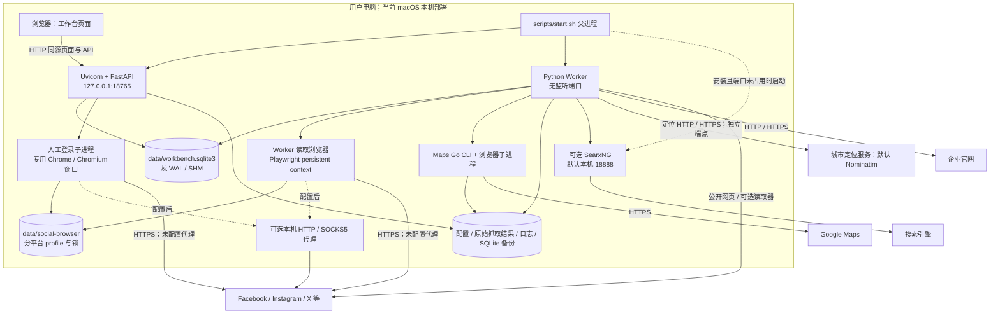
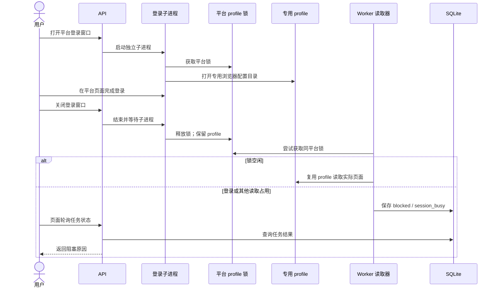

# 部署与运行拓扑

版本 1.0 · 2026-09-23 · 当前本机部署

## 1. 生产运行拓扑



市场规划器独立调用城市定位服务，默认 Nominatim，也可通过 `NOMINATIM_ENDPOINT` 配置端点；缓存与失败降级见模块设计§2。

连接线表示可能的访问路径，浏览器配置代理时走代理路径。社媒连接配置中的代理不代表自动代理 Maps、官网或 SearxNG 的所有流量。

## 2. 端口和运行职责

| 组件 | 地址/端口 | 启动与用途 |
|---|---|---|
| API 与生产静态页面 | `127.0.0.1:18765` 默认；`LEAD_PORT` 可改 | start.sh 启动 Uvicorn；SPA 与 `/api/*` 同源 |
| Worker | 无 HTTP 监听端口 | start.sh 默认启动；单进程持久任务消费 |
| SearxNG | start.sh 探测 `127.0.0.1:18888` | 安装后可自动启动；实际监听按 `tools/searxng/settings.yml`，业务使用保存的 searxng_url |
| 登录窗口 | 无产品服务端口 | API 启动独立 Python 子进程，再打开浏览器 |
| 采集浏览器 / Maps CLI | 没有产品约定的公开端口 | 按任务启动；内部控制端点不作为产品 API |
| 开发 Vite | Vite 默认端口通常为 5173，项目未固定 | npm run dev；仅本机 host；`/api` 代理到固定18765 |

修改 LEAD_PORT 不会自动修改 Vite 代理目标。开发模式要同步配置，生产模式没有这个代理问题。

## 3. 文件系统拓扑

```text
local-lead-workbench/
├── .venv/                         Python 运行环境
├── frontend/dist/                 已构建 SPA
├── tools/bin/google-maps-scraper   Maps 可执行文件
├── tools/searxng/                 可选独立搜索运行环境
└── data/                         LEAD_DATA_DIR 可覆盖
    ├── workbench.sqlite3          业务、证据和持久任务
    ├── workbench.sqlite3-wal      运行时 WAL（可能存在）
    ├── workbench.sqlite3-shm      运行时共享索引（可能存在）
    ├── worker-single.lock         单 Worker 进程互斥
    ├── worker.lock                工作执行与恢复操作互斥
    ├── worker-heartbeat.json      当前 Worker 心跳
    ├── social-connections.json    读取器与代理等连接设置
    ├── social-secrets.json        可选 API 凭据；不可公开
    ├── social-browser/            各平台专用 profile、锁与登录日志
    ├── geocoding/                 城市定位结果缓存
    ├── backups/                   SQLite 在线备份文件
    └── …                         运行结果与其他配置文件
```

列表不是数据目录所有文件的枚举。抓取输出位置由执行器传入；Maps 每次创建独立目录，包含 query.txt、results.jsonl、metadata.json 和 normalized.json。

SQLite 备份接口只备份数据库，**不包含浏览器登录态、社媒配置/密钥、程序或原始结果文件**。不要把“数据库恢复成功”解释为完整机器灾备恢复。完整数据目录备份需另行设计凭据保护与会话恢复策略。

## 4. 登录与读取的进程协作



窗口 open/closed 仅是进程状态，不是登录有效性探测结果。macOS 上 X 的人工登录使用普通 Chrome 启动方式和独立 user-data-dir；采集使用同一专用目录，并保留对应系统凭据存储参数。没有把用户普通 Chrome 主配置目录复制进来，也没有账号密码录入数据库的接口。

## 5. 启停与恢复

- `scripts/start.sh` 要求已有 Python 环境和前端 dist；默认启动 API、Worker，必要时启动已安装的 SearxNG。
- `scripts/start.sh --api-only` 不启动 Worker 和搜索服务；能打开页面不代表采集任务会执行。
- 父脚本捕获退出信号后停止自己管理的子进程；已经存在的搜索服务不属于它的 SEARCH_PID，不会被它主动结束。
- Worker 启动时恢复中断任务；循环内派发到期计划并执行工作项。
- 数据库恢复需取得操作锁，API 还串行化请求；2026-10-15 起 `worker-single.lock` 由 Worker 全程持有（单实例与健康检查）。`worker.lock` 只在派发和执行作业时持有；所有通道结束（`scheduler.idle()` 为 True）后，在 1 秒休眠期间释放。恢复接口最多等待 5 秒拿锁；拿锁期间 Worker 跳过调度、不写库。有通道运行或正在清理时始终持锁，清理结束前不释放。恢复前会先创建当前数据库备份。不得绕过接口直接覆盖运行中的 sqlite 文件。
- SQLite `user_version` 不完整表达所有增量表变化；Store 初始化还有幂等建表/补列与审核整理副作用，查看生产 schema 应使用 SQLite 只读连接。

### 2026-09-25 市场社媒集成部署验收

本地 API（`127.0.0.1:18765`）与 Worker 已重启，Worker 心跳存活；浏览器重新加载后已验证新增字段，设置区域已展开。部署前最终测试为后端 705 项及另 44 个子测试通过、前端 111 项通过，tsc 与 Vite 构建通过。

停机备份为 `data/backups/backup-before-market-social-20260925T144041Z.sqlite3`。重启核验为 195 家企业、2831 个联系人、2 个市场任务、2 个轮次，停机前 ID 全部保留，数据库完整性正常。`social_runs=0`、`market_social_runs=0`，部署没有创建历史社媒补采轮次。Facebook、Instagram、X 的 Cookies 文件均保留；未验证线上登录态有效性。原始证据与停机计数基准见[实施审计](../validation/2026-09-25-market-social-integration.md)。

## 6. 信任边界和部署限制

| 边界 | 当前机制 | 含义与限制 |
|---|---|---|
| 浏览器 → 本地 API | 回环监听、Host/Origin/Sec-Fetch-Site 校验、本地令牌、CSP | 本机单用户边界，不是账户登录、权限系统或租户隔离 |
| API → 数据库 | SQL 参数化、事务、部分 revision、API 锁 | API 锁只在单个进程有效；不能直接加多个 Uvicorn worker 当作扩容 |
| Worker → 平台 | 受限读取、平台阻塞状态、profile 锁 | 不保证平台始终可读；人工处理验证后再重试 |
| 文件与凭据 | 配置私有写入，profile 目录700、部分文件600 | 文件权限不是数据库/备份加密，也不是操作系统密钥管理服务 |
| 操作系统 | fcntl、POSIX 信号；X 原生 Chrome 路径为 macOS | Windows 不能按当前脚本直接保证运行，需要适配与验证 |

尚无容器编排、反向代理、TLS 终止、跨机器 Worker、集中监控或自动扩容拓扑。需要对外部署时必须重新设计认证与数据隔离，不应只把监听地址改为 0.0.0.0。
