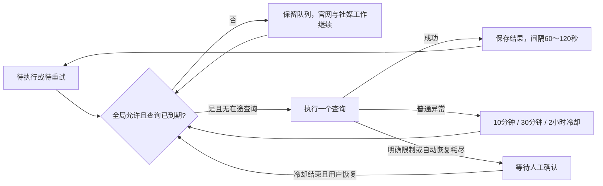

# 地图采集：稳定优先与自动恢复

更新：2026-09-25。优先保留进度、限制请求和明确等待原因，不追求并发速度。

## 默认策略

- 同一数据目录只运行一个 worker，Maps CLI 保持 `-c 1`。领取工作项时还检查全局是否已有地图查询正在执行，包括冷却结束后的试探查询。
- 正常查询结束后间隔 **60～120秒**。这是查询任务之间的间隔，不是浏览器页面子请求的逐请求限速。
- 超时、连接或采集进程异常：依次等待 **10分钟、30分钟、2小时**，每次冷却后只放行一个查询。成功后恢复正常低速节奏，三次自动恢复仍失败则转为人工恢复；不会无限重试。
- 明确验证码、频率限制、拒绝访问：立即保存保护状态并暂停整个地图来源，至少冷却30分钟后由用户确认恢复。缺少采集程序或启动失败也要求检查环境。普通结果不能静默解除人工暂停。
- 未确认的空结果：对该查询最多复核两次，分别间隔10分钟和30分钟。其余到期查询可以继续；复核后仍无法确认就保留为“需要处理”，不声称该地区没有企业。空结果次数与超时次数独立。
- 未执行查询始终保留 `pending`；禁止把剩余队列批量记作失败或受阻。只有实际尝试后无法完成的查询才记录异常。
- 已取得的企业持续入库，成功的工作项不重跑。重试发生在查询边界，未成功结束的查询可能重新访问相同页面，沿用现有入库去重。

## 持久化与接口

`maps_access_policy` 单例表继续保存 `not_before/manual_required/failures/reason`，无需删除或重建业务数据。`phase`、倒计时、下次尝试时间由持久化状态计算。重启或新建市场不会清除全局冷却。

每个查询的 `work_items.result.maps` 保存：

- `attempts/cycle_attempts`：已知的总尝试次数、本次人工恢复周期的尝试次数；在真实来源调用之前持久化。
- `transient_failures/empty_attempts/crash_attempts`：本周期的普通异常数、未确认空结果数、采集浏览器意外关闭次数，分别限制重试。
- `last_attempt_at/next_attempt_at`：上次发起时间、该查询最早可重试时间。
- `history`：历次尝试的时间、来源状态、停止原因及说明。
- `legacy_attempted/legacy_attempts_unknown`：旧记录确认尝试过但无法恢复准确次数时使用，不伪造历史次数。

`claim_item` 在事务中同时检查全局冷却、在途查询和单条重试时间。冷却不使用长时间 sleep 占住 worker；网页补全、其他任务和社媒任务仍可调度。worker 在独占锁下恢复孤立的 running 查询，即使其所属轮次已取消，也不会留下永久的来源占用；取消的轮次不会自动恢复。

来源返回的访问限制先于企业数据入库保存。即使某条企业入库发生冲突，也不能把已确认的 CAPTCHA 降级成普通网络重试。

`GET /api/overview.maps_policy` 返回当前 `phase`、原因、倒计时、下次尝试时间及连续恢复次数。`POST /api/maps/resume` 使用本地 token；保护冷却未结束返回409。确认恢复后，活动轮次内可恢复的实际异常项回到队列；成功项和用户暂停/取消的轮次不变。已结束轮次仍需在轮次中点击继续。

`GET /api/tasks/{id}/activity.workflow` 增加：

- `stages[].retry_pending/unattempted`：待重试、尚未执行的查询数，两者之和为地图 pending 数。
- `maps_recovery`：当前轮次适用的全局保护状态与最早调度时间；暂停、取消、历史已结束轮次不显示自动恢复承诺。
- `maps_queries/maps_query_issue_count`：最近最多20个有重试或异常记录的查询及总数量，默认折叠展示。成功且从未重试的查询不占用明细列表。每项含 `stop_reason` 与 `failure_kind`（`scraper_error` 采集程序异常、`no_results` 确实没有结果、`restricted` 平台限制、`null` 其他如用户暂停），历次尝试同样带 `failure_kind`。

界面以“已完成、待重试、等待恢复/执行、处理中、需要处理”解释地图进度。未执行队列不会推高执行结束比例。官网列表直接写“读取X页、联系记录Y条”，避免把两个数量误读为完成比例。

## 旧数据修复

`scripts/repair_maps_queue.py` 默认只预览并回滚；`--apply` 在持有 worker 锁的情况下先做 SQLite 在线备份，再执行幂等修复。仅修复最新或活动市场轮次中有明确旧“连续三次地图访问失败”批量标记、且没有该查询来源执行目录的未执行项；保留成功记录，不触碰暂停、取消及被新轮次替代的历史任务。

同一受影响轮次中已知超时和空结果项进入有限恢复流程。旧超时来源进入两小时冷却后一次试探，保留曾有三次连续失败这一事实；不会自动解除验证码或拒绝访问保护。旧日志和原始来源文件保留。

## 验证范围

使用临时数据库、模拟时间和合成来源结果验证全局单查询、三级冷却、独立空结果预算、人工恢复、成功项保留、取消后重启、来源限制先于入库、官网继续及历史修复幂等性。不会对 Google 进行压力测试；低速策略也不保证永远不遇到平台限制。

## 2026-10-15：采集浏览器意外关闭按查询重试
`browser_closed`（stderr 中的 `playwright: target closed`、`page crashed`、`browser has disconnected` 等）是本机 Chromium 进程事件，不是平台限流，因此从全局退避集合（TRANSIENT）移出，归入 `SCRAPER_CRASH`：
- 不增加全局 `failures`、不触发人工暂停，只施加普通的 60–120 秒查询间隔，其他查询照常执行。
- 该查询按 120、600、1800 秒自动重试最多 3 次（`maps.crash_attempts`）；用尽后工作项保持 blocked/partial，`retry_exhausted=true`，用户点“继续”重新排队，`resume`/`reset_cycle` 把 `crash_attempts` 归零。
- 崩溃错误常附带完整浏览器日志，单行可达 150–320 KB。超过 64 KB 的 stderr 行只取前 8 KB，按行首 4 KB 内顶层 `"error"` 字段识别崩溃特征，不再整行跳过后误判为 `empty_output`。
- 文案统一中文：采集程序异常以“采集程序异常：”开头，正常结束但无结果以“没有找到结果：”开头，用户暂停为“已暂停：…”。
