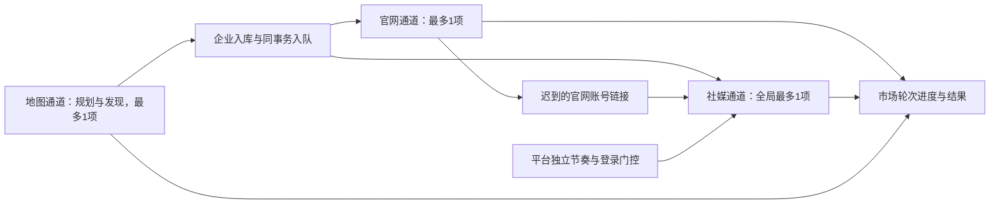

# 市场任务内的社媒检索与补全

2026-09-25 · 当前实现，稳定优先；评审问题已关闭，最终回归及本地部署验收完成。

产品规则见 [PRD-04](../product/overseas-lead-acquisition.prd.md#prd-04-通过官网与社媒发现业务入口)，页面行为见 [IX-02](../product/interaction-design.md#ix-02-创建与维护市场)，进度字段见 [任务流程与进度](task-workflow-progress.md)，交付状态见 [实施审计](../validation/2026-09-25-market-social-integration.md)。本文描述已在本机部署的集成设计；部署验收覆盖进程、页面及数据保留，未验证真实平台认证或读取可用性。

## 1. 执行通道与稳定性边界

保留一个 Worker 进程，使用 `ParallelWorkScheduler` 同时维护三个独立通道。每个通道全局最多执行一个工作项，最多三个业务项并行；不是每个市场、每个平台各获得一个并发额度。

| 通道 | 工作范围 | 单通道并发 |
|---|---|---|
| 地图 | `planning`、`discovery`；地区规划和 Maps 查询 | 最多 1 |
| 官网 | `refresh`；企业官网分批读取与检查点续扫 | 最多 1 |
| 社媒 | 市场关联及手动独立社媒运行中的搜索、基础资料、可选帖子 | 全局最多 1 |

企业一经入库，就能分别进入官网与社媒队列；不等整个 Maps 阶段结束，也不以存在官网为社媒检索前提。地图/官网通道各自轮转可执行的运行。社媒领取跳过尚未到期或需人工处理的平台，可继续其他可执行项，不用长时间睡眠占住社媒通道。该调度不承诺严格公平、即时抢占或固定完成时间。

`worker-single.lock` 由 Worker 全程持有（单实例与健康检查）。`worker.lock` 只在派发和执行作业时持有；所有通道结束（`scheduler.idle()` 为 True）后，在 1 秒休眠期间释放。恢复接口最多等待 5 秒拿锁；拿锁期间 Worker 跳过调度、不写库。有通道运行或正在清理时始终持锁，清理结束前不释放。退出时取消并等待三个通道及来源清理结束，再释放锁，避免后台协程仍在写入时恢复备份。

## 2. 设置、快照与历史兼容

| 字段 | HTTP/旧数据默认值 | 新建市场表单默认值 |
|---|---|---|
| `auto_social` | `false`；旧任务缺字段或无设置记录也视为关闭 | `false`（2026-10 P1 第二批起默认不勾选，可手动开启；已有市场的设置不变） |
| `social_platforms` | `["facebook","instagram","x"]` | 三个平台全部勾选 |
| `social_read_posts` | `false` | 不勾选，仅基础资料 |

支持平台为 Facebook、Instagram、X。启用自动检索或显式补充时至少选择一个平台。不改变地区/关键词决定的市场身份；相同市场定义复用已有市场，不通过新表单偷偷重置其设置。

`task_social_settings.payload` 保存未来设置。创建轮次时把三个选项写入 `runs.snapshot`，市场关联的 `social_runs.settings.market_options` 保存本轮业务选项，`settings.connections` 保存读取连接配置。`PATCH /api/tasks/{id}/social-settings` 只改变后续设置，不改已有队列、运行快照或历史结果；改变开关本身不会执行一次补充。平台恢复允许重载连接配置，业务选项仍按本轮快照执行，详见第 4 节。

加载页面、轮询、迁移和部署均不自动重放历史市场，也不批量为历史市场开启自动社媒。新建市场只保存定义；用户启动或定时计划正常创建新轮次后，按该轮快照入队。已有市场也可通过显式补充动作创建工作。

## 3. 企业流水线、证据与有界读取

1. 企业入库时，在同一事务中按本轮快照加入所选平台的企业名称站内搜索。没有官网的企业也能进入社媒队列。
2. 正常搜索结果先保存全部候选链接及来源证据，再按预算添加基础资料读取；候选不等于账号归属或人员岗位已确认。
3. 每家企业、每个关联社媒轮次最多创建 **8 个账号基础资料 `profile` 项**，跨所选平台合计。该预算限制读取，不截断候选证据，也不是市场企业数上限。
4. 官网随后发现的新账号增量并入同轮社媒队列，规范化并去重，仍受 8 个 profile 项的预算约束；已保存的成功结果保留。
5. `social_read_posts=true` 时，基础资料成功后才追加近期帖子读取。复用现有 reader 的 `max_posts` 配置（默认 3，上限 **5 条/单次账号读取**）；开启帖子选项不意味着一定读到 5 条，也不改变历史观察可累计更多帖子的事实。

同轮同 stage、同账号的完整成功结果可按现有规则复用，部分结果不作为完整成功缓存；缓存不制造新的采集日期。不采用账号、已合并或拒绝联系企业在入队、领取和结果应用时继续受保护。账号数、帖子数、企业数和具体人员数分别展示，不互相替代。

账号在 `profile/read` 执行期间被标为 `excluded` 时，`social_item_active` 检测到关联不再可用，Worker 协作取消并等待来源清理。`finish_social_item` 在写入事务中再次检查该企业与账号的关联；即使来源已返回，也取消该项并丢弃本次结果，不新增页面观察、帖子或后续工作。已保存证据保留，其他企业对同一账号的独立关联不因此被排除。

读取已经取得有效预览，但同时遇到需恢复的网络/限流时，先保留有效字段和页面观察，再让原项回到 pending。等待期间仍可查看这次部分预览；后续失败不清空历史有效资料。`result.partial=true` 必须进入企业及父轮次异常汇总，不能只因 state=succeeded 就归为全成功。

## 4. 平台节奏、失败与恢复

市场关联社媒使用 `social_platform_gates` 按平台持久化节奏。同一平台跨市场共用门控；Facebook 的登录或冷却不会暂停 Instagram、X、地图或官网。

| 情况 | 保留的工作状态与后续行为 |
|---|---|
| 正常执行，包括正常无结果 | 下一次同平台读取间隔随机 **60–120 秒**；成功后重置连续异常计数 |
| 网络异常、超时或限流 | 原项回到 pending，依次冷却 **10、30、120 分钟**，最多安排 3 次自动恢复尝试 |
| 第 3 次自动恢复仍未成功 | 转为人工处理，不再无限重试；若仍有 `next_attempt_at`，人工恢复也不能提前跳过冷却 |
| 需要登录或平台验证 | `waiting_login`，仅等待该平台人工处理；不把未执行队列记作完成或失败 |
| 专用会话被登录窗口占用 | `waiting_session`，等待释放后按队列重试 |
| 缺依赖、未配置或持续恢复失败 | `waiting_configuration`，处理连接/配置后人工恢复 |

`waiting_recovery` 表示自动恢复等待；正常间隔也可能返回 `pending` 和将来的 `next_attempt_at`，必须结合原因与时间显示。到期只是允许调度，并非承诺准点执行或平台已登录。

浏览器在首次预览后继续滚动或读取帖子时，仍保留结构化异常原因：登录页及帖子 HTTP 401/403 为 `login_required`，验证页为 `challenge`，限流为 `rate_limited`，网络/超时及服务端错误为 `network_error`。有效预览及已读帖子保留为 `preview_read`、`partial=true`；`social_policy` 同时检查 status 和 reason，使迟到的登录/验证进入 `waiting_login`，不能因已有预览而错误结束。首次打开即受登录/验证阻挡时不制造部分预览；普通帖子不存在等错误也不伪装成登录或网络冷却。

`POST /api/social/platforms/{platform}/resume` 无请求体。它解除允许恢复的平台门控，让保留的 pending 工作继续；冷却未到期返回 409，不能借恢复按钮跳过。调用不会打开外部社媒页面或发送消息。用户通过内部“去登录/处理连接”进入设置，自行处理并释放专用会话后再恢复。

恢复成功的同一事务中，重新加载已保存连接配置，更新所有活动市场父轮次（queued/running/paused）下未取消社媒子运行的 `settings.connections`。该操作只解除请求平台的门控，不改变其他平台门控、父轮次暂停状态、`market_options`、既有队列范围或未来市场设置，也不重写手动独立运行。后续领取使用更新后的连接配置，无需重建业务轮次。

## 5. 父轮次、终态与迟到结果

`market_social_runs` 明确关联市场父轮次和社媒子运行。社媒没有 Maps 查询工作项，不以复制工作项伪装成地图阶段。

- 社媒当前队列暂时为空时，只要本轮 Maps 或官网上游仍有 pending/running 项，就不能把子运行和父轮次判为全部结束；后续可能继续发现企业和账号。
- 企业总量、已结束量和结果量会随上游发现而变化。父轮次结束要求上游已关闭，并且关联社媒没有 pending/running；真实失败另按部分完成、失败、受阻汇总。
- 父轮次暂停后不再领取其社媒项；正在执行项的旧领取结果不能应用或扩展。恢复后重新领取使用新 `claim_token`，暂停前的迟到结果即使在恢复后返回，也必须丢弃。
- 父轮次取消时取消关联子运行与其未完成项；已取得证据保留，不继续创建后续搜索/profile/read。结果写入事务再次核对父状态、子状态、工作项状态、领取令牌、企业资格和账号是否已不采用。
- 这些控制沿关联表传播，不按 company_id 扫描所有运行。相同企业另行发起的手动独立社媒任务，不会被某个市场的暂停/取消误伤。

手动独立社媒仍使用 `/api/social/runs`，保留其单次最多 20 家、操作模式和历史重试语义；活动运行去重明确排除市场关联子运行，即使企业集合与执行选项相同也不跨归属复用。它与市场社媒共用单并发通道和专用会话锁，但不继承市场父轮次或市场平台门控状态。

关联 SocialRun 的 API 投影增加 `parent_run_id`、`task_id`。企业详情的 SocialDiscovery 据此提供父市场任务入口，由父轮次统一控制；手动独立运行不带这两个归属字段。企业内独立搜索/补资料按钮的活动运行判断排除市场子运行，仍保留独立运行自身的防重复提交规则。内部 `claim_token` 不出现在公开 `items[].result`，客户端既不提交也不展示它。

## 6. 已有市场的显式补充

`POST /api/tasks/{id}/social` 请求体为 `social_platforms`、`social_read_posts`，返回 **市场 `Run`**：

- 有 queued/running/paused 市场轮次时，附加到该活动轮次。paused 保持暂停；不会因补充动作自动继续。
- 若该轮次已有社媒配置，新增请求须与其执行快照兼容，不能静默改写已有队列的平台/帖子选项；当前不同配置被拒绝，需待该轮结束或取消后再补充。
- 没有活动轮次时，新建 `kind="social"`、`snapshot.social_only=true` 的仅社媒父轮次；保留旧轮次及其结束时间、统计与报告，不伪造新的地图发现或官网读取。
- 已有市场没有可处理成员时返回可读错误；不是启动一次空 Maps 检索。
- 手动请求只影响这次补充，不顺带打开市场未来的 `auto_social`。前端切换到返回的父 `Run.id`；完整报告用 `workflow.social.run_id` 这个子运行编号读取。

仅社媒轮次的 RunCard 使用社媒名称与 `social_done/social_total` 企业进度，不显示零地图/官网进度。Task.latest_run 可指向该社媒轮次，但市场 coverage 和发现统计继续从最近 discovery 轮次读取，避免一次资料补充把原发现范围、存量/新增统计清空。

旧备份恢复在 audit/social 迁移后补执行 `_migrate_market_social`，建立未来设置、父子关联和平台门控三表；缺历史设置仍关闭，不因此创建采集队列。临时结构验证不等同于在真实库执行恢复。

## 7. 验证边界

稳定性优先于吞吐：不为缩短等待提高并发、缩短平台间隔或绕过登录/冷却。测试使用临时数据库、假来源和 asyncio 事件；前端使用 mocked API。迟到登录/验证、不采用账号的在途读取、独立任务归属和恢复连接配置已有对应修复及回归覆盖，评审问题已关闭。

最终后端回归 **705 项及另 44 个子测试通过（35.43 秒）**；前端 **111 项通过，tsc 与 Vite 构建通过**。隔离端口 18766 验证了并行/登录/详情、375px 布局及新表单默认值，未为验收发起真实采集。本地 API（18765）与 Worker 已重启，页面重新加载后新增字段可见，Worker 存活。

以停机备份为基准核验，195 家企业、2831 个联系人、2 个市场任务、2 个轮次的原有 ID 全部保留，数据库完整性正常；`social_runs=0`、`market_social_runs=0`，未触发历史社媒补采。三平台 Cookies 文件保留，线上认证有效性未验证。备份路径、原始测试日志、部署核验及计数基准统一记录在[实施审计](../validation/2026-09-25-market-social-integration.md)。
