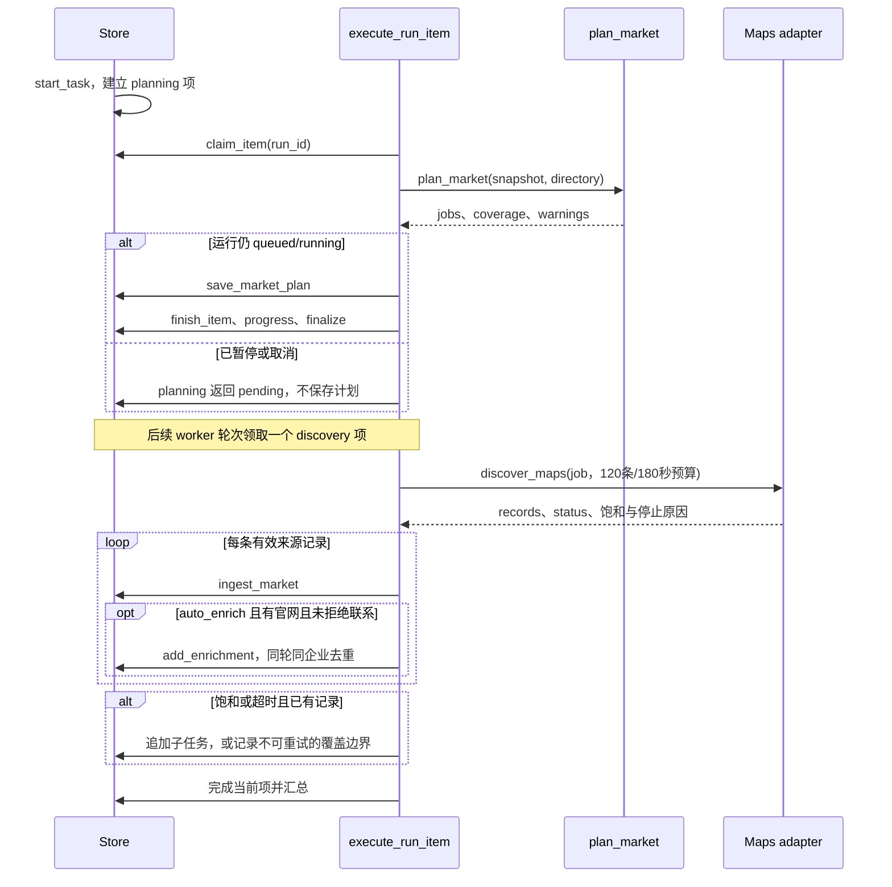
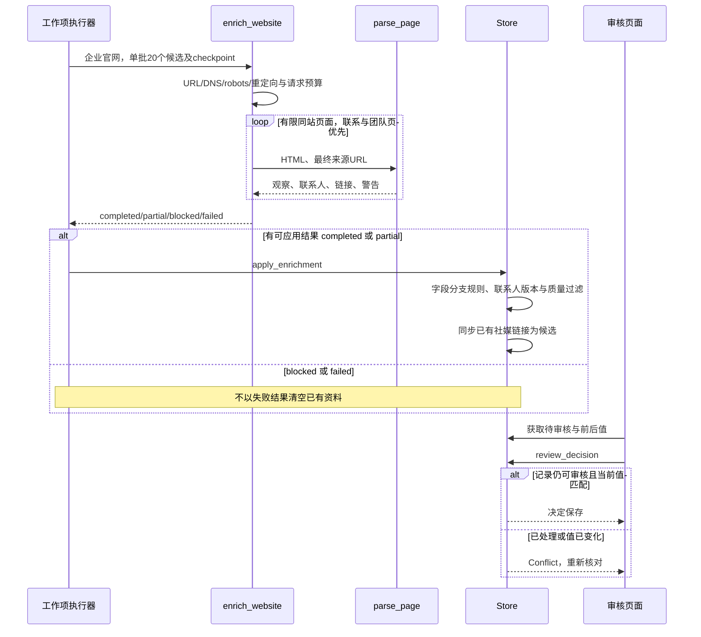
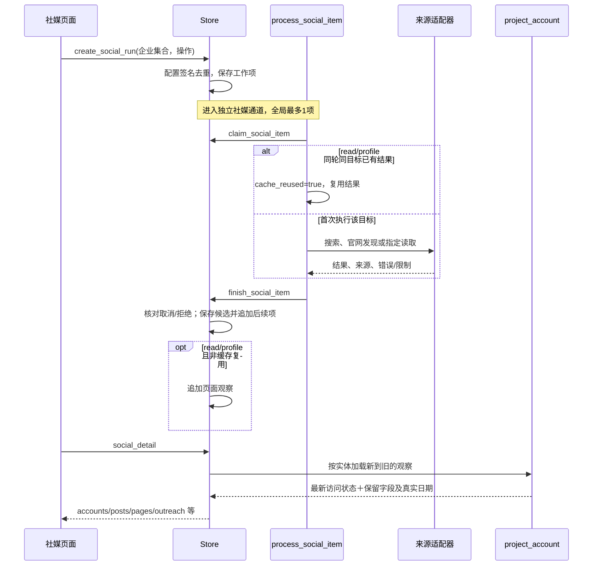
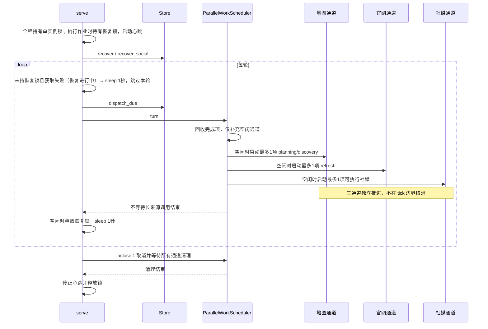
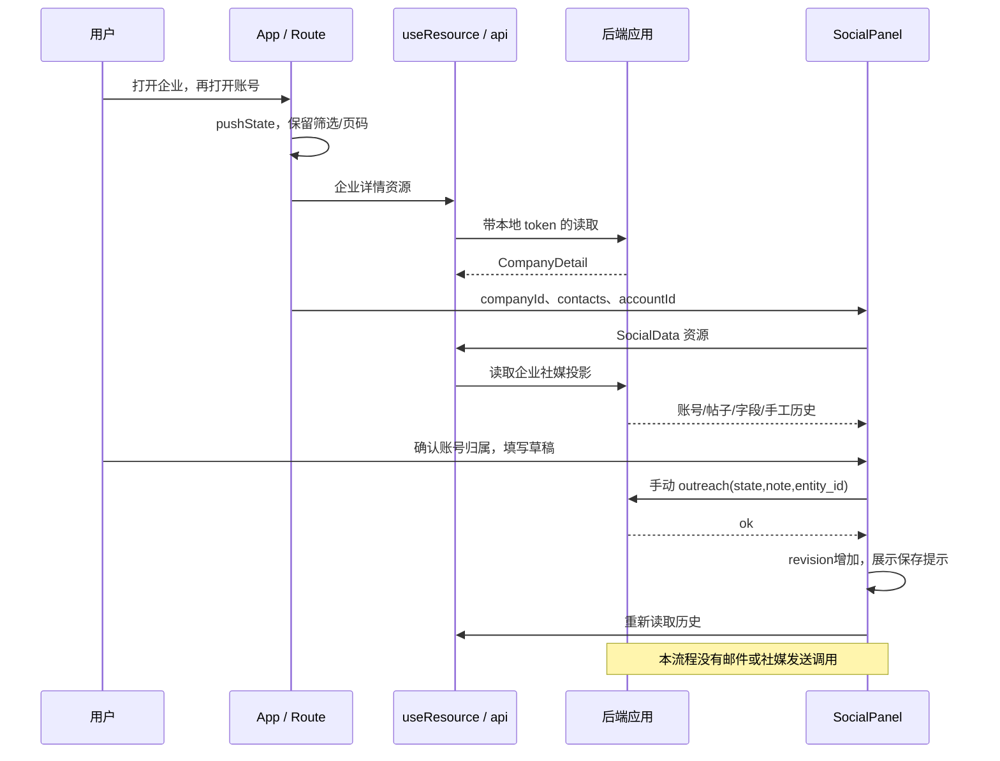

# 模块设计：当前实现、内部协作与验证边界

状态：当前工作树源码核对稿。本文描述已有实现，不把产品评审稿中的目标能力写成已实现。

产品基线：[PRD](../product/overseas-lead-acquisition.prd.md)、[交互设计](../product/interaction-design.md)、[UI 设计](../product/ui-design.md)。

本文负责模块职责、源码入口、内部调用契约、时序和失败边界；HTTP 完整契约、数据库表结构、整体部署拓扑及规划发送由配套文档负责。下文出现的路径仅用于说明页面与模块如何接合，不代替 API 规范。Python 返回值多为普通 `dict`，表中的字段是当前调用者实际依赖的结构，并非新增类型定义。

核对方式：静态读取源码与已有测试。本次没有运行采集、启动或重启服务、实例化业务 `Store`、操作业务数据库，也没有重新执行业务测试。测试文件存在不等于本轮测试通过；真实平台可用性、召回率和浏览器交互另需验证。

2026-09-25：本文已同步[市场社媒集成](market-social-integration.md)。下文三通道、市场父子轮次和平台门控为当前实现；手动独立社媒的操作模式单独说明。评审问题已关闭，最终后端/前端回归、构建和本地部署验收完成；测试与部署证据见[实施审计](../validation/2026-09-25-market-social-integration.md)。

## 1. 模块边界总览

| 模块 | 当前职责 | 主要源码入口 | 不承担的职责 |
|---|---|---|---|
| 市场规划与 Maps 发现 | 城市参考范围、查询展开、持久化工作项、饱和细分、来源记录标准化 | `market_plan.py`、`market_worker.py`、`sources/maps.py` | 严格行政边界核验、全城召回证明 |
| 企业归一、官网提取与审核 | 来源身份归一、门店关联、字段观察、联系人质量过滤、人工决定与展示投影 | `market_store.py`、`db.py`、`sources/website.py`、`contact_*.py` | 通用实体合并/撤销、邮箱收信验证、完整关键员工关系图 |
| 社媒发现、登录读取与聚合 | 市场父子关联、未来设置/快照、候选链接、平台门控、有限资料/帖子读取 | `market_social.py`、`social_policy.py`、`social_discovery_store.py`、`social_worker.py`、`sources/social_*.py`、`social_projection.py` | 自动确认人员身份、实际私信或邮件发送 |
| worker 与运维 | 单实例锁、工作项调度、恢复、心跳、到期计划、恢复备份互斥 | `worker.py`、`worker_scheduler.py`、`work_item_executor.py`、`db.py` | 并行 worker、抢占式时间片、跨社媒运行公平调度 |
| 前端页面数据流 | URL 上下文、请求/轮询、局部动作、列表投影、错误反馈 | `App.tsx`、`hooks.ts`、`api.ts`、`pages/`、`social/` | 已持久化的多入口编辑器、可靠发送状态机 |

路径约定：表中的 Python 路径相对 `leadworkbench/`，前端路径相对 `frontend/src/`。后台模块通过 `Store(MarketStoreMixin, SocialStoreMixin)` 组合业务方法；这些 mixin 不是独立服务，也没有各自的进程或消息队列。

## 2. 市场规划与 Maps 发现

### 2.1 职责与入口

- [`market_plan.py`](../../leadworkbench/market_plan.py)：校验城市/国家与业务条件；城市级地理编码；缓存、请求间隔；根查询和网格生成；确定性任务 key；细分及能力耗尽说明。
- [`sources/maps.py`](../../leadworkbench/sources/maps.py)：包装本地 Maps 可执行文件，增量读取 JSONL，校验来源记录，终止并回收子进程，写入运行诊断文件。
- [`market_worker.py`](../../leadworkbench/market_worker.py)：执行一个市场发现项、入库、追加官网项；判断饱和并追加细分项，保留无法继续覆盖的叶子。
- [`market_store.py`](../../leadworkbench/market_store.py)：`create_market`、`save_market_plan`、`append_market_jobs`、`ingest_market` 及市场进度投影。
- [`work_item_executor.py`](../../leadworkbench/work_item_executor.py)：根据 `stage` 调用规划、发现或官网读取，完成工作项并汇总运行。

### 2.2 内部接口

| 调用 | 输入 | 输出 / 副作用 |
|---|---|---|
| `plan_market(config, data_dir)` | `city`、可空 `state`、两位 `country_code/country`、`company_types[]`、`keywords[]` | `{jobs, coverage, warnings, status}`；`coverage` 包括 `scope_label/bbox/attribution`；写地理编码缓存 |
| `split_job(job)` | `query/geo/bbox/level/zoom/depth/key` | 四个子任务或 `[]`；纯计算，不发请求 |
| `discover_maps(query, output_dir, *, limit, timeout_seconds, should_stop, geo, zoom, depth)` | 单行查询、来源工作预算、可选坐标及合作式停止回调 | `{status, records, warnings, stop_reason, saturated, exhausted}`；写原始结果、归一结果、元信息和进程日志 |
| `discover_market_item(store, run, item, discover)` | `run.snapshot`；`item.target` 为序列化的 job；可注入来源函数 | 返回来源结果；逐条 `ingest_market`，可追加细分项和官网复核项 |
| `save_market_plan(run_id, plan)` / `append_market_jobs(run_id, jobs)` | 运行标识及计划 | 保存覆盖信息、按 job key 去重追加工作项 |
| `ingest_market(record, run_id, query, task_id)` | 来源标识、链接、名称及可选企业字段 | 企业记录及本轮 `_outcome` / `_changed` 分类；较旧来源不覆盖当前字段，但仍记录市场遇见及归属；身份规则见第 3 节 |

标准化 Maps 记录核心字段：`source_key/source_url/name/address/phone/website/latitude/longitude/category/observed_at`，另有明确营业状态及可选 `source_aliases`。CID 优先，其次 Place ID，最后保留查询参数的 URL 哈希；查询的 `input_id` 不作为地点身份。

### 2.3 执行时序

### 2.4 预算、失败边界与现状差异

1. 每个展开关键词有一个根查询；地理编码成功时另有 4×4 初始网格。饱和后按 2×2 细分；最大层级 3，子格最短边不能低于 0.5km，发现任务预算 4096 项。每个来源项最多取 120 条、180 秒、深度参数 10。**这些是内部工作预算，不是整个市场企业数量上限。**
2. 成功地理编码缓存不设过期；失败缓存 15 分钟。跨数据目录共用当前桌面账号的文件锁与 15 秒请求间隔。失败可降级为城市文字查询；缓存损坏不会自动反复请求。缺少 bbox 的饱和任务不能细分。
3. `saturated` 表示达到单项预算；`exhausted` 仅表示 CLI 成功结束且未到预算，不证明城市已覆盖或 Maps 已给出全量结束标记。
4. 空 JSONL 被标为 `blocked/empty_output`，不当作真实零企业。缺二进制/启动失败、验证码或来源级限制可阻止同运行其余发现项；孤立空网格不阻止其他网格，独立官网项仍可继续。
5. 已取得的来源记录先保存，再处理细分/失败。`capability_exhausted` 持久化后不可通过“继续”无限重放；总状态可能为 `partial`。
6. 新市场使用 `limit=0` 作为内部模式标记；执行器仍保留旧 `limit>0` 发现分支。不要把旧分支的总量截断规则描述成当前市场交互。
7. PRD-02/03 缺口：没有严格地理归属验证。新建市场企业时 `city/country` 仍可来自任务，不能当作地址核实结果。类型展开仍包含服装场景词汇，不是已完成通用行业词库。

### 2.5 验证用例

| 已有测试入口 | 验证内容 | 不可据此推导 |
|---|---|---|
| `tests/test_market_plan.py`：`test_city_grid_cache_and_no_company_cap`、`test_failure_ttl_recovers_then_success_never_expires` | 网格、缓存和无市场总量截断 | 全城企业召回率 |
| `tests/test_market_worker.py`：`test_dense_query_subdivides_and_does_not_finish_at_batch_cap`、`test_saturated_leaf_remains_explicitly_unresolved` | 饱和细分、不可扩展叶子的部分完成状态 | 无限扩展能力 |
| 同文件：`test_market_empty_tile_does_not_abort_other_tiles` | 空项与来源级阻塞区分 | 空结果即无企业 |
| `tests/test_maps.py`：`test_timeout_kills_descendant`、`test_task_cancellation_metadata`、`test_exhausted_only_for_success_below_cap` | 假可执行文件边界、清理及诊断语义 | 当前真实 Maps 可访问 |

## 3. 企业归一、联系人过滤与字段审核

### 3.1 职责与入口

[`market_store.py`](../../leadworkbench/market_store.py) 与 [`company_comparison.py`](../../leadworkbench/company_comparison.py) 处理来源别名、复合身份、门店区分及语义比较；[`sources/website.py`](../../leadworkbench/sources/website.py) 把受限官网遍历与 HTML 提取分开；[`db.py`](../../leadworkbench/db.py) 应用观察、审核及人工修订。

[`contact_quality.py`](../../leadworkbench/contact_quality.py) 提供纯过滤函数；[`contact_fields.py`](../../leadworkbench/contact_fields.py) 从保留证据生成可读字段；[`contact_projection.py`](../../leadworkbench/contact_projection.py) 聚合同一联系记录的来源并分类。展示投影不会因重新格式化制造新采集时间。

### 3.2 内部接口

| 调用 | 输入 | 输出 / 关键行为 |
|---|---|---|
| `ingest_market(record, run_id, query, task_id)` | Maps 记录与有效市场运行 | 来源别名命中，或保守身份匹配；写观察、市场本轮归属和变化 |
| `enrich_website(url, *, max_pages=WEBSITE_BATCH_SIZE, checkpoint=None)` | 官网 URL；单批1–20候选链接；可恢复检查点 | 本批增量内容、`has_more/checkpoint/summary`；详见[分批续扫方案](website-batch-design.md) |
| `parse_page(html, source_url)` | 有限 HTML 正文及真实来源 URL | `{observations, contacts, social_links, links, warnings}`；不执行网页脚本、不合成邮箱 |
| `invalid_contact_reason(contact)` | 字段映射或数据库行 | 原因码或 `None`；当前解析和历史重分类实际使用的保守策略 |
| `contact_quality(contact)` | 联系字段映射 | 严格原因码或空字符串；独立纯函数，不能据其存在声称所有入库链路都已使用严格策略 |
| `apply_enrichment(id, payload, run_id="")` | 企业与官网结果 | 仅接受 `completed/partial` 结果；写来源、联系人版本、冲突、社媒链接；随后重分类 |
| `update_company(id, revision, fields, notes, status, business_types)` | 人工输入及读取时修订号 | 修订保护；过期抛 `Conflict`；更新人工确认信息 |
| `review_decision(id, decision)` | `accept/reject` | 保存决定；重复审核或当前值已变化时冲突；重复企业候选不允许接受为覆盖合并 |
| `group_contact_records(records, website, include_excluded=...)` | 当前联系人及同身份来源版本 | 带 `fields/sources/record_ids` 的展示集合 |
| `categorize_outreach(records)` | 上述展示集合 | `procurement/email/other/irrelevant` 分类；合格同邮箱记录可被聚合 |

### 3.3 身份与观察规则

- 相同 CID/Place ID/URL 别名关联已有来源。别名指向多个历史地点或 CID 冲突时抛错，不自动合并。
- 新来源仅在唯一强身份候选成立时复用企业。比较使用国家、规范化名称、地址、电话/域名及地点线索；不凭名称或共用官网直接合并。不同门店保留独立记录；不确定同名对象进入重复候选审核。
- 稳定地点身份的新地址更新位置并留历史；较旧的来源响应不能把地址回滚。
- 非空字段才进入观察处理。**市场运行与独立复核是两个分支**：市场分支按同来源历史比较，无人工保护的字段可随新观察更新；人工保护值受挑战时进入审核。非市场分支遇到不同的已有非空值时进入审核，空值自动补全、纯格式差异跳过。不能笼统写成“所有变化自动更新”或“所有变化必须审核”。
- 联系人新记录自动收录；非空身份字段发生冲突时保存版本并进入待审核。采用决定与采集审核状态分开保存，后续采集不能静默复活不采用记录。
- 解析采用人员卡片/结构化人员与同块证据，部门邮箱不能归给卡片附近的具体人；供应商入口要有联系意图。历史重分类归档明显错误记录，保留来源和变化；错误人名关联被撤下时，原文明确出现的真实邮箱可降为企业通用入口。占位或第三方插件邮箱不按此规则复活。

### 3.4 官网到人工审核时序

### 3.5 失败边界与 PRD 缺口

官网读取限制同站遍历、响应大小、DOM 大小/深度；请求次数和总时间现按批次计算，剩余队列持久化并自动续扫（2026-09-24更新）；robots 缺失的 404/410 可继续，不可读/不识别的规则失败关闭。联系、团队、采购、供应商页优先；无关路径跳过单独计数。没有受保护的动态官网渲染回退；只读到脚本外壳不是完整官网。

`partial` 可以保留已取得内容；`last_checked_at` 在当前 `apply_enrichment` 中只于 `completed` 更新。因此该字段不等于最近一次尝试时间。`reclassify_contacts`、启动时迁移与历史审核清理有写入副作用，不能在只读审计中通过实例化业务 Store“顺便检查”。

PRD-05/06 尚未完整落地：社媒字段未形成具体人员/岗位/入口的统一确认链路；同人跨平台聚合、共享入口但人员独立、关键员工分类仍是目标。当前入库有同邮箱回查，展示有按邮箱聚合，不能宣称已满足新版“多人共用邮箱保留多个人员”的模型。

当前企业库 `procurement_count` 按邮箱或联系身份去重，`email_count` 为排除采购等用途后的邮箱，`social_count` 包含未排除的候选账号；这些不是三个可相加的“人数”。新版待确认单列与采购优先级示例属于待实施口径。

### 3.6 验证用例

| 已有测试 | 主要断言 |
|---|---|
| `tests/test_branch_lifecycle.py`：`test_branches_do_not_need_review_and_same_place_move_updates_history`、`test_older_listing_does_not_restore_stale_address` | 分店独立、同地点搬迁、迟到数据不回滚 |
| `tests/test_auto_fill.py`、`tests/test_format_reviews.py` | 空值补全、纯格式变化不产生无意义审核、真实变化保留 |
| `tests/test_contact_quality.py`、`tests/test_extractor_quality.py` | 栏目/宣传文字不是人员，第三方与占位邮箱过滤 |
| `tests/test_contact_fields.py`：`test_shared_mailbox_does_not_inherit_person_fields` | 通用邮箱不借用个人电话、语言或分机 |
| `tests/test_contact_projection.py`：`test_rejected_contact_is_not_revived_by_new_evidence` | 不采用决定不被新证据覆盖 |
| `tests/test_website.py` | 网络边界、robots、遍历预算及解析场景；以测试替身为边界，不证明真实站点完整性 |

## 4. 社媒发现、专用登录读取与聚合

### 4.1 职责与入口

- [`social.py`](../../leadworkbench/social.py)：链接分类、平台 URL 规范化、搜索建议及组织 `sameAs` 证据。
- [`social_discovery_store.py`](../../leadworkbench/social_discovery_store.py)、[`social_run_policy.py`](../../leadworkbench/social_run_policy.py)：运行身份、工作项生成/领取/完成、来源级阻塞、重试与结果聚合。
- [`market_social.py`](../../leadworkbench/market_social.py)、[`social_policy.py`](../../leadworkbench/social_policy.py)：市场父子轮次、未来设置与执行快照、入库/官网新增账号的同事务入队、平台独立节奏及恢复。
- [`social_worker.py`](../../leadworkbench/social_worker.py)：一次执行一个社媒工作项；使用运行的读取配置快照。
- [`sources/social_discovery.py`](../../leadworkbench/sources/social_discovery.py)：本机 SearxNG、官网社媒候选、无登录公开预览。
- [`sources/social_platform_search.py`](../../leadworkbench/sources/social_platform_search.py)、[`sources/social_browser.py`](../../leadworkbench/sources/social_browser.py)、[`sources/social_profile.py`](../../leadworkbench/sources/social_profile.py)：FB/IG/X 专用会话、站内搜索、账号头部资料与有限帖子读取。
- [`sources/social_combination.py`](../../leadworkbench/sources/social_combination.py)、[`sources/social_optional.py`](../../leadworkbench/sources/social_optional.py)：显式选择 HTTP、浏览器、Instaloader 或 YouTube API。
- [`social_projection.py`](../../leadworkbench/social_projection.py)、[`social_store.py`](../../leadworkbench/social_store.py)：跨观察聚合、账号归属决定、共享账号历史、手动跟进记录。

### 4.2 内部接口与操作分流

| 调用 | 输入 | 输出 / 行为 |
|---|---|---|
| `create_social_run(company_ids=None, pilot=False, read_only=False, platform_search=False, profile_only=False)` | 1–20 家企业，或自动试点样本；互斥操作参数 | 运行详情及处理项；同企业集合＋操作＋执行配置的活动运行可复用 |
| `start_market_social(task_id, platforms=None, read_posts=False)` | 市场及显式平台/帖子选择 | 返回市场父 Run；附加活动轮次或创建 `kind=social` 的仅社媒轮次，保留历史 |
| `set_task_social_settings(task_id, payload)` | auto_social、social_platforms、social_read_posts | 保存未来设置并返回 Task；不改当前执行快照 |
| `resume_social_platform(platform)` | facebook/instagram/x | 解除可恢复门控、保留成功和 pending；重载已保存连接，业务快照不变；冷却未到期拒绝 |
| `execution_signature(settings)` | 操作标记、SearxNG URL、连接配置 | 确定性字符串；默认配置兼容旧快照，操作不同不共用任务 |
| `claim_social_item()` | Store 当前任务集合 | 一个带 `settings` 的工作项或 `None` |
| `process_social_item(store, *, search, read, platform_search)` | Store；可替换来源边界 | 是否领取项；完成结果或异常结果写回 |
| `search_searx(endpoint, query)` | 校验过的本机搜索 URL、查询词 | `status/results/engine_failures/message`，失败附 `reason` |
| `search_platform(platform, query, directory, settings)` | FB/IG/X、当前企业名称、专用 profile、配置 | 候选 `links` 与来源证据，或登录/验证/读取错误 |
| `read_public(url, stage)` | 官网发现或公开预览目标 | 官网 `links`，或账号 `title/description/fields` 与访问结果 |
| `read_combined(url, directory, settings)` | 已知账号/帖子及连接配置 | 指定 provider 的有限预览/帖子结果 |
| `project_account(observations)` | **非空、按新到旧排列**的 `(payload, observed_at)` 序列 | 最新访问状态、最近非空成功字段、字段来源时间、不同历史值、去重帖子 |
| `decide_social(cid, eid, status, scope, revision=None)` | 企业—实体关系、状态、范围、可选修订号 | `{ok: true}` 或冲突；不建立采购人员身份 |
| `record_social_outreach(cid, eid, state, note)` | 已确认入口；`draft/contacted/replied/closed`；非空、最多 5000 字 | 插入一条手工记录，返回 `{ok: true}`；没有发送网络调用 |

公开 SocialRun 投影对市场关联运行附 `parent_run_id/task_id`，不返回 settings 或 `items[].result.claim_token`。企业 SocialDiscovery 使用父归属字段导向市场任务统一控制；市场子运行不禁用企业内独立搜索/补资料按钮，手动独立运行仍保留自身取消/重试操作。手动创建运行的活动去重排除市场子运行，不因企业与执行选项相同而跨归属复用。领取令牌只属于 Worker 内部协议。

手动独立社媒的四类运行不可混为“搜索”；它们不受某个市场的暂停/取消控制：

| 操作 | 初始项与后续项 | 当前边界 |
|---|---|---|
| 常规发现 | 官网项＋搜索项＋已有账号读取；新候选可追加 read | 当前自动 SearxNG 查询筛选 Instagram/Facebook/TikTok，不等于 FB/IG/X 三平台站内搜索；发现追加 read 有每企业同运行少于 8 项的检查，不能当作全局统一上限 |
| `read_only` | 已关联且未排除的账号 read | 没有账号时拒绝；不必先重新搜索 |
| `profile_only` | 已有关联账号 profile；内部同时设 `read_only` | 直接走 `read_browser(..., profile_only=True)`，不会按组合路由使用 Instaloader；非 FB/IG/X 浏览器平台会返回不支持 |
| `platform_search` | 每企业 FB/IG/X 搜索；候选追加 profile | 不依赖官网；自动补基础资料，帖子需另行读取 |

市场关联流水线另以轮次快照为准：所选 FB/IG/X 站内搜索 → 基础资料 → 可选帖子；没有 20 家市场总量截断。每企业每轮最多 8 个 profile 项，所有候选证据先保存；官网迟到账号可增量入队。帖子默认关闭，开启后沿用 reader 默认 3/最多 5 条的单次账号预算。历史市场默认不开启，不自动回放。

### 4.3 登录与读取边界

`open_session/close_session/session_status` 使用应用数据目录中的专用 profile，不复用用户日常浏览器。每个平台通过 `profile_lock` 互斥登录窗口与后台读取。界面报告的 open/closed 来自进程内会话登记和子进程状态，**不证明登录有效，也不代表跨 API 重启的完整进程发现机制**；实际读取还要检查登录页、密码框、验证页及页面结构。

连接配置由 `social_connections.py` 管理；普通配置在创建运行时写入 `settings.connections`，密钥单独保存在本地私有文件、不返回明文。平台恢复成功时，重载已保存连接并更新活动市场父轮次下未取消子运行的连接配置；`market_options`、既有队列范围、父轮次暂停状态及手动独立运行保持不变。YouTube 密钥在执行时读取，并非运行快照中的固定凭据。

组合路由：配置 YouTube key 时选 YouTube API；Instagram 显式选 Instaloader 时走独立子进程；FB/IG/X 在配置 `reader=browser` 时走浏览器；否则 HTTP。实际默认配置为 `reader=http`、`instagram_reader=browser`，因此 Instagram 仅设置为“browser”而 `reader` 仍为 HTTP 时，组合路由仍是 HTTP。profile-only 另按上表处理。

搜索适配器为本机服务校验 URL，公开 HTTP 路径有 `PublicResolver`/robots 检查。浏览器路径有 URL 和主框架平台导航检查，但不应把它描述为完全复用 HTTP 的 DNS 固定和 robots 链路。不同 provider 的访问控制与预算须分别验证。

### 4.4 发现与聚合时序

### 4.5 失败、取消与时间语义

- `no_results` 仅在搜索正常且无结果时出现；搜索引擎未响应而无结果属于受阻。无官网是 `skipped/missing_website`，不代表无社媒账号。
- `preview_read` 映射为项成功。市场关联项的登录/验证、会话占用、配置或可重试网络/限流先经过平台门控，保留 pending，不将未执行队列计结束；其他不可恢复读取错误仍可受阻/失败。手动独立项保留原有 `auth_required/challenge/unreadable → blocked` 语义。
- 滚动或帖子读取中迟到的登录、验证、HTTP 和超时异常保留结构化 reason；已取得有效预览时返回 partial，并保留资料与帖子。策略同时检查 status/reason，使 `preview_read` 中的 `login_required/challenge` 仍进入登录等待，网络/限流仍进入对应冷却。
- 手动独立运行的搜索服务失败、同 hostname 后续读取阻塞保留原规则。市场运行则按平台全局节奏跳过不可执行项：正常 60–120 秒；网络/限流 10、30、120 分钟，最多三次自动恢复后转人工。只限制受影响平台，其他平台、地图和官网可继续。
- `cancel_social_run` 把 pending/running 项标为取消。Worker 定期调用 `social_item_active`，失效时协作取消并等待来源清理；结果写入事务仍拒绝已取消结果。账号在 profile/read 期间被标为“不采用”也触发这两层检查，丢弃迟到资料/帖子并结束该项，避免留下 running 孤项。进程取消另走领取释放与恢复路径。
- 手动独立社媒 `/social/runs/{id}/retry` 建立新运行并保留历史，用当前连接配置；市场平台 `/social/platforms/{platform}/resume` 恢复原 pending 队列并重载已保存连接，保留本轮业务快照。两者不能互换描述。
- 市场父轮次暂停/取消沿 `market_social_runs` 传播。领取和完成事务核对父/子/项状态与 `claim_token`，暂停前旧领取返回的数据不得在恢复后写入或扩展。手动独立社媒即使涉及相同企业，也没有市场父关联，不受其控制。
- Maps/官网上游仍有 pending/running 时，社媒暂空不能结束父子轮次；迟到的企业/账号可能增加分母。完整终态须合并上游与社媒真实剩余状态。
- 同一社媒运行内，同 stage、同目标的已完成结果可跨关联企业复用，包括失败结果；不新增伪造的新页面观察。聚合器忽略旧版本写入的缓存观察。
- 最新失败状态与上次有效资料可以同时展示。标题、简介、字段仅来自成功预览的最近非空值；不同旧值进入历史，每项保留其来源日期，失败页面内容不晋升为账号资料。
- 若本次已取得有效部分预览但平台还需恢复，先保存有效观察，再把项保留为 pending；不因重试丢弃预览。企业计数和父轮次汇总同时检查 result.partial，避免 succeeded 项中的部分失败被漏计。
- 单次读取帖子有预算；聚合器可积累多个成功观察的帖子，不能把单次 `max_posts` 当作整个详情历史的总量上限。

**手动 outreach 不是实际发送。** 当前要求账号关系已确认、企业未拒绝联系后才允许记账；scope 为第三方也能成为已确认关系，不能反推为未来发送准入。API 没有收到发送凭据，`contacted/replied` 是用户补记。前端的“实际发生”勾选也是交互约束，不是投递证据。共享账号历史展示最近最多 200 条相关记录以辅助人工判断，不具备发送幂等机制。PRD-08/09/10 的入口编辑器、发送身份、受理/未知/退信、统一回复仍未实现。

### 4.6 验证用例

| 已有测试 | 主要断言 |
|---|---|
| `tests/test_social_refresh_semantics.py`：`test_distinct_actions_do_not_reuse_profile_job`、`test_changed_execution_settings_get_a_new_job` | 操作与配置签名隔离 |
| 同文件：`test_shared_account_cache_does_not_create_a_new_observation`、`test_failed_read_does_not_promote_untrusted_fields_or_refresh_old_date` | 缓存不伪造观察、失败保留真实字段日期 |
| `tests/test_social_platform_search.py`、`tests/test_social_profile.py` | 无官网站内搜索；候选不是确认；基础资料与帖子分开 |
| `tests/test_social_connections.py`：`test_profile_lock_prevents_concurrent_login_and_read` | 专用 profile 互斥 |
| `tests/test_social_discovery.py`：`test_source_failure_preserves_coverage_and_other_stages`、`test_missing_website_is_skipped_not_no_results` | 来源局部失败与未尝试语义 |
| `tests/test_social.py`、`frontend/tests/socialPanelDom.test.ts` | 归属、手动记录及草稿展示；不是发送验收 |

## 5. worker 调度、恢复与运维

### 5.1 内部接口与顺序

| 入口 | 契约 |
|---|---|
| `worker.serve(directory)` | 全程持有 `worker-single.lock`；只在派发和执行作业时持有 `worker.lock`（所有通道空闲后在休眠期间释放）；启动心跳、恢复、每秒派发/补充空闲通道；退出等待全部通道清理 |
| `ParallelWorkScheduler.turn(...) / aclose()` | 地图/官网/社媒各最多一个在途项，只补充空闲通道；关闭时取消并等待全部项 |
| `process_run_item(...)` / `execute_run_item(...)` | 按可选 stages 过滤原子领取，最多执行一项；地图通道 planning/discovery，官网通道 refresh；支持假来源注入 |
| `process_run(...)` | 兼容批处理入口：持续执行同运行直到无可领项；**serve 不使用此排空调用** |
| `worker_health(directory)` | 同时判断单实例锁被持有和心跳年龄小于 30 秒；不是仅看文件存在 |
| `recover()` / `recover_social()` | 恢复中断 running 项为待处理，已完成项保留；普通运行恢复为 queued |
| `dispatch_due()` | 到期计划按日历月和时区生成/复用运行；返回后再开始本轮执行 |

### 5.2 非抢占与有限公平性

**一个 Worker，三个独立通道，各最多一个业务工作项。** 地图通道处理 planning/discovery，官网通道处理 refresh，社媒通道全局串行处理所有平台；单个平台不是另一个并发通道。已有兼容 `WorkScheduler` 不再是 `serve` 生产入口。

地图和官网通道各维护活动运行 deque，跳过没有相应可领项的运行。企业入库即可同时产生官网和社媒工作，不等 Maps 全部结束；官网项继续按批次检查点与已处理批数轮转。

社媒领取按运行最近完成时间、创建时间、stage 和项顺序选候选，并跳过父轮次不允许执行或平台尚未到期/需人工处理的项。没有跨运行严格公平或固定等待上限承诺，不能把 SQL 排序等同于公平调度算法。

通道间不相互等待来源返回；一个长 Maps 或社媒调用只占住本通道。通道内仍无时间片抢占，来源预算、平台间隔和清理耗时都不等于任务必在某时刻启动的承诺。稳定性优先，不通过增并发或跳过冷却提高吞吐。

用户控制与公平调度应分开理解：Maps 通过 `should_stop` 合作式检查；官网执行器每 0.5 秒检查运行状态并取消正在读取的协程；planning 在调用返回后检查状态；社媒取消见第 4.5 节。**合作式取消不等于新任务能抢占当前项。**

### 5.3 调度时序

### 5.4 锁、运维与失败边界

- `worker-single.lock` 由 Worker 全程持有（单实例与健康检查）。`worker.lock` 只在派发和执行作业时持有；所有通道结束（`scheduler.idle()` 为 True）后，在 1 秒休眠期间释放。恢复接口最多等待 5 秒拿锁；拿锁期间 Worker 跳过调度、不写库。有通道运行或正在清理时始终持锁，清理结束前不释放。`worker.lock` 与 API 备份恢复互斥；API 另查活动运行（queued/running 仍阻止恢复，paused 不阻止）。
- 心跳每 5 秒以临时文件替换写入；健康要求锁与新鲜心跳同时成立。停止时取消心跳并清理文件。新鲜文件但进程已死不能显示后台在线。
- 进程取消将当前项恢复到可重试状态并等待来源清理；工作项完成前的崩溃仍可能让来源重读，不能声称来源调用 exactly-once。已完成项不会因恢复而全部重跑。
- 执行器按来源结果或平台恢复规则保存状态；调度器回收已结束通道并记录异常，不把失败变成成功。`scripts/start.sh` 启动 API/worker 并管理退出清理，不是自动重启监督器。
- 到期计划使用原始 anchor、时区和日历月；错过多个周期最多补一次。已暂停旧运行会延后本期调度而不消费该次 occurrence；拒绝联系的企业计划停用。
- 备份采用 SQLite 一致性备份；恢复检查文件、完整性和支持版本，并先备份当前业务库。**数据库备份不等于整个数据目录备份**：浏览器 profile、密钥、原始 Maps 输出等不由此自动打包。具体表与备份契约由 DB 文档维护。
- restore 在 audit/social 之后执行市场社媒扩展迁移，为旧备份补建三个新表；缺设置默认关闭，不以结构恢复触发历史补采。

### 5.5 验证用例

| 已有测试 | 主要断言 |
|---|---|
| `tests/test_parallel_worker.py` | 三通道各最多1项、长项独立推进、空通道跳过及退出清理 |
| `tests/test_market_social.py`、`tests/test_market_social_api.py` | 平台门控、父子隔离、领取/迟到结果、读取中不采用、独立归属去重、恢复连接与接口契约 |
| `tests/test_social_late_gate.py` | 滚动/帖子读取的迟到登录、验证、HTTP/网络异常，预览保留与真实门控，来源清理和初始受阻 |
| `tests/test_worker_scheduling.py`：`test_scheduler_rotates_survivors_and_appends_new_and_resumed_runs` | 保留兼容调度与恢复入队的历史断言，不代表生产入口仍串行 |
| 同文件：`test_shutdown_waits_for_enrichment_cleanup_before_returning_item`、`test_serve_recovers_interrupted_work_and_cleans_heartbeat_on_cancellation` | 清理、恢复与心跳释放 |
| `tests/test_social_connections.py`：`test_restore_blocks_social_queue` | 社媒活动任务阻止恢复 |
| `tests/test_store.py`、`tests/test_audit_remediation.py` | 计划、恢复及运维边界；具体断言随配套 DB 文档核对 |

这些测试入口不证明严格公平、同通道长项抢占或真实平台可访问；本轮测试数量和待完成的只读评审见实施审计。

## 6. 前端页面数据流

### 6.1 状态所有权与请求接口

| 状态 / 入口 | 所有者与输入输出 |
|---|---|
| URL 上下文 | [`navigation.ts`](../../frontend/src/navigation.ts) 的 `Route={view,selected,filters,page,account?}`；解析与序列化；[`useNavigation.ts`](../../frontend/src/useNavigation.ts) 使用 `pushState/popstate` |
| 会话请求 | [`api.ts`](../../frontend/src/api.ts)：`api<T>(path, method, body)`；取得本地 token 后请求；返回 JSON 或 `ApiError(status)`；401/403 清理 token，不自动重放写请求 |
| 数据读取 | [`hooks.ts`](../../frontend/src/hooks.ts)：`useResource<T>(path, version=0, poll=false)` → `{data,error,loading}`；空 path 不请求；依赖变化清空旧 data；poll 在上次请求结束后 5 秒再读 |
| 全局动作 | [`App.tsx`](../../frontend/src/App.tsx) 的 `act` 管理 busy、notice、error 和 version；成功刷新；409 提示冲突并刷新，不重试写入 |
| 企业选择 | `CompaniesPage` 捕获当前页 `{id,revision}`；筛选、页码或 version 变化清空选择；轮询时只保留仍可见的行 |
| 社媒局部动作 | `SocialPanel` 使用自己的 busy/failure/notice/revision；不等同于 App 全局动作 |
| 跟进草稿 | `useFollowupDraft` 的 target/state/note/confirmed 属于 SocialPanel 内存状态；保存后成为追加式手工历史，不是统一草稿实体 |

### 6.2 页面读取与更新

| 页面 | 主要数据源 | 操作后的更新方式 |
|---|---|---|
| App / 目标市场 | overview、tasks、runs；开启轮询 | 创建市场或运行控制通过全局 version 刷新 |
| 企业库 | tasks、带筛选/分页的 company-page；开启轮询 | 筛选变 URL、页码回 1；单条/批量状态与导出通过 act |
| 企业详情 | companies/:id；不轮询 | 编辑或官网复核后全局刷新；联系人来自 detail，社媒另请求 |
| 联系人/账号子详情 | URL `account`；`contact:` 前缀选择 ContactCard，否则取 SocialData 中实体 | 返回企业保留 URL 列表上下文；账号决定局部刷新 |
| 待审核 / 更新记录 | reviews / changes；不轮询 | 审核决定刷新全局 version；记录仅跳转企业 |
| 社媒发现面板 | social/runs 列表及选中报告；轮询 | 报告内容变化触发 onChange，刷新 SocialPanel 数据 |
| 设置 | 环境、来源、备份；社媒配置和会话独立读取 | SocialSettings/SocialConnections/Schedules 各自管理局部状态与错误 |

URL 保留筛选/页码不等于所有本地输入被保留。当前账号跳转另有 `accountScroll` 恢复位置逻辑；未实现全站统一的滚动位置和脏表单管理。

### 6.3 前端读取与手动跟进时序

### 6.4 已知失败边界及目标缺口

- `Resource` 会在 loading/error 时替换 children；`useResource` 用 active 标志忽略过期响应，但未通过 AbortController 取消已发出的 fetch，也没有全局缓存。不能把轮询写成固定 5 秒严格时钟。
- 企业详情与账号详情挂载不同分支/key 的 SocialPanel；内存草稿会随卸载丢失。`useFollowupDraft` 中“列表/详情切换不丢草稿”的注释不能覆盖这一调用事实。切换 target 也不自动清空正文。PRD-08、IX-06 的保存/放弃/取消及每入口独立草稿仍待实现。
- `SocialDetail` 的 `contact:` 分支只显示 ContactCard，不渲染 SocialFollowup；邮箱联系人不能复用社媒前置条件完成统一跟进。账号页可选已确认账号/帖子；当前没有邮件主题、发送身份和最终发送预览。
- `SocialPanel.act` 只更新局部错误与 revision，没有 App 同样的 409 自动刷新处理；失败提示与重新取修订号的路径不能写成全站统一。
- 当前四列账号表为联系人/账号、渠道、企业关系、更新时间；联系人主要在客户端分组，账号归属和数据时间来自后端投影。新版不重叠人员/入口统计不能只改列名，需同步第 3 节的投影规则。
- 当前真实读取状态、账号归属、人工跟进是不同维度。不得将 `preview_read` 映射成“采购已核验”，或将 `contacted` 映射成服务方已受理。

### 6.5 验证用例

| 已有测试 | 范围 |
|---|---|
| `frontend/tests/navigation.test.ts`、`appDom.test.ts` | URL 上下文、返回与分页选择清理；批量冲突不重试 |
| `frontend/tests/socialPanelDom.test.ts` | 归属操作后的修订刷新、手工草稿记录；不能证明跨 App 分支不丢草稿 |
| `frontend/tests/socialConnections.test.ts` | 连接表单校验、打开会话时的保护及读取方式说明 |
| `frontend/tests/contactList.test.ts`、`contactPresentation.test.ts` | 采购优先、无关/待确认分组、补充页面与字段展示 |
| `frontend/tests/socialDisplay.test.ts`、`workerStatus.test.ts` | 名称清洗与后台状态文案 |

新增目标回归应覆盖：A 脏稿切换 B、保存失败/取消留在 A、企业/账号详情切换及刷新、邮箱无社媒时准备联系、未知发送结果禁止无条件重发。当前这些是待实施场景，不是已有功能通过声明。本次未运行浏览器冒烟、CSS 可达性或真实平台测试。

## 7. 与 PRD 目标的差距及交叉审查口径

| PRD 目标 | 当前模块事实 | 实施或评审时须明确 |
|---|---|---|
| PRD-01/02 产品与严格市场条件 | 市场关键词/类型与近似范围已有 | 产品、目标岗位、排除条件配置；真实地域核验 |
| PRD-03 企业身份与变化 | 来源别名、保守复合身份、门店和搬迁历史 | 复杂人工合并/撤销仍有限；不得覆盖独立门店 |
| PRD-05/06 关键员工与不重叠入口 | 联系人规则、账号归属和邮箱投影分散 | 人员/岗位/渠道关联模型及共享入口；候选独立计数 |
| PRD-07 持续更新 | 来源观察、字段历史、空值保护、人工决定已有 | 统一说明市场/独立复核差异，真实冲突样本验收 |
| PRD-08 独立草稿与入口选择 | 社媒内存输入＋追加式手动历史 | 邮件/社媒统一编辑、持久草稿、切换保护 |
| PRD-09 真实发送 | 无发送实现，`auto_send=false` | 由规划发送设计定义；当前不能接入虚构回执 |
| PRD-10 回复与跟进 | 人工 contacted/replied/closed | 回复来源、受理/未知/退信和停止联系范围 |
| PRD-11 导出与维护 | 现有企业导出、数据库备份和日历计划 | 完整社媒入口/触达历史导出、非数据库文件备份边界 |

与 API/DB/整体架构文档交叉核对时，至少检查以下一致性：

1. `process_run`、`WorkScheduler` 兼容实现与 `serve → ParallelWorkScheduler` 三通道生产循环不能混写。
2. 三通道各最多1项、平台门控跳过、生命周期恢复锁须一致；不得写成“每平台并行”或“完全公平/即时抢占”。
3. `runs/work_items` 与社媒表通过市场关联表建立父子生命周期；手动独立重试新建运行、市场平台恢复保留队列，未来设置与轮次快照分开。
4. 候选账号关系、页面观察、人员/岗位证据和手工 outreach 分开；“记录成功”不是发送成功。
5. 来源观察时间、最近访问检查、字段保留时间和页面缓存复用分别表达；统计单位不能混作人数。
6. 本文的测试条目是已读的验证入口；跨文档测试通过数、真实平台结论须引用实际运行记录，不能由本文推算。

本轮已只读交叉核对 [整体架构](architecture.md)、[部署拓扑](deployment-topology.md) 的调度、进程锁、数据库备份与当前能力边界，相关表述与本文一致；也核对了 [规划触达](outreach-planned.md) 对当前手动 outreach 的界定。规划触达中的新增表、接口和状态机不是本文当前实现的一部分。

以下两项交叉评审发现后已在规划稿补齐，经复核关闭：

- 邮件主题：规划触达第 3/4 节已将 `subject` 纳入草稿、创建/修改协议、预览及 `content_snapshot`，与正文一起版本化；第 7 节补充主题与正文共同预览和快照的验收用例。
- 出站准入：第 5/6 节已明确执行器实际出站前重查拒绝联系、归属及发送账户/渠道状态；准入失效且尚未出站时标记 `Cancelled`、保留原因且不调用通道。第 7 节补充排队后新增拒绝联系时不出站的验收用例。

上述关闭仅指规划文档已补齐，当前实现未变；不表示发送能力或准入检查已实现，也不表示新增验收用例已执行通过。

随后已只读交叉核对 [API 协议](api-contract.md) 与 [数据库设计](database.md)：当前请求入口、主要响应投影、FK 与逻辑关联、修订号、缓存观察及手工 outreach 与本文调用关系一致。OpenAPI 的 45 个操作与源码装饰器对应，其中 SPA 路径转换器 `/{path:path}` 在 OpenAPI 表示为 `/{path}`；SQL 附件列出的五个源码哈希均与核对时文件一致。这是静态一致性核对，不代替响应类型、迁移或真实数据验收。

API 协议第 7 节的社媒 cancel 仍建议补充完成边界：`ok=true`/`cancelled` 表示状态标记成功，不表示在途来源协程已结束或 profile 锁已释放；当前读取返回后丢弃迟到结果，新的任务仍可能等待。对应本文件第 4.5 节及 `cancel_social_run/process_social_item` 调用，不应由客户端据取消响应立即宣称资源空闲。数据库稿第 7 节的 observations 描述在最新稿中已更正为 INSERT OR IGNORE，没有再发现该项冲突。

本文的本地链接、测试文件引用和 Markdown 围栏已静态检查；Mermaid 未进行浏览器渲染验收。

2026-09-24更新：[官网分批续扫](website-batch-design.md)替代整站20页终止规则；checkpoint随刷新工作项保存，暂停/恢复保留已提交批次。

2026-09-24过滤补充：`website_link_policy.py`独立负责商品/分类/文件判定；HTML解析使用链接文字和导航上下文，遍历入口与重定向再次执行URL判定。PDF保留为未解析文件，累计summary及运行摘要单独说明，不与网页访问失败混合。详见官网分批方案末节。
