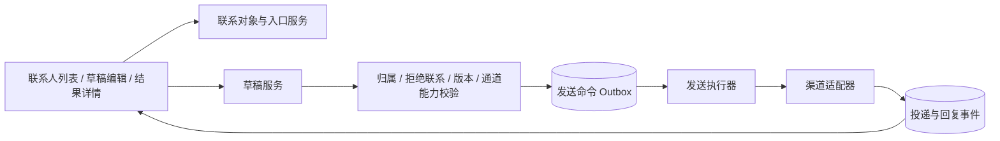
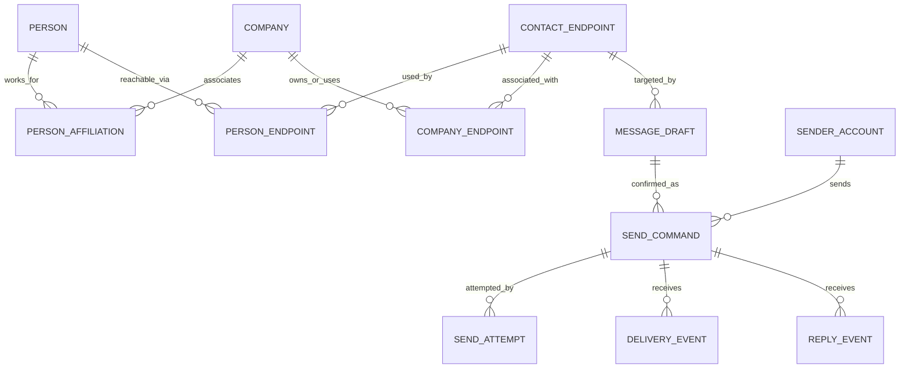
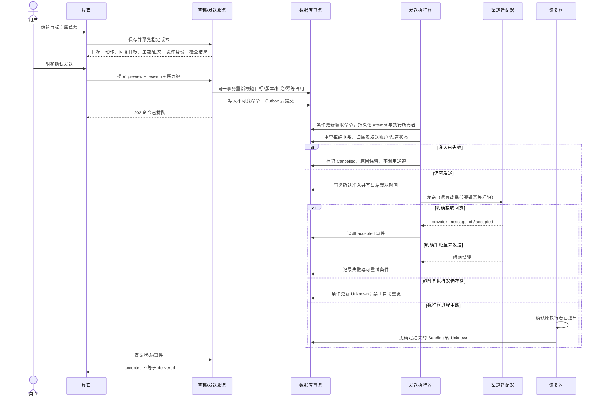
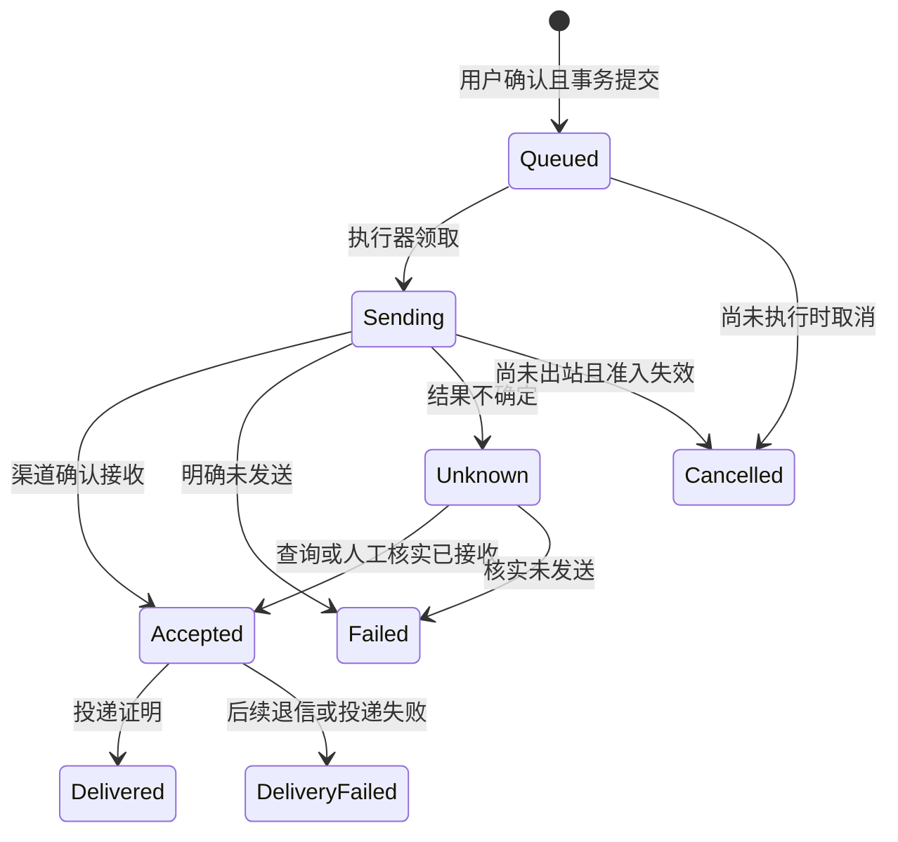

# 触达闭环扩展技术设计（规划，尚未实现）

版本 1.0 · 2026-09-23

对应 PRD-05/06/08/09/10。此文中的模块、表和 `/api/v2/*` 为建议协议，**当前接口不可调用**。现有 `/api/companies/{id}/social/outreach` 仅保存人工跟进记录，不能作为实际发送接口复用。

## 1. 设计目标与前置决策

让用户从同一个联系人/账号列表选择目标、准备独立草稿、确认后通过可用通道发送，并看到真实回执和回复。邮件正文模板尚待确定，不妨碍先约定目标身份、草稿生命周期与状态语义。

实施前还需确定首个发送渠道、发送账户接入方式、产品介绍内容及渠道能力。社媒已登录浏览器不等于具备可稳定调用的私信/回复发送适配器；每个平台、每种动作必须分别验收。

## 2. 模块与调用关系

建议先在现有单体包中新增边界清楚的 service/repository/adapter，不提前引入分布式服务。发送执行器必须与采集执行器区分任务类型和失败语义：发送有外部副作用，不能沿用“失败就重新爬一次”的规则。

## 3. 规划身份和数据库模型

该 ER 是新增逻辑设计，非当前 DDL。现有 social_entities 可作为社媒 endpoint 的引用；旧 contacts 需经规则迁移，不能简单一行联系人变成一个确定的人。

| 规划实体 | 关键字段 / 约束 | 设计理由 |
|---|---|---|
| person | id、display_name、revision | 人与账号分开；无姓名的邮箱不强行造人 |
| person_affiliation | person_id、company_id、role、role_evidence_id、status | 企业归属与岗位证据分别确认 |
| contact_endpoint | id、channel、canonical_value、social_entity_id?、revision；UNIQUE(channel, canonical_value) | 同一邮箱或账号只形成一个入口；原始拼写另存 |
| person_endpoint | person_id、endpoint_id、association_evidence_id；联合唯一 | 共享邮箱可关联多个人，入口数仍为1 |
| company_endpoint | company_id、endpoint_id、scope、adoption_status、revision | 品牌账号可以关联多个门店；排除与范围明确记录 |
| sender_account | id、channel、external_identity、revision、display_name、credential_ref、capabilities、status | UI不读取凭据；不同通道能力独立；身份变更提升revision |
| message_draft | id、company_id、endpoint_id、person_id?、sender_id?、action、reply_target?、subject、body、revision、updated_at | 草稿按目标保存；邮件主题和正文一起版本化；非邮件主题为空；切换目标不继承未明确复制的内容 |
| send_command | id、draft_id、draft_revision、target_snapshot、content_snapshot（含action/reply_target/subject/body）、sender_id、sender_revision、sender_snapshot、idempotency_key、request_digest、business_dedupe_key、state、revision | 用户确认的是不可变的目标和正文版本 |
| send_attempt | id、command_id、command_revision、owner_id、provider_idempotency_key?、started_at、dispatch_authorized_at?、finished_at?、result_state | 出站前持久化；崩溃恢复依据；不存凭据正文 |
| delivery_event | id、command_id、provider_event_id?、type、occurred_at、received_at、payload_summary | accepted/delivered/bounced事件追加，不覆盖历史 |
| reply_event | id、command_id?、endpoint_id、provider_message_id?、occurred_at、body | 回复是独立事实，不覆盖投递状态 |
| contact_suppression | endpoint_id?、company_id?、reason、created_at、source | 拒绝联系约束在发送时重新检查 |

唯一键、外键、索引与迁移脚本需在选定首个发送渠道后实施。上述表尚不存在，不列入当前数据库 schema 附件。

## 4. 建议接口协议

| 规划接口 | 输入 | 输出/规则 |
|---|---|---|
| GET `/api/v2/contact-targets?company_id=…` | 企业 ID | 人员、去重入口、关系、证据、可用动作；不能返回裸 credentials |
| POST `/api/v2/drafts` | company_id、endpoint_id、person_id?、action、reply_target?、subject?、body | draft_id、revision；候选目标可以保存草稿 |
| PATCH `/api/v2/drafts/{id}` | revision、action/reply_target/subject/body等 | 新 revision；冲突409 |
| POST `/api/v2/drafts/{id}/preview` | draft_revision、sender_id、sender_revision | 目标、动作、回复目标、主题/正文、发件身份快照、关系/渠道检查结果、preview_id、expires_at |
| POST `/api/v2/send-commands` | preview_id、draft_revision；`Idempotency-Key` | 202 command_id/state；同键同内容返回同命令，同键不同内容409 |
| GET `/api/v2/send-commands/{id}` | command_id | 事件历史、当前派生状态、可执行动作 |
| POST `/api/v2/send-commands/{id}/reconcile` | revision/核对动作 | 支持渠道查询时核对回执；否则返回人工核对要求 |

动作明确区分 `email`、`direct_message`、`post_reply`；回复动作必须绑定真实帖子/消息目标。模板格式可以待定，但 action、reply_target、subject、body 和发送身份必须进入版本校验与摘要；未接入的动作不开放。

Preview及命令绑定发送账户revision、渠道和实际发件地址/平台账号标识；命令保存不可变sender_snapshot，凭据仍只存引用。换绑发送身份使旧预览失效、旧排队命令停止；同一身份的凭据轮换不等于身份变更，但仍需检查可用性。

请求幂等和业务重复保护分别实施。同键同摘要在事务中复用同一命令；不同键仍按规范化入口＋动作＋回复目标＋内容摘要形成business_dedupe_key，检查Queued/Sending/Unknown占用，命中则返回409及原command_id，不能新建。该检查不得以company_id分隔，防止共享品牌账号跨门店重复发送。规划使用活动命令上的部分唯一索引实现原子占用；Unknown一直占用，直到明确核实结果。不同发送账户也不自动绕过重复保护。已Accepted/Delivered的同内容同入口显示既有结果，再次发送需用户明确确认已有记录；首版不提供批量发送，未来若支持批次须增加batch_id及批次入口唯一约束。

Preview 不是发送许可缓存：commit 时重新校验草稿版本、接收入口、企业关系、拒绝联系状态、发送账户和渠道能力。候选归属必须先有可追溯确认依据；没有采购岗位证据的正常通用联系入口仍可被选择。

当前本地令牌可在内部测试阶段继续作为 API 边界；多人/多租户版本需要另行设计认证、授权、审计主体与幂等键作用域。

## 5. 发送与故障时序

Queued→Sending 与 Queued→Cancelled 用状态及revision条件更新竞争，只有一个成功；取消失败不能返回“已取消”。领取之后执行器先重查准入，再持久化发送尝试的出站裁决记录；此裁决点之后不承诺取消或撤回。拒绝联系与裁决在数据库事务顺序中确定先后，禁止把锁跨网络调用一直持有。

恢复器必须确认原执行者退出，才能接管无结果的Sending尝试并转Unknown。仅租约到期不足以证明旧执行者停止：本机版本由进程锁与进程退出确认保证没有旧发送执行者；若未来多节点运行需另行实现fencing/通道幂等，未具备前不开放多发送Worker。核对结果和事件更新使用命令revision条件，迟到结果追加为证据后归并，不能无条件覆盖新状态。

Outbox 保证业务命令与待执行记录同时提交，**不能保证外部平台只收到一次**。如果平台不支持幂等或查询，超时需要人工核对；不能因为没有本地成功记录就重发。

## 6. 状态与不可违反的规则

- Replied 独立展示，不强行放进投递状态机；可能收到回复而没有 delivered 事件。
- Unknown 不能直接进入 Sending；只有明确核实未发送后，用户才可创建新的发送尝试。
- API提交和执行器实际出站前都要重查准入；排队期间新增拒绝联系必须阻止发送。若拒绝发生在出站裁决完成后，只能阻止后续动作，不能宣称撤回成功。
- 发送后修改草稿不改变已发送命令的内容快照。
- 外部回调/轮询可能重复或乱序；使用来源事件标识去重，同时保存发生时间和接收时间。不能以最后到达的事件简单覆盖全部状态。
- 取消采集不等于撤回发送；发送动作发生后不承诺可撤回。

## 7. 实施顺序和验收

1. **统一身份与持久草稿**：人员/入口去重、归属证据、按目标保存与版本冲突；完整页面切换回归。
2. **单一真实发送通道**：能力探测、预览确认、Outbox、幂等、超时 Unknown；使用测试接收账号验收。
3. **事件与回复**：渠道回执、退信、回复关联、拒绝联系；独立审计历史。
4. **扩展其他通道**：分别实现邮件、私信、帖子回复的能力矩阵；不沿用一个“社媒可发送”总开关。

关键测试：重复点击发送只产生一个命令；同幂等键不同正文409；预览后目标被排除则禁止提交；排队后新增拒绝联系则执行器不出站；邮件主题与正文一起预览和快照；切换目标不串正文；发送超时不自动重发；accepted 后退信显示失败且保留曾接收事件；没有查询能力时明确要求人工核对；不同门店、不同请求键对同一入口提交相同内容也不能重复在途；Unknown无法换键绕过；取消与领取竞争只有一个成功；进程退出后的无回执尝试转Unknown；发送身份换绑使旧预览及排队命令失效。
