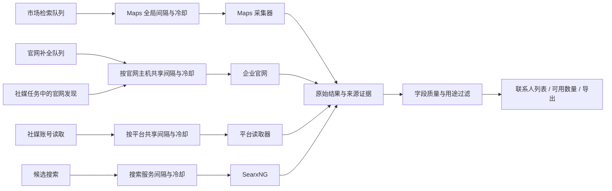

# 检索稳定性与数据质量评审

2026-09-25～26 · Google Maps、企业官网、社交媒体

本轮优先级：稳定性 → 可用数据质量 → 有界恢复 → 执行效率。以下为本地实现评审，不是平台可用率或账号安全保证。测试不向真实企业发送消息，也不新增批量采集。

## 1. 已有数据中的证据

只读检查现有两个市场轮次及全库联系人。检查期间原有任务仍可能运行，数字是审计时刻快照。

- Maps 工作项中，42 项执行成功，4 项因无法确认有效输出停止；另有 62 项待执行。部分失败历史包含超时后继续出现空输出。空文件不能证明城市里没有匹配企业。
- 官网失败日志累计出现 HTTP 403 264 次、robots 相关异常 126 次、页面体积超限 87 次、不支持的内容类型 49 次、超时 20 次、404 16 次、跨站重定向 12 次。这是保存日志条目数，不是失败企业数或独立站点数。
- 2,924 条可进入原有显示规则的联系人记录中，2,647 条是联系表单记录。发现 `Contact Us → #` 被解释为当前商品页、整页外层表单被误当联系表单、订阅表单因包含 Contact number 被误判。
- 发现表单示例邮箱 `youremail@here.com`，以及 7 条隐私/举报用途邮箱记录。正常销售、客服、企业通用邮箱仍有联系价值，不按名称相近或免费邮箱域名一刀切。

## 2. Google Maps

外部队列保持单个 Maps 任务，查询间隔与全局冷却持久保存。验证码、访问拒绝、限流与单次查询超时分开处理；恢复只针对未完成项，已有结果和查询历史保留。

本轮修正：

1. “no captcha / captcha false”只否定验证码判断，不会同时抹掉日志中的 403/429。
2. 子进程退出前继续读取剩余日志；日志行有长度上限，分段日志及无末尾换行也能识别。
3. 城市定位的 429/503 尊重 Retry-After（秒数或 HTTP 日期），冷却跨城市、跨目录生效；不占用 Maps 通道长时间睡眠。
4. 定位结果明确与所选城市、州不一致时，不使用错误坐标；保留“关键词＋城市＋州＋国家”文字检索方案，并提示范围未验证。
5. 底层采集器的快速重试与持久任务队列统一，安装时对固定源码应用可重放补丁；具体构建与回归记录见实施报告。

文字检索成功与地理覆盖完整是两件事。查询量、有效企业量和未验证的范围继续分别记录。

## 3. 企业官网

每次只处理一个官网任务；单站请求串行，默认至少间隔 2 秒，并尊重更长的 robots Crawl-delay/Request-rate。robots、本页、重定向和底层连接重试都计入请求预算与间隔。

| 情况 | 处理 |
|---|---|
| 403、401、证书错误、robots 明确禁止 | 停止该站继续访问，保留已采结果和原始原因，需处理后手动继续 |
| HTTP 200 但内容是访问验证页 | 根据页面标题与实际验证脚本联合识别，在提取前暂停该主机；普通验证码介绍文章不因此被拦截 |
| 429、503、网络异常 | 停止当前站点批次，记录冷却；不换协议/备用入口绕过限制 |
| Retry-After | 保存绝对截止时间；冷却前手动继续也不能提前访问 |
| 普通文件、商品或分类页面 | 尽量在入队前识别；未解析文件独立记录，不假装已成功读取 |
| 普通页面 404 | 保留具体失败地址，已读取的其他页面仍保留 |
| 跨站跳转 | 保留人工核对边界，不自动把另一域名当原企业官网 |

新增 `website_host_gates` 表，按去除 `www.` 的主机名保存 gate、最近请求时间、最小间隔。HTTP/HTTPS、分支企业、不同市场轮次共享状态，重启不清零；其他域名仍可继续。

`WebsiteAccessPolicy` 使用短事务读写状态，网络等待在爬虫中完成；发现限制时先提交 gate，再做业务资料入库，避免入库异常丢失限流状态。显式继续仅清除对应官网的手动 gate，未来冷却截止时间不能清除。

首次升级时，将未完成官网任务中仍有效的历史限制迁入共享表。建表与迁移在同一事务内完成，失败回滚；后续启动不会重新导入已由用户解除的旧限制。

## 4. 社媒

社媒仍是独立串行通道；手动单企业任务与市场自动任务使用同一平台 gate。一个平台等待登录或冷却，不把其他平台误判为受阻。

- 成功缓存只用于复用已读取的同一目标，不重置平台失败次数或解除冷却。
- 已选择浏览器、官方接口或可选读取器时，出现登录、挑战、限流、连接或配置错误即停止该路径，不静默换其他读取器继续触发请求。
- 读取过程中已有账号简介、帖子等快照时，后续超时/子进程失败仍保留已读部分，同时返回未完成原因。
- 手动运行报告展示平台等待状态、原因和下次可尝试时间；可读平台使用同一恢复接口。市场自动搜索选择仍限定 Facebook、Instagram、X。
- 社媒独立联系方式展示复用公共邮箱质量规则；原始观测不会被覆盖或删除。
- 社媒流程中的官网发现也复用官网主机级限制；SearxNG 查询有独立的搜索服务访问节奏，不能通过辅助来源绕过主流程的限制。
- 社媒正常访问间隔为 60–120 秒，SearxNG 为 15–30 秒。临时错误采用 10、30、120 分钟退避，连续恢复超过上限转为等待人工处理；服务返回更长的 Retry-After 时采用其截止时间。
- 平台“继续”同时处理该平台的共享主机暂停。若任何相关主机仍有未来冷却时间，整个恢复操作回滚；其他平台与无关官网的限制不变。单企业官网发现重试仅处理原失败任务记录的主机，保留历史结果。

发现账号链接不等于已确认企业归属。企业名称相似、搜索命中、官网链接、电话/域名一致等证据继续分开保存，不能自动推断某账号就是采购人员。

## 5. 联系人过滤

共享纯规则位于 `contact_quality.py`，在采集、历史投影、企业数量和导出中复用：

- 邮箱格式校验只检查已公布值的形状，不猜邮箱、不验证投递，不排除正常免费邮箱、国际化域名或 plus alias。
- 明确表单示例/格式错误不展示为可点击联系方式。
- 招聘、隐私、举报、无回复邮箱归入非获客用途；从可用数量和联系人导出排除，原始记录保留。
- 裸 `#` 菜单链接、订阅/购物用途页面、明确整页导航外层表单不算联系入口；真实 `#contact` 锚点不因是页内链接而被排除。
- 联系页面的已知来源追踪参数不会制造重复入口；业务参数仍保留。
- 姓名/岗位误识别时，如果原文确实包含一个有效邮箱，可保留为企业通用入口，不继续声称属于某个人。

自动清理不覆盖用户已明确接受的历史决定；即使旧记录未经清理，读路径也不把无效地址作为可用入口显示。原始证据与变更日志保留，便于追溯。

## 6. 验证与边界

测试使用临时数据库、模拟 HTTP/浏览器子进程和虚拟时钟，覆盖限流截止时间、跨任务状态、重启、保留部分结果、手动恢复与坏数据回归。执行结果及数据保留记录见[实施验证报告](../validation/2026-09-25-search-stability-review.md)。

不承诺低速访问不会被限制；平台访问策略、会话、网络和目标站点内容仍会影响结果。本轮没有真实三平台批量抓取验收，也没有实际发送邮件或社媒消息。
