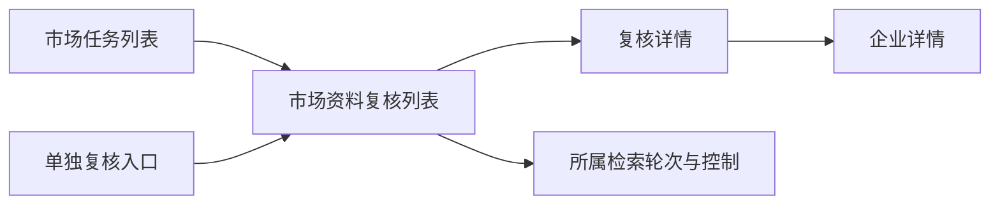

# 市场任务与资料复核浏览设计

2026-09-24

## 用户路径

目标市场 → 市场检索任务列表 → 该市场资料复核任务列表 → 资料复核详情。

首页市场以表格呈现名称、地区、最近状态、最近检索时间和操作。取消堆叠展示每次复核的大卡片。企业单独复核有单独入口，包含没有市场归属的记录。

市场详情显示检索轮次和企业复核列表，每次复核占一行。企业、状态、来源、读取页数/联系记录数、轮次开始时间用于快速比较。支持状态、轮次筛选和50条分页。相同企业不同轮次保留，避免丢失历史；当前市场成员的单独复核标注来源，不认作某次检索创建。

2026-09-25：市场详情统一展示官网/社媒并行工作流，社媒不伪装成下方官网复核行。常驻“补充社媒资料”按钮使用当前选项，成功后选择返回的市场父轮次并重置页码/状态筛选。已有活动轮次附加社媒，已结束则新建 `kind=social` 的仅社媒轮次；旧轮次仍可查看。社媒完整报告按 `workflow.social.run_id` 懒加载，与轮次选择的父 run ID 区分。未来设置及平台登录/恢复见[市场社媒集成](market-social-integration.md)。

详情展示企业、当前处理结果、累计读取情况、网站逐页日志和所属轮次。逐页日志保留此前失败与重试，明确它是历史尝试，当前状态以复核结果为准。详细日志有独立滚动区域。控制按钮说明其作用于整轮；不把市场暂停按钮冒充单企业暂停。

## 实现

前端由 TaskActivityPage / RefreshTable 展示，URL保存task、run、item、activityStatus、page，支持刷新及浏览器前进后退。Store 的 RunActivityMixin 继续仅做读投影；市场社媒的新增关联与设置表由独立集成模块维护，读取 activity 不创建队列或迁移历史运行。接口参见 [API 协议](api-contract.md)。

## 日志问题修复边界

图片与Atom/RSS直链在发现、恢复和重定向阶段过滤；PDF单独记录未解析。空异常保留异常类型。Maps读取stderr中结构化error，发现浏览器退出或闲置超时不标记范围穷尽。界面把大小限制、网络、证书、404、访问策略、平台鉴权等原因分开，并保留原日志。代码修复不回写历史任务为成功；平台拒绝访问、证书错误和搜索引擎超时仍需来源恢复后重新验证。

## 2026-09-24 交互补充

复核列表以企业/来源、状态、网页/联系记录、轮次开始时间、操作五列展示。`listRun` 路由参数保存进入详情前的轮次上下文（`all` 为全部），返回时恢复原 `run` 并保留 page/activityStatus，随后清除 listRun。无 run 的孤立 item 和非法状态在路由解析时忽略。轮次弹窗使用现有 Modal 原生 dialog，关闭返回触发控件。

`Store.restore` 在任何备份与写入前将无效SQLite/缺少必需表的验证异常转换为可读400；实际写入错误不伪装成输入验证错误。本轮未更改DDL。
