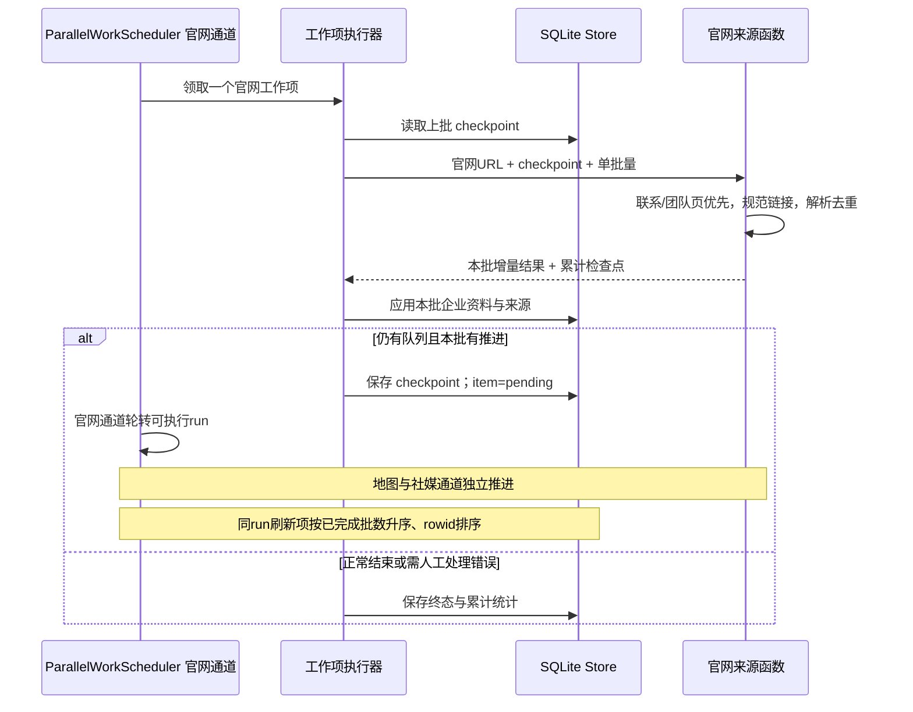

# 官网分批续扫技术方案

2026-09-24 · 当前实现更新，替代“单次官网最多20页、继续从头扫描”的旧规则。

2026-09-25：分批读取语义保留，调度已切为[三通道市场社媒集成](market-social-integration.md)。官网通道不再等待 Maps 全部结束，官网新账号可增量加入关联社媒轮次。

## 1. 行为变化

- 20为单批候选链接处理量，在 `leadworkbench/sources/website.py:WEBSITE_BATCH_SIZE` 配置。Worker和来源函数使用同一常量，当前没有面向用户的设置项。
- 一批结束仍有待扫描链接且本批有推进时，保存检查点，工作项回到pending；Worker给其他运行/企业执行机会后自动继续。
- 单批预算耗尽不再产生 `Page limit reached` 或要求用户点击继续。企业工作项在队列处理结束前不计入已完成企业数。
- 失败页不自动无限重试；保留原因及待重试地址。用户继续失败/部分完成任务时，只重试失败页与未完成队列，保留已成功页面。
- 老运行记录没有检查点，首次继续仍需从官网首页开始一次；后续使用新检查点。旧运行结果不会伪装成新逻辑已执行。

这不是全站无条件遍历：同站、安全网络、robots、链接深度2、待扫描队列200及解析限制仍保留。深度/队列容量不足或页面访问失败会留下真实限制说明，不能宣称完整官网已覆盖。

## 2. 数据与接口

无需新增表。沿用 `work_items.result` JSON，刷新工作项结果新增：

```text
checkpoint:
  version: 1
  start: 规范化官网URL（变更后丢弃旧遍历）
  queue: URL -> [优先级, 发现顺序, 深度]
  attempted: 已处理候选URL
  fetched: 已成功解析的最终URL
  skipped: 已过滤URL
  observation_keys / contact_keys / social_seen: 跨批去重键
  warnings / failures / failure_warnings: 本轮限制与失败地址及精确访问错误
  last_request / request_delays: 按origin保存墙钟时间与robots间隔
  logs: 每链接 parsed / duplicate / excluded / failed / blocked / deferred
  summary: 累计统计
  batches: 已完成批次数
has_more: 是否可以自动继续
summary:
  pages_checked / pages_skipped / contacts_found
  attempted / remaining / duplicates / failed
```

`enrich_website(url, *, max_pages=WEBSITE_BATCH_SIZE, checkpoint=None)` 返回本批增量观察/联系人/社媒链接，以及累计checkpoint/summary。`pages_checked`顶层仍是本批解析数量，累计数量读summary；UI不得累加多次累计summary。

`Run.progress`增加 `website_pages_checked`、`website_links_remaining`。前端显示累计页面和待扫描链接；原enrichment_done/total仍按企业工作项计数。当前逐URL日志保存在数据库检查点中供诊断，不通过运行列表返回完整checkpoint。

## 3. 分批与调度时序



官网通道使用自己的 deque，按 refresh stage 原子领取；同 run 内按 checkpoint.batches 较少者优先。地图通道独立处理 planning/discovery，企业入库后的官网和社媒均可启动，无需等 Maps 清空。单个官网批次仍不可被新任务抢占，但可合作式取消。

## 4. 去重和过滤

- 保留原URL规范化：片段与明确跟踪参数去除；保留有业务含义的query参数。
- 对明确路由参数`route`和`controller`解析路径段，例如 `route=account/register`、`route=product/category`过滤；`route=information/contact`保留。普通`topic=account`不误过滤。
- 添加register/registration/signup/sign-up路径排除。
- 最终重定向目标已在fetched中时终止重复读取，记录duplicate和最终URL。首个未知别名的重定向请求仍可能消耗预算，跨批不再重新处理该别名。
- 提取内容以跨批去重键合并统计；“联系记录数量”不是独立采购人数或可发送入口数。

## 5. 预算、错误和恢复

| 情况 | 行为 |
|---|---|
| 20个候选处理完仍有队列 | 正常分批交接，自动pending，不报页面上限 |
| 单批60次HTTP请求或120秒总时限 | 保留正在处理的目标；若已完成其他目标则交接下一批 |
| 整批没有完成任何候选目标就耗尽预算 | 停止自动循环，保留队列，给出人工重试原因 |
| robots拒绝、HTTP失败、页面解析错误 | 记录对应URL与错误；其他目标可继续；失败URL不自动反复重试 |
| 用户暂停/进程关闭 | 保留上一批已提交checkpoint，回收来源协程；未提交批次恢复后重做 |
| 官网URL变化 | 新URL重新建遍历，不把旧站已访问集合带过去 |
| robots访问间隔跨批/跨进程 | checkpoint保留按origin的最近请求时间和间隔；下一批在robots和页面请求前等待剩余间隔；时钟倒退时等待完整间隔 |
| 成功完成所有当前队列，但有真实错误/范围限制 | partial并保留原因，不用“处理结束”冒充完整覆盖 |

资料应用和work_items检查点保存是两次事务。中断发生在两者之间时，会重读上一未确认批次；现有来源/联系人身份去重避免简单重复实体，但可能增加新的访问证据或修订。这里保证恢复后不会跳过未确认结果，**不承诺网络读取或证据写入exactly-once**。

累计warnings用于确保早先批次错误不被后续成功覆盖。手动重试按failure_warnings的精确访问错误清理（不按URL前缀整组删除），因此同URL解析警告也保留；只清理将被重试的访问失败，永久的深度/队列/解析限制应继续保留。数据目录备份和恢复边界仍见部署文档。

## 6. 验证与发布

合成网站测试覆盖26页两批、跨批不重扫、query路由过滤、重定向最终页去重、HTTP预算保留目标、手动重试只补失败页、Worker恢复与同run企业轮转、取消保留检查点。DOM测试覆盖企业进度与网页进度分开显示。测试使用临时数据库和替身HTTP，不访问外部官网。

源码测试：`tests/test_website_batches.py`、`tests/test_website.py`、`tests/test_worker_scheduling.py`；前端：`frontend/tests/websiteBatchProgress.test.ts`。

升级需要重启API和Worker加载新版代码。旧任务中的`Page limit reached`是历史结果，刷新页面不会改写；首次继续或新建复核后使用新版流程。不会自动重跑全部客户企业。

## 2026-09-24：商品链接及PDF过滤更新

新增纯规则模块 `website_link_policy.py`，综合URL末段、链接文字和最多4层祖先的class/id判定。明确联系/团队/岗位/供应商意图优先保留；`style-数字`款号路径、纯服装分类词组合识别为商品；分类/商品导航中的纯服装分类链接也跳过。无法确定用途的链接继续保留，不用广泛关键词一律删除。

PDF扩展名及实际返回application/pdf的资源归入`checkpoint.files_unparsed`，保存URL、文字和来源；不创建虚假的HTML联系表单，不计入网页失败。累计summary增加files_unparsed，运行完成摘要明确提示未解析文件数量；“完成”仅指HTML扫描，不代表PDF内容已读取。逐文件入口当前保存在检查点供诊断，不新增文件阅读器。

新规则同时应用于旧检查点中的待处理URL和重定向目标。`tests/test_website_filter.py`覆盖商品路径、导航证据、联系入口保护、未知路径保留、带/不带扩展名PDF和旧队列重新分类。

防误判：联系意图检查完整URL路径，团队子目录不因成员/页面名称包含服装词而误过滤；官网入口本身为PDF且没有HTML成果时标记blocked，并保留文件未解析说明。
